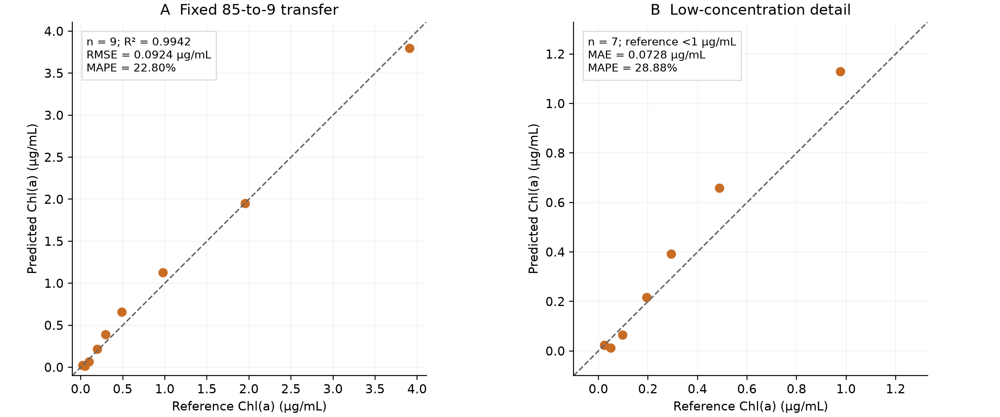

# Fluorometer ESP32

Prototipo de instrumento óptico para estimar clorofila a en extractos, con un **ESP32**, un LED azul y un sensor **AS7265X de 18 canales**. El ESP32 crea su propia red Wi-Fi y sirve una interfaz web en inglés para controlar la adquisición, ver resultados, exportarlos y actualizar el firmware por OTA, sin depender de Internet.

## Estado del proyecto

**Para Daniela y el paper:** empezar por la [guía de entrega de noviembre](datos/datos%20para%20el%20paper/00_LEEME_DANIELA.md). Reúne las figuras seleccionadas, sus pies, las tablas, las fuentes y la reproducción del análisis. Configuración elegida por Alex: **90°/680 nm y modelo lineal global** (20/11/2026); cultivo seleccionado: **AO**.

El firmware y las etapas de investigación deben distinguirse:

| Parte | Estado |
|---|---|
| Firmware y binarios existentes | Conservan la fórmula inicial: Chl(a) = −2,7924 × ln(media I645) + 20,1264 |
| Investigación de octubre: 85 → 9 | Calibración con 85 registros y transferencia fija a nueve diluciones, usando el blanco de sesión |
| Función de esa etapa | Chl(a) = −0,0621128959 + 2,8428103277 × ln(B645 / media I645) |
| Investigación de noviembre | 20 niveles de extracto a 90°/180°, controles con caolín y aplicación de la calibración de 680 nm a AO |
| Decisión actual del 20 de noviembre | 90°/680 nm y recta global con intercepto libre; AO conserva equivalentes exploratorios y respuesta medida, sin validación absoluta |
| Funciones de investigación en el equipo | No instaladas: el firmware conserva la fórmula inicial, aunque se actualicen otras funciones |

Las once muestras quedan fuera del análisis 85 → 9 de octubre. Los documentos y paquetes de cada etapa conservan su fecha y alcance; no mezclar sus ecuaciones, muestras o métricas.

El [índice de investigación y datos](datos/README.md) distingue la entrega de noviembre, la etapa 85 → 9 de octubre y el historial. Para utilizar el equipo, seguir la guía rápida de abajo.

## Guía rápida

1. Conectar el ordenador o teléfono a la red **Fluorometer**, con contraseña predeterminada **clorofila**.
2. Abrir **<http://192.168.4.1>**. Debe ser HTTP; no hace falta conexión a Internet.
3. Pulsar **Start**: se enciende el LED y el equipo queda listo para medir inmediatamente, sin espera por software.
4. El botón pasa directamente a **Stop**. El LED permanece encendido entre ciclos; Stop lo apaga.
5. Con el blanco de la sesión en la cubeta, pulsar **Measure White**. Se toman diez lecturas, se guarda la referencia y se descarga automáticamente un CSV del blanco.
6. Introducir la muestra y pulsar **Measure**. Se toman diez lecturas por canal. Este botón requiere LED listo y un blanco guardado.
7. Escribir un nombre y pulsar **Save Excel + spectrum CSV**. El navegador descarga dos archivos; permitir descargas múltiples si lo solicita.

La estabilización del LED se realiza por hardware. El firmware principal no añade un temporizador de espera antes de medir.

Para registrar el fondo con la excitación apagada, pulsar **Measure Dark** con la cámara óptica cerrada. Puede hacerse antes de Start o con el LED encendido: el equipo lo apaga antes de tomar diez lecturas de los 18 canales y lo deja apagado al terminar. Después, pulsar Start para volver a encenderlo.

### Qué muestra y guarda la interfaz

- Diez lecturas individuales de 435 y 645 nm, en una tabla desplegable, y sus promedios.
- Cálculo de Chl(a) con la fórmula que esté instalada en el firmware.
- Un espectro desplegable de los 18 canales: un promedio por canal y barras de desviación estándar muestral calculadas con las diez lecturas.
- Un archivo .xls compatible con Excel: lecturas de 435/645, promedios y Chl(a).
- Un CSV espectral: longitud de onda, intensidad media, desviación estándar y número de lecturas.
- Un espectro desplegable del blanco con el promedio y la desviación estándar de los 18 canales. Su CSV automático contiene las diez lecturas por canal, una fila de promedios y otra de desviaciones estándar.
- Un espectro desplegable **dark**, con el mismo formato de promedios y desviaciones, y descarga automática de `dark-reference-<fecha>.csv` (diez lecturas por canal, promedio y desviación estándar).

La desviación de las lecturas no equivale a incertidumbre total de concentración ni al error predictivo de la calibración. Las intensidades de los datos de investigación se utilizan en las unidades instrumentales almacenadas, sin atribuirles una conversión acreditada a irradiancia absoluta.

### Blanco persistente y enfriamiento

El blanco guarda las **diez lecturas de los 18 canales** en memoria no volátil, sobrevive al apagado y solo se sustituye al completar y guardar correctamente un nuevo **Measure White**. Los promedios y las desviaciones estándar se calculan a partir de esas lecturas. Si falla el guardado o se reciben valores inválidos, se conserva el blanco anterior y la interfaz muestra el fallo, sin descargar un archivo como si se hubiera guardado.

Los blancos guardados con firmware anterior conservan sus datos de 435/645 nm. La interfaz los identifica como referencias antiguas: **realizar un nuevo Measure White para guardar los 18 canales**; los canales que no se midieron no se rellenan con ceros. La descarga `/white.csv` utiliza el blanco persistente y también funciona tras reiniciar el equipo.

La persistencia del blanco no garantiza que siga siendo válido tras cambiar sesión, cuveta, potencia, atenuador o configuración. El protocolo del estudio usa **un blanco por sesión**, no uno por muestra.

Con **Enable cooling cycle** activado, el LED se apaga 60 s después de tres ciclos completos de adquisición. **Los ciclos de blanco también cuentan.** Al terminar la pausa, pulsar Start para encenderlo y volver a medir inmediatamente. La casilla permite desactivar esta pausa: se trata de una protección por contador, no de una regulación mediante temperatura medida; no desactivarla sin controlar el calentamiento del montaje.

Guardar un blanco es actualmente un requisito de la interfaz. **La fórmula inicial del firmware todavía no incorpora ese blanco matemáticamente.** La normalización B645/I645 corresponde al análisis de octubre; la resta del blanco a 680 nm, al análisis de noviembre. Ninguna sustituye automáticamente la ecuación instalada.

### Medición dark

**Measure Dark** registra la señal del sensor sin el LED de excitación. No requiere un blanco guardado ni se convierte en un requisito para medir muestras. Durante la toma se desactiva también el LED indicador controlable del AS7265X; después se restaura a su estado habitual. La cámara debe permanecer cerrada: apagar el LED no elimina la luz ambiental que pueda llegar al sensor.

Las diez lecturas de los 18 canales se guardan por separado en memoria no volátil, sobreviven al apagado y solo se sustituyen al guardar correctamente otra toma dark. Un valor cero es válido en dark. Los datos no finitos o negativos y los fallos de escritura no reemplazan la referencia anterior. `/dark.csv` permite volver a descargar la referencia guardada, incluso tras reiniciar.

La toma dark no altera el blanco ni la última medición de muestra, **no se resta automáticamente** de las señales y no cambia la fórmula de clorofila. Tampoco cuenta como adquisición con LED encendido para el enfriamiento; no reinicia ese contador y no puede interrumpir un enfriamiento en curso. Al terminar, el LED de excitación queda apagado.

## Hardware y adquisición

| Elemento | Uso |
|---|---|
| ESP32 | Punto de acceso Wi-Fi, web local, adquisición y OTA |
| LED azul nominal 430–435 nm | Excitación, mediante electrónica de potencia; no conectar la potencia del LED directamente al GPIO |
| GPIO4 | Control del LED; la fuente actual utiliza HIGH para encender y LOW para apagar |
| AS7265X | Sensor espectral de 18 canales con filtros incorporados |
| Cubeta y montaje óptico | LED y detector de frente; documentar geometría y condiciones utilizadas |

Longitudes nominales: **410, 435, 460, 485, 510, 535, 560, 585, 610, 645, 680, 705, 730, 760, 810, 860, 900 y 940 nm**.

Los factores CALIBRATION_435 y CALIBRATION_645 de la fuente escalan esos dos canales. Cambiar estos factores o la configuración óptica puede invalidar la aplicación directa de una calibración anterior.

## Investigación de noviembre: extractos, caolín y AO

La [entrega para Daniela](datos/datos%20para%20el%20paper/00_LEEME_DANIELA.md) contiene la selección de figuras PNG/SVG, pies en inglés, tablas y las limitaciones que deben acompañarlas. Los generadores y fuentes permanecen juntos en [datos para el paper](datos/datos%20para%20el%20paper/README.md).

La comparación de extractos y controles con caolín apoya la elección de **90°/680 nm** para este estudio. Alex selecciona el **modelo lineal global** el 20 de noviembre: RMSE interno 0,1552 µg/mL y MAPE 8,55%, con residuos estructurados. El cuadrático queda como comparación histórica. La aplicación a AO es una estimación referida al extracto vegetal, sin concentración independiente de referencia. Una futura calibración más densa a bajas concentraciones está propuesta, no ejecutada.

El [paquete de noviembre para compartir](datos/Paquete_Daniela_lineal_90_680_2026-11-20.zip) es una instantánea de esta entrega con fuentes, tablas, figuras y código. No se ha enviado automáticamente a Daniela.

## Investigación de octubre: calibración 85 → 9

La función elegida se ajustó exclusivamente con las 85 mediciones. Las nueve diluciones se predijeron sin reajustar coeficientes, usando el blanco de su propia sesión.

**Chl(a) [µg/mL] = −0,0621128959 + 2,8428103277 × ln(B645 / media I645)**

B645 e I645 deben ser positivos y finitos, expresados en la misma escala y configuración. Se aplica el logaritmo natural al cociente de medias. Blancos de los datos existentes: **1356 para las 85** y **1214 para las nueve**; no son constantes universales para sesiones futuras.

| Evaluación | n | R² predictivo | RMSE (µg/mL) | MAE (µg/mL) | Error relativo absoluto medio |
|---|---:|---:|---:|---:|---:|
| CV85: entrenar con 84 y predecir el registro omitido | 85 | 0,94052 | 0,45598 | 0,27406 | 20,86 % |
| Transferencia fija 85 → 9 con blanco de sesión | 9 | 0,99424 | 0,09241 | 0,06937 | 22,80 % |

En las siete diluciones con referencia <1 µg/mL, el error relativo absoluto medio es **28,88 %**. No representa una incertidumbre de ±28,88 % ni un error máximo garantizado.

El foco del paper es una **prueba de concepto de estimación empírica de clorofila a en extractos etanólicos**, con evaluación retrospectiva. Las nueve proceden de un único extracto madre, no de nueve extractos independientes. La selección se realizó después de explorar los datos disponibles: no es una validación prospectiva ciega. No se establece desempeño en lagos, LOD/LOQ o exactitud universal entre sesiones.

Materiales de la etapa de octubre:

- [Guía del artículo de octubre para Daniela](datos/articulo.md): función, enfoque, explicaciones, seis figuras con pies y próximos pasos de esa versión.
- [Resumen de octubre](datos/RESUMEN_PARA_DANIELA.md).
- [Resultados, figuras PNG/SVG y reproducción](datos/articulo_85_a_9/README.md).
- [Índice de datos e historial](datos/README.md).
- Paquete listo para compartir con Daniela (archivo histórico no presente en esta copia).
- [Bibliografía y documentos descargados](datos/bibliografia/README.md).

El paquete contiene los dos Excel utilizados y el análisis principal; excluye el conjunto de once y sus análisis. Los originales permanecen intactos y se verifican por SHA-256.

### Reproducir el análisis de octubre

Desde la raíz del repositorio, con Python y las dependencias indicadas:

~~~sh
python3 -m pip install -r datos/articulo_85_a_9/requirements.txt
python3 datos/articulo_85_a_9/analisis_publicacion.py
~~~

La ejecución verifica los originales y regenera las tablas y figuras de la carpeta principal. No modifica los Excel, el manuscrito ni el firmware.

## Primera carga por USB

1. Instalar en Arduino IDE el soporte **ESP32 by Espressif Systems** y la biblioteca **SparkFun Spectral Triad AS7265X**.
2. Abrir [Spectro18_V_Flu.ino](Spectro18_V_Flu/Spectro18_V_Flu.ino).
3. Seleccionar el modelo de ESP32 y una tabla de particiones que admita OTA; no elegir una opción marcada como No OTA.
4. Compilar y cargar por USB. Revisar por el monitor serie, a 115200 baudios, la dirección del AP y si se detecta el sensor.

La web y la actualización OTA se inicializan antes de detectar el sensor, de modo que siguen disponibles si este no responde. Esto no habilita mediciones sin sensor.

### Compilar desde la terminal

Con Arduino CLI, el soporte de ESP32 y la biblioteca instalados, el ejemplo para la placa ESP32 genérica es:

~~~sh
arduino-cli compile --fqbn esp32:esp32:esp32 --clean --output-dir output Spectro18_V_Flu
cp output/Spectro18_V_Flu.ino.bin output/Fluorometer-OTA.bin
cp output/Spectro18_V_Flu.ino.merged.bin output/Fluorometer-USB.bin
~~~

Adaptar la placa si el hardware es diferente. Los pasos de copia actualizan los alias: **compilar no renueva automáticamente un archivo de nombre distinto que ya exista**.

| Archivo | Uso |
|---|---|
| output/Fluorometer-OTA.bin | Aplicación para actualizar desde la web |
| output/Spectro18_V_Flu.ino.bin | Aplicación original generada por la compilación |
| output/Fluorometer-USB.bin | Alias de la imagen completa .merged.bin para una carga inicial compatible por cable |
| Archivos .merged.bin | Imagen completa; no cargarla mediante el formulario OTA |

Los binarios actuales permiten medir inmediatamente al pulsar Start, guardan blanco y dark de 18 canales por separado y conservan la fórmula inicial de clorofila. Una actualización de README, datos o artículo no los recompila ni instala la función nueva del estudio. Revisar **Firmware build** en la interfaz para identificar el firmware ejecutándose.

## Actualizaciones OTA

1. Conectarse al punto de acceso del equipo y abrir su web.
2. Seleccionar el .bin de aplicación correspondiente a la placa.
3. Pulsar **Install .bin** y esperar a que termine la carga y el reinicio.
4. No desconectar la alimentación durante el proceso. La página muestra progreso e intenta reconectar.

Si aparece **No suitable partition found**, la tabla de particiones instalada no admite OTA: cargar por USB una configuración compatible antes de intentar otra actualización.

La contraseña del AP es una configuración predeterminada. Usar el equipo en un entorno local de confianza y cambiarla antes de compartir acceso; el formulario OTA no añade autenticación propia.

## Prueba independiente de estabilidad del LED

[LED_Stability_Test](LED_Stability_Test/README.md) contiene un firmware separado, no una opción del firmware principal. Enciende el LED y registra intensidad frente a tiempo hasta cumplir el criterio de estabilidad o el límite de seguridad.

Utiliza el canal de 435 nm: **debe atenuarse la señal para evitar saturación durante esta prueba**. No confundir una señal saturada y constante con estabilidad. No hay resultados experimentales de esta prueba incluidos en el análisis principal del paper.

## Comprobaciones disponibles

~~~sh
python3 tests/check_firmware.py
python3 tests/check_white.py
node tests/check_web.js
python3 tests/check_led_stability.py
~~~

Las comprobaciones verifican elementos esperados de la fuente y la fórmula inicial, las referencias de 18 canales (promedios, desviaciones, CSV, recuperación tras reinicio simulado, compatibilidad con blancos anteriores y fallos de guardado), la captura dark con LED apagado, su independencia del blanco y el contador térmico, los controles y descargas de la web, y los elementos de la prueba de estabilidad. La prueba de referencias necesita un compilador C++; la de la web, Node.js, sin dependencias adicionales. Son comprobaciones de software, no pruebas físicas del equipo.

La media y la desviación estándar tienen una prueba C++ independiente:

~~~sh
c++ -std=c++11 tests/check_spectrum.cpp -o /tmp/fluorometer-check-spectrum
/tmp/fluorometer-check-spectrum
~~~

El análisis científico incluye sus propias comprobaciones numéricas: coeficientes por un segundo cálculo, exclusión del registro omitido en CV85, equivalencia de la normalización por blanco y reconciliación de métricas y rangos.

## Mapa del repositorio

| Ruta | Contenido |
|---|---|
| [Spectro18_V_Flu/](Spectro18_V_Flu/) | Fuente del firmware principal y cálculo de estadísticas espectrales |
| [output/](output/) | Binarios del firmware principal |
| [LED_Stability_Test/](LED_Stability_Test/) | Firmware, instrucciones y binarios de estabilidad del LED |
| [Entrega de noviembre para Daniela](datos/datos%20para%20el%20paper/00_LEEME_DANIELA.md) | Entrada al material de extractos, caolín y AO; figuras, tablas, métodos y límites |
| [datos/articulo.md](datos/articulo.md) | Guía del manuscrito de octubre, conservada con su alcance original |
| [datos/articulo_85_a_9/](datos/articulo_85_a_9/) | Calibración 85 → 9 de octubre, separada del estudio de noviembre |
| [datos/README.md](datos/README.md) | Índice de etapas, originales, entregas e historial |
| [tests/](tests/) | Comprobaciones del firmware y estadísticas |

Las carpetas históricas no se han movido para conservar trazabilidad y referencias internas. Los temporales locales, cachés de Python y nuevas carpetas de compilación se excluyen mediante .gitignore; los binarios ya versionados se mantienen.
