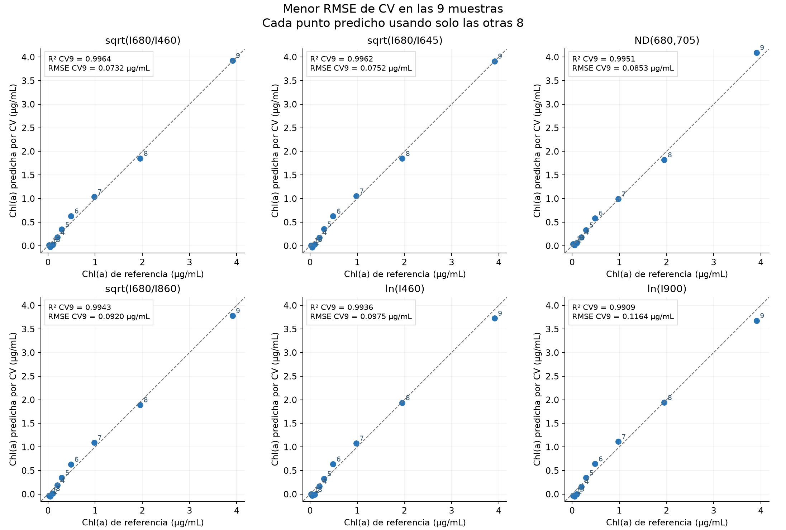
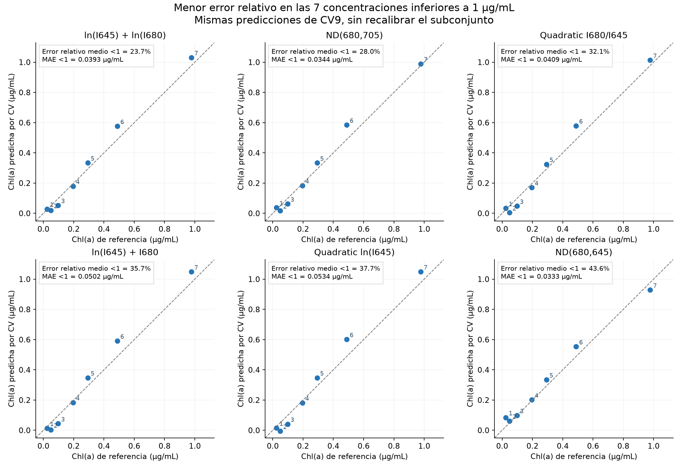

# Fluorómetro de clorofila: resumen para Daniela

Actualizado el 18 de octubre de 2026. Este documento resume el desarrollo del prototipo, los análisis realizados, la discusión bibliográfica y el alcance acordado. No introduce una nueva calibración ni sustituye los informes detallados.

## 1. Acuerdo actual y conclusión principal

Queremos que el equipo sea útil y que el trabajo pueda presentarse como investigación. Por ahora **trabajaremos con las nueve muestras existentes, sin preparar más extractos y sin validar en lagos**. La aplicación inmediata es cuantificar esta serie de extractos bajo las condiciones estudiadas.

Hay relaciones prometedoras entre los canales espectrales y la concentración, pero un R² alto en todo el rango puede coexistir con errores relativos grandes cerca de cero. No se ha elegido ni instalado un modelo definitivo a partir de la última CV.

El alcance defendible es una **prueba de concepto y caracterización empírica del prototipo con la serie disponible**. Las nueve diluciones comparten un extracto madre: la CV evalúa puntos de esa serie, no la transferencia a extractos independientes. Esto es una limitación que se debe declarar, no una exigencia de preparar nuevos extractos dentro del alcance actual.

## 2. Prototipo y funcionamiento desarrollado

- ESP32 con un LED azul, aproximadamente 430–435 nm, controlado por GPIO4 mediante electrónica de potencia, y sensor espectral AS7265X de 18 canales.
- LED y detector están de frente. El sensor incorpora filtros espectrales por canal. Las relaciones encontradas se interpretan como calibraciones empíricas; los datos disponibles no permiten demostrar qué fracción de la señal corresponde exclusivamente a fluorescencia.
- El ESP32 crea un punto de acceso Wi-Fi y sirve su propia interfaz web en `http://192.168.4.1`. La interfaz está en inglés y permite actualización OTA.
- **Start** calienta durante 10 segundos una sola vez y se convierte en **Stop**. El LED permanece encendido hasta detenerlo o activar el enfriamiento.
- Cada ciclo toma 10 lecturas instrumentales. Muestra las lecturas individuales de 435/645 en un desplegable y calcula los promedios.
- Otro desplegable muestra los 18 canales, con promedio por canal y desviación estándar calculada con las 10 lecturas, no una barra de error fija. Es desviación estándar de las lecturas, no error estándar del promedio ni incertidumbre total de concentración.
- **Measure White** registra el blanco, lo conserva aunque se apague el equipo y descarga su medición automáticamente. El botón de muestra requiere calentamiento y un blanco guardado. Guardarlo en el equipo no significa que las regresiones de este resumen lo utilicen.
- El blanco previsto es **uno por sesión, no uno por muestra**. Las CV más recientes se hicieron sin corrección por blanco.
- Se añadió un ciclo opcional de enfriamiento: después de tres ciclos de medición, LED apagado 60 segundos. Una casilla permite respetarlo o desactivarlo.
- La exportación conserva los datos de 435/645 y sus promedios, con nombre de muestra, y añade un CSV espectral de los 18 canales.
- Existe un firmware independiente en `LED_Stability_Test` para estudiar tiempo frente a intensidad y detenerse al cumplir el criterio de estabilidad. Su canal de 435 debe recibir una señal no saturada para que la prueba sea interpretable. No se dispone aquí de resultados experimentales de esa caracterización.

Las 18 longitudes nominales son **410, 435, 460, 485, 510, 535, 560, 585, 610, 645, 680, 705, 730, 760, 810, 860, 900 y 940 nm**. Las intensidades de los Excel se tratan como **unidades del instrumento**: no se ha acreditado una conversión a irradiancia absoluta.

La ecuación que permanece en el firmware principal es la calibración aportada inicialmente:

```text
Chl(a) = −2.7924 × ln(promedio de I645) + 20.1264
```

Los análisis estadísticos posteriores no reemplazaron esa ecuación ni recompilaron el firmware. Los binarios existentes no contienen automáticamente los modelos nuevos de CV.

## 3. Datos disponibles y condiciones

| Conjunto | Registros completos | Rango real de referencia (µg/mL) | Señal disponible | Preparación descrita |
|---|---:|---:|---|---|
| 85 muestras | 85 | 0,02384–7,98964 | I645 y desviación | Extractos medidos frente al método de referencia |
| 11 muestras | 11 | 0,79440–3,07062 | 18 canales y sus desviaciones | Otra tanda de extractos |
| 9 muestras | 9 | 0,02440–3,90980 | 18 canales y sus desviaciones | Diluciones de un único extracto madre; concentración asignada por dilución |

Son **105 registros completos** en total. Las siete concentraciones inferiores a 1 µg/mL del conjunto de nueve son 0,0244; 0,0489; 0,0977; 0,1955; 0,2932; 0,4887 y 0,9775. Las otras dos son 1,9549 y 3,9098 µg/mL. No hay un punto de concentración cero en los Excel.

Blancos de sesión de etanol al 90 %, aportados durante la conversación: **B645 = 1356 para las 85; 1256 para las 11; 1214 para las 9**. No hay blanco espectral de los demás canales en estos archivos.

### Calidad de datos y límites de interpretación

- 410 y 435 están saturados según lo confirmado por Alex. Se mantendrán así en esta etapa y se excluyen como predictores: los modelos multicanal utilizan los otros 16 canales.
- En la muestra 5 de las nueve hay una desviación de 485 anómala (`J6 = 1589592733`). Se conserva el original y no se usa esa desviación como peso. Esto no implicó eliminar la muestra ni su intensidad de 485.
- Se excluyeron filas sin mediciones completas, no muestras por su error de predicción. Los Excel originales no se modificaron.
- Daniela describió absorbancias de referencia a 664/648 nm, pero esas absorbancias, la concentración madre y los factores individuales de dilución no aparecen en los Excel analizados. Tampoco están las 10 lecturas originales de cada medición. No se ha auditado de nuevo la concentración de referencia ni recalculado las desviaciones instrumentales.
- Diez repeticiones del sensor no equivalen a diez extractos ni a diez muestras independientes. Las desviaciones instrumentales no incluyen toda la incertidumbre de extracción, dilución o referencia.

## 4. Cómo interpretar las métricas

**CV dejar-una-fuera:** se omite una muestra completa, se ajusta con las restantes y se predice la omitida. Se repite hasta que cada muestra tiene una predicción obtenida sin participar en su entrenamiento.

```text
R² predictivo = 1 − Σ(predicción − referencia)² / Σ(referencia − media de referencia)²
RMSE = raíz del promedio de (predicción − referencia)²
MAE = promedio de |predicción − referencia|
Sesgo = promedio de (predicción − referencia)
MAPE = promedio de [|predicción − referencia| / referencia] × 100
```

RMSE, MAE y sesgo se expresan en µg/mL. Un R² de ajuste usa las mismas muestras que fijaron los coeficientes; **no es equivalente a un R² de CV ni a una comprobación sobre otra tanda**. El MAPE depende mucho del rango: un error absoluto de 0,03 µg/mL representa 60 % si la referencia es 0,05, pero solo 3 % si es 1 µg/mL.

Se conservaron las predicciones negativas para mostrar el comportamiento real de los modelos. No se truncaron a cero para mejorar las métricas.

## 5. Recorrido de los análisis

### 5.1. Exploraciones iniciales de transferencia y blanco

Se exploraron I645, I680, cocientes, raíces, logaritmos, diferencias normalizadas, combinaciones de canales y PLS. I645 disminuye con la concentración; I680 aumenta en las dos tandas espectrales. Son tendencias empíricas, no una demostración aislada del mecanismo óptico.

Una relación de interés, ajustada con las once, fue:

```text
C = −2.21412414 + 9.92830753 × √(I680/I645)
```

Aplicada sin reajuste a las nueve obtuvo R² predictivo = 0,99060 y RMSE = 0,11809 µg/mL. También se exploró √(I680/I705), con RMSE sobre nueve de 0,10280, y una normalización parcial por B645, con RMSE de 0,07810.

**Advertencia histórica:** las nueve se consultaron para comparar formas funcionales en esas primeras exploraciones. Por tanto, esos resultados no deben presentarse como una validación prospectiva ciega. Más tarde se separó el ajuste y la selección sobre once de la aplicación sobre nueve, pero eso no borra la exploración previa del catálogo.

Con un blanco constante dentro de una sesión y regresión con intercepto, `ln(B645/I645)` es equivalente a `ln(I645)`. Esa CV de una sola sesión no demuestra por sí misma que el blanco mejore la transferencia entre sesiones. Dividir ambos canales por el mismo blanco también deja su cociente sin cambios.

### 5.2. CV realizada exclusivamente sobre las once

Se compararon 57 candidatos: entrenar con 10 y predecir 1, once turnos. Las dos variantes de blanco constante son equivalencias matemáticas, no relaciones independientes.

| Modelo | R² CV11 | RMSE CV11 (µg/mL) |
|---|---:|---:|
| Cuadrático en ln(I645) | 0,99736 | 0,03799 |
| Lineal en ln(I645) | 0,99721 | 0,03905 |
| ln(I645) y ln(I680), dos predictores | 0,99712 | 0,03969 |
| ln(I645) e I680, dos predictores | 0,99710 | 0,03980 |
| ln(I940) | 0,99695 | 0,04083 |
| √(I680/I645) | 0,99666 | 0,04270 |

La ventaja del cuadrático frente al logarítmico lineal es pequeña en esa CV y no demuestra mejor transferencia. El rango de las once, 0,7944–3,07062 µg/mL, cubre pocas concentraciones realmente bajas.

### 5.3. Ajustes 1 y 2 de las once aplicados a las 85

Se tomaron los coeficientes ajustados previamente con las once y se aplicaron sin volver a calibrar, sin blanco:

```text
Ajuste 1: C = 38.75817833 − 7.76490941 × ln(I645) + 0.32676847 × [ln(I645)]²
Ajuste 2: C = 24.62904595 − 3.46519495 × ln(I645)
```

| Modelo fijo procedente de las once | R² predictivo en 85 | RMSE (µg/mL) | MAE (µg/mL) |
|---|---:|---:|---:|
| Ajuste 1, cuadrático | 0,80924 | 0,81658 | 0,44409 |
| Ajuste 2, lineal en el logaritmo | 0,89057 | 0,61848 | 0,36077 |

El ajuste 2 transfiere mejor a las 85, aunque el 1 tuviera menor error en CV11. Hay cambio de tanda y extrapolación: 44 señales I645 de las 85 están fuera del intervalo I645 usado para calibrar.

Para el ajuste 2, las **30 referencias menores de 1 µg/mL** del conjunto de 85 tuvieron **MAPE = 128,5 %**, MAE = 0,2260 µg/mL y RMSE = 0,2734 µg/mL. Siete predicciones fueron negativas. Este resultado motivó abandonar esa opción como solución satisfactoria para todo el rango bajo y pasar a CV exclusivamente sobre las nueve.

### 5.4. Resultado actual: CV exclusivamente sobre las nueve

Se compararon **55 modelos sin blanco**. En cada uno se entrenó con 8 y se predijo la muestra restante, nueve veces. Los modelos PLS aprendieron centrado y escalado dentro de cada turno. Las gráficas muestran esas predicciones de CV, no predicciones del ajuste con las nueve juntas.

| Modelo | R² CV9 | RMSE CV9 (µg/mL) | MAPE en las 7 referencias <1 | MAE en esas 7 (µg/mL) |
|---|---:|---:|---:|---:|
| √(I680/I460) | 0,99639 | 0,07318 | 46,85 % | 0,06110 |
| √(I680/I645) | 0,99619 | 0,07518 | 54,60 % | 0,06574 |
| ND(680,705) | 0,99510 | 0,08528 | 27,99 % | 0,03439 |
| Lineal en ln(I645) | 0,98892 | 0,12819 | 96,07 % | 0,09544 |
| ln(I645) y ln(I680), dos predictores | 0,96305 | 0,23408 | 23,73 % | 0,03926 |
| Cuadrático en ln(I645) | 0,86915 | 0,44047 | 37,74 % | 0,05337 |

`ND(680,705) = (I680 − I705)/(I680 + I705)`. El modelo de dos logaritmos tiene intercepto y un coeficiente distinto para cada predictor; no es simplemente sumar dos intensidades.

Interpretación:

- **Menor RMSE global observado:** √(I680/I460).
- **Menor MAPE observado por debajo de 1:** el modelo con ln(I645) y ln(I680), 23,73 %, aunque su error global es mayor.
- **ND(680,705)** combina un error relativo bajo de 27,99 % con RMSE global de 0,08528 µg/mL. Es un candidato de interés, no un ganador validado externamente.
- El ranking cambia según se priorice RMSE global, MAE bajo o porcentaje relativo bajo. No hay un criterio único que haga a un modelo el mejor para todas las aplicaciones.
- Al omitir el punto de 3,9098, las otras ocho solo llegan a 1,9549 µg/mL: ese turno de CV incluye extrapolación y se mantuvo en todas las métricas.
- Elegir el mínimo entre 55 candidatos y solo nueve puntos introduce optimismo de selección. La CV mostrada es por candidato, no una validación anidada de todo el proceso de elegir el mejor.

El subconjunto <1 se usó para evaluar las mismas predicciones de CV9, **no para volver a entrenar solo con siete muestras**. No se leyó el conjunto de once ni el de 85 durante esa ejecución; se reutilizaron únicamente definiciones matemáticas y funciones de ajuste, sin datos ni coeficientes previos.





## 6. Comparación con literatura y una aclaración importante

Se encuentran errores relativos del orden de 20–30 % en literatura, especialmente en contextos distintos y matrices complejas. Eso no establece un umbral universal de aceptación para nuestros extractos. Rango, preparación, referencia y tipo de validación deben coincidir antes de comparar porcentajes.

**Aclaración de la comparación verbal con Sensors 2026:** el artículo obtiene MAPE = 6,14 % en 15 muestras independientes. Sin embargo, en su sección 2.5 los valores usados como referencia se calculan para el **agua original** a partir del extracto. El intervalo publicado de 203,74–934,94 µg/L no debe presentarse como un intervalo directamente comparable de concentración del extracto en nuestra cubeta. Nuestra comparación previa de rangos era incompleta.

El estudio de lagos presenta errores porcentuales de 24 % y 66 % tras una corrección por color del agua. Se conserva como contexto sobre interferencias futuras, no como criterio de aceptación para esta serie.

El artículo de bajo coste de 2013 incluye una caracterización temporal del LED. Sirve como ejemplo metodológico; su tiempo de estabilización no se debe copiar a nuestro LED de distinta potencia.

Los tres artículos completos están en [bibliografia](bibliografia/README.md), con DOI, fuente, páginas útiles y notas de comparabilidad. Son documentos de acceso abierto, sin modificaciones.

## 7. Qué podemos y qué no podemos concluir ahora

**Apoyado por el análisis:** existe una relación empírica fuerte con la concentración en la serie; los canales y transformaciones cambian el reparto de errores; las métricas globales ocultan parte del problema a concentraciones bajas; hay modelos pequeños que merecen seguir estudiándose.

**No establecido:** exactitud entre extractos o sesiones independientes; límite de detección/cuantificación defendible; incertidumbre total; una ecuación universal; cuantificación directa de agua de lago; separación completa entre fluorescencia, transmisión, fondo y dispersión en la geometría actual.

No se garantizará una mejora de exactitud por incorporar una corrección. Si se prueban nuevas transformaciones, ponderaciones o decisiones de modelo con los datos existentes, deben aprenderse dentro del entrenamiento de cada turno, y la selección debe distinguirse de la evaluación.

Para el manuscrito, conviene separar claramente: descripción del instrumento, protocolo de adquisición, preparación y referencia descritas, calibración, CV, errores por concentración, decisiones exploratorias y limitaciones. La posibilidad de publicación depende del conjunto del estudio y la revisión editorial; este análisis por sí solo no asegura aceptación.

## 8. Guía de archivos

| Carpeta o informe | Qué contiene y cómo interpretarlo |
|---|---|
| [CV de nueve: informe principal actual](cv_9_exclusivo/informe.md) | 55 candidatos, nueve turnos por modelo, gráficos y métricas globales/bajas |
| [Predicciones de CV9](cv_9_exclusivo/predicciones_cv_9.csv) | 495 predicciones; identificación de muestra, referencia, error y error relativo |
| [CV exclusiva de once](cv_11_exclusivo/informe.md) | 57 candidatos; histórico de comparación dentro de esa tanda |
| [Ajustes 1 y 2 sobre las 85](ajustes_1_2_sobre_85/informe.md) | Aplicación de ecuaciones previamente fijadas con once, sin recalibrar |
| [Exploración inicial](analisis_2026-10-18/informe.md) | Revisión de las tres tandas. Sus propuestas de nuevos extractos/óptica/lago son históricas y no forman parte del acuerdo actual |
| [Relación 645/680](relacion_645_680_sin_blanco/informe.md) | Exploración de transferencia, no prueba prospectiva ciega |
| [Relación solo 645](relacion_645_sin_blanco/informe.md) | Histórico de aplicación de ln(I645) a nueve y 85 |
| [Comparación once a nueve](comparacion_modelos_11_a_9/informe.md) | Ranking exploratorio que consultaba las nueve; no confundir con CV9 |
| [Selección separada sobre once](validacion_solo_11/informe.md) | Reanálisis con selección sobre once, incluida CV anidada; las nueve ya habían sido exploradas anteriormente |
| [Bibliografía descargada](bibliografia/README.md) | Artículos completos y notas de lectura |

Se mantiene el material histórico sin sobrescribirlo para que se pueda reconstruir la evolución del análisis. **Para el estado actual, empezar por este resumen y por `cv_9_exclusivo`.**

## 9. Próximo paso acordable, sin nuevos extractos

Trabajar con la serie actual para decidir qué error se necesita en el rango bajo, comparar candidatos sencillos sin mezclar R² de entrenamiento con CV, y delimitar dónde cuantifica el prototipo y dónde la incertidumbre es excesiva. Cualquier análisis adicional debe identificarse como nuevo y no presentarse como ya realizado.

Este resumen y los artículos se han preparado para compartirlos con Daniela; no se han enviado automáticamente a ninguna persona.
