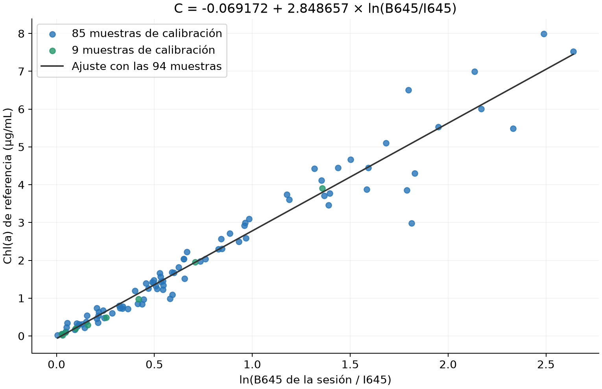
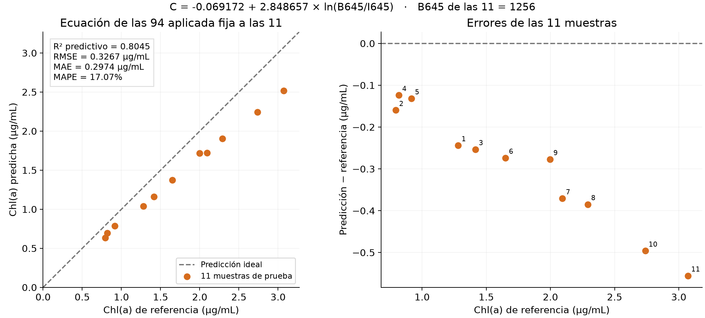

# Ajuste conjunto con 85 + 9 y blanco de sesión; prueba en las 11

> Informe histórico de exploración. La decisión vigente es 85 → 9 con blanco; consultar [articulo.md](../articulo.md). Este informe conserva sus resultados originales y no es la guía actual del manuscrito.

Fecha: 18 de octubre de 2026.

## Diseño solicitado
Calibración: las 85 y las 9 juntas, 94 puntos. Prueba: las 11, excluidas del cálculo de los coeficientes. Se mantiene una única relación lineal con intercepto en ln(B645/I645), sin polinomios ni selección posterior mirando las once.
Blancos fijos proporcionados por Alex: 1356 para las 85, 1214 para las 9 y 1256 para las 11. Se emplea el blanco de cada sesión, no un blanco por muestra. No se añaden los blancos como puntos de concentración cero.
Mínimos cuadrados ordinarios, igual peso por muestra: la tanda de 85 aporta 85/94 del peso y la de nueve 9/94. No se igualan los pesos por tanda ni se pondera por las desviaciones del sensor.

## Ecuación nueva
**Chl(a) (µg/mL) = -0.0691723511 + 2.8486574141 × ln(B645 / I645).**
I645 es la intensidad media de la muestra. B645 es la intensidad del blanco de la sesión en la misma configuración y unidades instrumentales. ln es el logaritmo natural. I y B deben ser positivos y finitos.
Ambos coeficientes se recalculan con los 94 puntos. No es la ecuación anterior de las 85 aplicada otra vez. Se guarda modelo_fijado_94.json antes de abrir las once. No se recortan predicciones negativas ni se eliminan atípicos.

## Ajuste y prueba
| Evaluación | n | RMSE | MAE | Sesgo | MAPE (%) |
|---|---|---|---|---|---|
| Ajuste de calibración 85+9, no CV | 94 | 0.41551 | 0.24617 | -0.00000 | 21.55 |
| Prueba: no utilizada para ajustar | 11 | 0.32673 | 0.29739 | -0.29739 | 17.07 |

R² del ajuste de las 94 = 0.94984. R² predictivo en las once = 0.80449.
RMSE, MAE y sesgo en µg/mL. Las métricas de las 94 describen el ajuste sobre sus propios datos, no CV. Las métricas de las 11 corresponden a aplicación sin reajustar. Sesgo positivo significa sobreestimación. MAPE es el promedio del error relativo absoluto, no incertidumbre expandida.

## Prueba en las 11 por rango
| Rango (µg/mL) | n | RMSE | MAE | Sesgo | MAPE (%) |
|---|---|---|---|---|---|
| <1 | 3 | 0.13930 | 0.13845 | -0.13845 | 16.54 |
| >=1 | 8 | 0.37351 | 0.35699 | -0.35699 | 17.27 |

| Rango fijo (µg/mL) | n | RMSE | MAE | Sesgo | MAPE (%) |
|---|---|---|---|---|---|
| 0–<0,1 | 0 | — | — | — | — |
| 0,1–<0,25 | 0 | — | — | — | — |
| 0,25–<0,5 | 0 | — | — | — | — |
| 0,5–<1 | 3 | 0.13930 | 0.13845 | -0.13845 | 16.54 |
| 1–<2 | 4 | 0.26251 | 0.26214 | -0.26214 | 16.86 |
| 2–<3 | 3 | 0.42102 | 0.41728 | -0.41728 | 17.54 |
| 3–<5 | 1 | 0.55555 | 0.55555 | -0.55555 | 18.09 |
| 5–8 | 0 | — | — | — | — |

Los rangos se determinan por la concentración de referencia. Extremo inferior incluido y superior excluido, excepto el último, que incluye 8. — indica ausencia de muestras. Los rangos con n=1 describen solo esa observación.

## Gráficas

## Interpretación y alcance
En las once el sesgo medio es -0.29739 µg/mL. La inclusión de las nueve cambia poco la ecuación porque son 9 de 94 puntos y, tras normalizar por el blanco, ya estaban próximas a la relación de las 85.
Las once no se usan para ajustar o elegir la forma de esta nueva ecuación. Sin embargo, ya se examinaron en etapas previas: esta es una comprobación retrospectiva de transferencia, no una validación prospectiva ciega.
Las nueve son diluciones de un único extracto madre, no nueve extractos independientes. No se establece incertidumbre del blanco, LOD/LOQ ni rendimiento en lagos. No se ha modificado el firmware ni generado nuevos .bin.

## Fuentes y archivos
calibracion_85_puntos (1).xlsx: Sheet1 A1:D86; 9Samples.xlsx: Sheet1 A1:AL10; 11Samples.xlsx: Sheet1 A1:AL12. Se usan identificador, concentración e I645. Los originales permanecen intactos y sus SHA-256 se conservan en resultados.json.
modelo_fijado_94.json conserva la ecuación previa a la prueba; resultados.json contiene métricas y procedencia; predicciones.csv contiene 94 filas de calibración y 11 de prueba; metricas.csv separa ambas evaluaciones y las partes del ajuste. Los CSV de errores conservan la prueba de las once por rango y por debajo/encima de 1 µg/mL.
Los análisis anteriores se conservan sin cambios. El cálculo reutiliza las funciones verificadas de lectura, normalización y métricas. Se comprueba el ajuste por una segunda fórmula, las ecuaciones normales, los recuentos de muestras, la conservación del modelo y la agregación de errores por rango.
