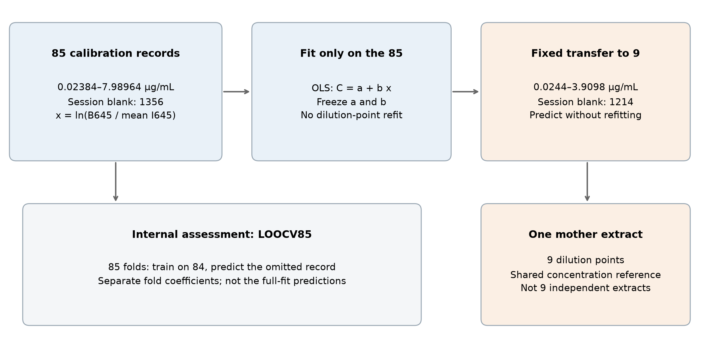
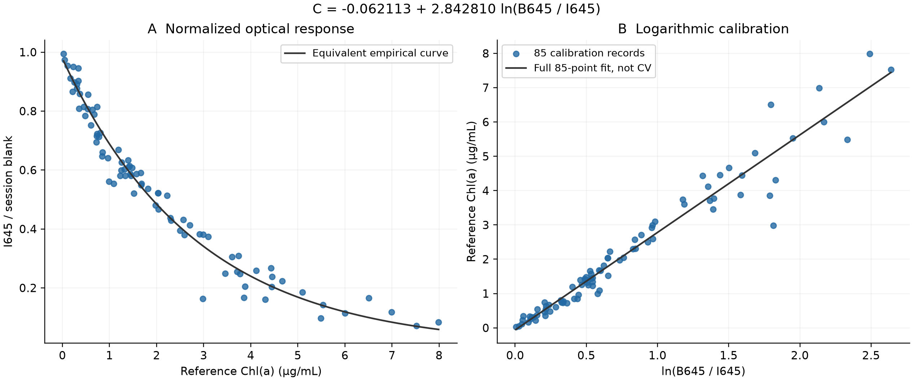
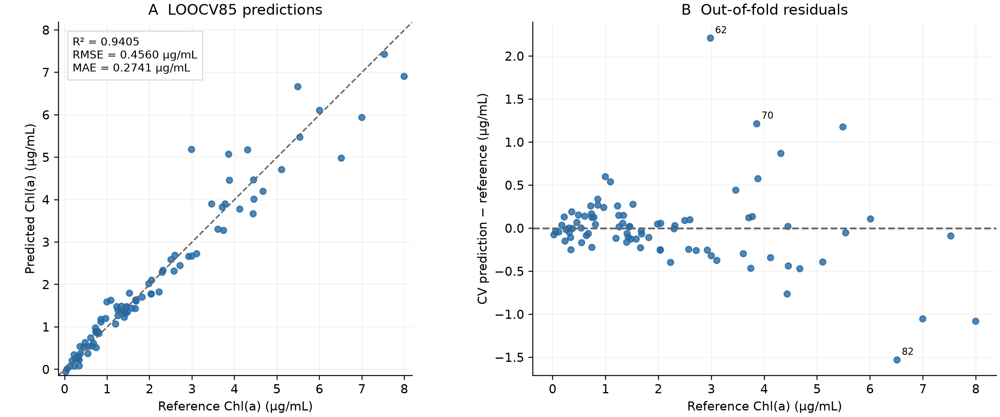
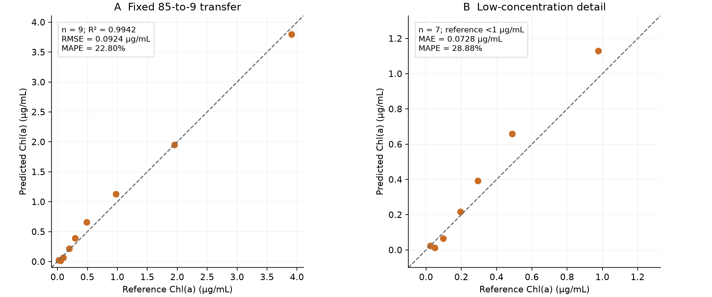
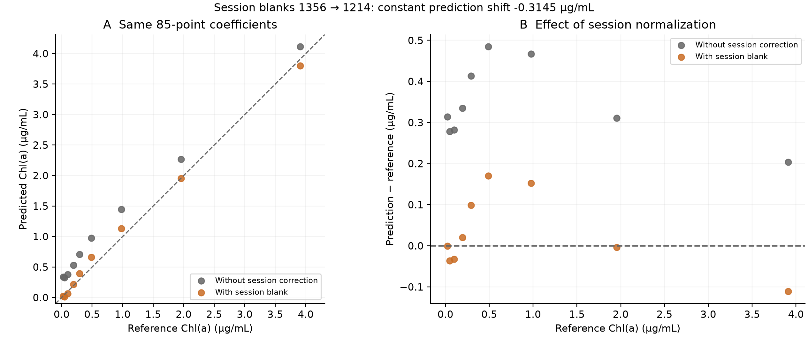
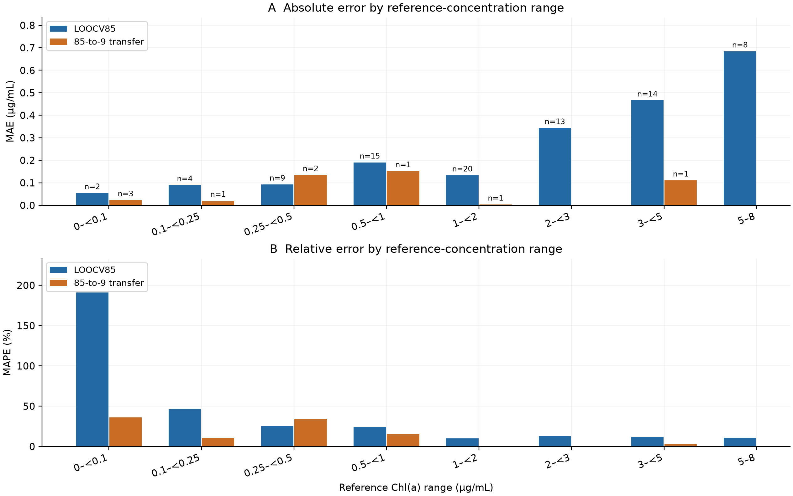

# Artículo para Daniela: calibración con 85 y evaluación sobre nueve diluciones

Documento de trabajo actualizado el 18 de octubre de 2026. Decisión acordada con Alex: **85 → 9, usando el blanco de sesión y una relación lineal en ln(B645/I645)**. Esta versión sustituye la propuesta anterior basada en ND(680,705).

## 1. Decisión y foco del paper

La historia principal será el **desarrollo de un instrumento multicanal basado en ESP32 y la evaluación de una calibración empírica sencilla para estimar clorofila a en extractos etanólicos**.

Usaremos 85 registros para calibrar y evaluar internamente mediante validación cruzada dejar-uno-fuera. Después aplicaremos la ecuación completa, sin reajustarla, a nueve diluciones de otro extracto madre, incorporando el blanco correspondiente a su sesión.

**Las once muestras quedan fuera del análisis principal, los coeficientes, las tablas y las figuras de esta versión.** Los análisis anteriores permanecen en el repositorio como historial. Excluirlas del alcance actual no convierte retrospectivamente la selección 85 → 9 en un ensayo prospectivo ciego.

La contribución combina:

- Instrumento reproducible, con control y visualización desde una web servida por el propio ESP32.
- Adquisición promediada y una calibración pequeña, interpretable y viable en el microcontrolador.
- Evaluación separada de CV85 y transferencia 85 → 9.
- Estudio explícito del efecto del blanco y del comportamiento a bajas concentraciones.

El paper no será una demostración de cuantificación directa en lagos, una comparación exhaustiva de algoritmos ni una prueba de fluorescencia ópticamente aislada. Tampoco se afirmará que este es el primer instrumento de bajo coste: la novedad debe apoyarse en su diseño concreto, reproducibilidad y evaluación.

Título provisional en inglés:

> An ESP32-based multispectral instrument for chlorophyll-a estimation in ethanolic extracts: empirical calibration and dilution-series transfer assessment

Pregunta principal:

> ¿Qué desempeño ofrece una calibración logarítmica de la señal de 645 nm, normalizada por el blanco de sesión, al calibrarse con 85 registros y aplicarse sin reajuste a una serie de nueve diluciones?

## 2. Datos y diseño del análisis

| Papel | Registros | Concentración de referencia (µg/mL) | Blanco I645 |
|---|---:|---:|---:|
| Calibración y CV interna | 85 | 0,02384–7,98964 | 1356 |
| Evaluación de transferencia | 9 | 0,0244–3,9098 | 1214 |

Son **94 registros de medición**, no 94 extractos independientes demostrados. Las nueve son diluciones de un único extracto madre y comparten la incertidumbre de su concentración inicial.

Según la preparación descrita, la referencia procede de espectrofotometría comercial a 664/648 nm. En las nueve, la concentración se asigna a partir del extracto madre y la dilución. Los Excel entregados contienen las concentraciones e intensidades, pero no las absorbancias originales, la ecuación de referencia, la concentración madre ni los factores de dilución. Estos elementos deben recuperarse de los registros existentes antes de cerrar Métodos; no se inventarán.

Fuentes principales:

- [85 registros originales](calibracion_85_puntos%20%281%29.xlsx), Sheet1, A1:D86.
- [Nueve diluciones originales](9Samples.xlsx), Sheet1, A1:AL10.
- [Resultados reproducibles de esta versión](articulo_85_a_9/README.md).

Se excluyen filas con solo identificador y sin medición completa, no muestras con errores grandes. No se eliminan atípicos ni se recortan predicciones negativas.

### Separación que debe aparecer en Métodos

1. **Ajuste completo:** mínimos cuadrados ordinarios sobre las 85, con intercepto libre e igual peso por registro.
2. **CV85:** 85 turnos; entrenar con 84 y predecir el registro omitido. Las métricas de CV usan solo estas predicciones fuera del entrenamiento.
3. **Transferencia 85 → 9:** aplicar a las nueve los coeficientes del ajuste completo de las 85, cambiando únicamente al blanco de su sesión. No se recalibra con sus concentraciones.

Los conjuntos y distintas formas funcionales ya se exploraron antes de elegir esta estrategia. Por ello, la evaluación se describe como **transferencia retrospectiva a una serie de dilución**, no como validación externa prospectiva ciega. Las métricas de CV85 tampoco validan todo el proceso previo de selección.

## 3. Función elegida y cómo utilizarla

Definimos:

$$
x=\ln\left(\frac{B_{645}}{\overline I_{645}}\right)
$$

La ecuación fijada con las 85 es:

$$
\boxed{\widehat{Chl(a)}\;[\mu g/mL]
=-0.0621128959+2.8428103277\,x}
$$

- **B645:** intensidad del blanco de la sesión. No se pide un blanco por muestra.
- **I645 promedio:** intensidad media del canal de 645 nm de la muestra.
- **ln:** logaritmo natural.
- Las intensidades se usan en las unidades instrumentales almacenadas en los Excel; el cociente B/I es adimensional.
- En la adquisición del firmware actual se promedian diez lecturas. Se calcula el logaritmo del promedio, no el promedio de diez logaritmos.

Para las nueve se utiliza B645 = 1214. Para las 85 se utilizó B645 = 1356. En una sesión futura habría que medir su propio blanco bajo la misma configuración; estos dos valores no son constantes universales del equipo.

### Relación con la ecuación sin normalización entre sesiones

La misma calibración de las 85 puede escribirse:

$$
\widehat C=20.4410723055-2.8428103277\ln(I_{645,\mathrm{equivalente}})
$$

donde:

$$
I_{645,\mathrm{equivalente}}
=\overline I_{645}\frac{1356}{B_{645,\mathrm{sesión}}}
$$

Esto aclara qué hace el blanco: expresa la intensidad de otra sesión en la escala de la sesión de calibración. No se resta I−B.

Con un blanco constante en las 85, escribir ln(B/I) en lugar de ln(I) solo cambia el intercepto y el signo de la pendiente. **Por eso la CV85 es idéntica con ambas escrituras y no demuestra por sí sola la utilidad del blanco entre sesiones.**

### Condiciones y restricciones

B e I deben ser positivos y finitos. Hay que mantener geometría, cuveta, solvente, potencia, atenuador, ganancia, integración y secuencia compatibles con las usadas para calibrar. Los canales saturados de 410/435 no intervienen en esta función.

El intervalo de ln(B/I) observado al calibrar fue **0,00529126–2,63944088**. Las nueve quedan dentro del intervalo de señal y del intervalo de concentración de las 85. Esto evita extrapolación en esta prueba, pero no garantiza exactitud en cualquier matriz o sesión.

Cuando I = B, la ecuación devuelve −0,06211 µg/mL. No se ha impuesto el paso por cero ni se ha añadido el blanco como patrón de concentración cero. Forzar ese punto o truncar resultados negativos produciría otro procedimiento y no debe hacerse silenciosamente.

**Estado del equipo:** esta función está fijada para el análisis del paper, pero todavía no se ha instalado en el firmware. El código principal conserva la ecuación inicial −2,7924 × ln(I645) + 20,1264. No deben confundirse los .bin existentes con esta calibración nueva.

## 4. Resultados que sostienen el manuscrito

### Evaluaciones globales

| Evaluación | n | R² predictivo | RMSE (µg/mL) | MAE (µg/mL) | Sesgo (µg/mL) | MAPE |
|---|---:|---:|---:|---:|---:|---:|
| CV85, entrenar con 84 por turno | 85 | 0,94052 | 0,45598 | 0,27406 | −0,00003 | 20,86 % |
| Transferencia fija 85 → 9, con blanco | 9 | 0,99424 | 0,09241 | 0,06937 | +0,02866 | 22,80 % |

El error absoluto máximo fue **2,20998 µg/mL en CV85** y **0,17001 µg/mL en las nueve**. En CV85 hay una predicción negativa, que se conserva; en las nueve no hay ninguna.

El menor error de las nueve no significa que el sistema sea más exacto en general: es una serie menor, cubre un rango más estrecho y comparte un extracto madre. No se comparan ambos RMSE como si procedieran de poblaciones idénticas.

### Concentraciones bajas y altas

| Evaluación y rango | n | RMSE (µg/mL) | MAE (µg/mL) | MAPE |
|---|---:|---:|---:|---:|
| CV85, referencia <1 | 30 | 0,18581 | 0,13863 | 38,61 % |
| CV85, referencia ≥1 | 55 | 0,55000 | 0,34793 | 11,19 % |
| Transferencia a nueve, referencia <1 | 7 | 0,09603 | 0,07281 | 28,88 % |
| Transferencia a nueve, referencia ≥1 | 2 | 0,07847 | 0,05734 | 1,51 % |

El 1,51 % describe solo dos puntos; no establece exactitud uniforme por encima de 1. Los intervalos más detallados, incluidos los vacíos, están en [errores por rango](articulo_85_a_9/errores_por_rango.csv).

MAPE = promedio de |predicción − referencia|/referencia × 100. Es sensible a referencias pequeñas. **22,80 % o 28,88 % no son incertidumbres de ± ese porcentaje, intervalos de confianza ni errores máximos garantizados.**

### Efecto del blanco en las nueve

| Aplicación de la misma calibración de 85 | RMSE (µg/mL) | MAE (µg/mL) | Sesgo (µg/mL) | MAPE |
|---|---:|---:|---:|---:|
| Sin corrección entre sesiones | 0,35419 | 0,34313 | +0,34313 | 291,78 % |
| Con blanco de sesión | 0,09241 | 0,06937 | +0,02866 | 22,80 % |

La corrección produce un desplazamiento de **−0,31447 µg/mL** en las predicciones de las nueve. Esta mejora es un resultado descriptivo de esta transferencia concreta; no demuestra que el blanco elimine cualquier deriva o efecto de matriz.

## 5. Explicaciones para la discusión

Hay que distinguir **observación**, **interpretación plausible** y **mecanismo demostrado**.

### A. Por qué utilizar el logaritmo

Se observa una disminución de I645 al aumentar la concentración. La ecuación elegida equivale algebraicamente a una curva exponencial de I645/B frente a C:

$$
\frac{I_{645}}{B_{645}}=\exp\left(\frac{-0.0621128959-C}{2.8428103277}\right)
$$

Esta forma ayuda a describir los datos, pero no prueba que se haya medido absorbancia monocromática ni permite interpretar la pendiente como un coeficiente de extinción. La ley de Beer–Lambert exige condiciones ópticas específicas que no se han demostrado aquí. [Definición de IUPAC](https://goldbook.iupac.org/terms/view/B00626).

Redacción aconsejada: “An empirical logarithmic calibration of the 645-nm optical signal was used.” Evitar: “The regression proves Beer–Lambert behaviour.”

### B. Por qué el blanco puede ayudar

Si muestra y blanco comparten una variación multiplicativa de iluminación o sensibilidad, el cociente puede cancelarla. Esto es una propiedad matemática bajo esa hipótesis. Un fondo aditivo, cambios de composición, geometría o diferencias espectrales no tienen por qué cancelarse.

La mejora observada en las nueve es compatible con una diferencia de escala entre sesiones, pero no identifica su causa. No se debe afirmar que el calentamiento del LED explica el cambio de blanco: no hay registros temporales o de temperatura que lo demuestren.

### C. Por qué la señal de 645 puede disminuir aunque se excite en azul

El sistema se diseñó para estudiar la respuesta óptica inducida por el LED azul y utiliza filtros espectrales incorporados en el sensor. En un montaje con LED y detector de frente, seleccionar un canal rojo no demuestra por sí solo que toda su señal sea fluorescencia aislada.

Entre las explicaciones posibles están:

- Atenuación de la luz de excitación antes de alcanzar el volumen observado.
- Reabsorción de parte de la emisión.
- Una señal compuesta por emisión, fondo y contribuciones ópticas dependientes de la geometría.

La absorción de excitación y la reabsorción de emisión pueden modificar la relación entre señal y concentración; la geometría también importa. Son mecanismos conocidos, **no comprobaciones de que sean la causa en este prototipo**. No deben aplicarse correcciones de filtro interno sin la información óptica necesaria. [Fonin et al., 2014](https://doi.org/10.1371/journal.pone.0103878), [Ceresa et al., 2021](https://doi.org/10.1088/2050-6120/ac0243), [IUPAC: inner filter effect](https://goldbook.iupac.org/terms/view/I03047).

No se ha separado aquí quenching químico de reabsorción, fondo o deriva. Por tanto, no se atribuirá la tendencia a un mecanismo único.

### D. Por qué el R² puede ser alto y el error relativo bajo seguir siendo grande

R² evalúa la variación global. Un error absoluto pequeño puede representar una fracción grande de una concentración cercana a cero. Las figuras deben mostrar el rango bajo y los errores individuales, no solo una recta con R² = 0,994.

Además, las nueve diluciones comparten una referencia madre. Esto puede producir una relación ordenada sin demostrar robustez frente a extractos independientes.

### E. Por qué la CV85 y la transferencia a nueve dan errores distintos

Cambian el rango, la estructura de las preparaciones y el tipo de evaluación. CV85 prueba omisiones dentro de la tanda disponible; las nueve prueban transferencia a una serie concreta. No se han documentado grupos por día o extracto madre para hacer CV85 agrupada.

Esta diferencia no justifica borrar registros de las 85 ni quedarse solo con el intervalo más favorable. Si un rango se propone a posteriori, debe identificarse como exploratorio.

## 6. Figuras propuestas para el paper

Las figuras ya están generadas con los datos originales, sin las once. Se ofrecen **PNG de 220 dpi para revisar y SVG editable para maquetar**. Los títulos y ejes están en inglés. Las líneas son ajustes o referencias ideales, no intervalos de incertidumbre. No se inventan barras de error de concentración a partir de desviaciones instrumentales.

### Figura 1. Diseño del análisis — principal

**Para qué sirve:** distinguir calibración, CV85 y transferencia; hacer visible que las nueve proceden de un solo extracto.

Pie sugerido:

> Analysis workflow. An empirical calibration was fitted using 85 records and assessed by leave-one-out cross-validation. The full calibration was then applied without refitting to nine dilutions from one mother extract, using the corresponding session blank. Dilution points do not represent independent extract preparations.

Es un esquema del análisis, no una fotografía ni un dibujo validado del montaje óptico. La fotografía y el esquema dimensional del prototipo siguen pendientes.

### Figura 2. Señal normalizada y calibración — principal

**Para qué sirve:** mostrar la respuesta óptica original normalizada y su representación logarítmica. La recta se ajustó solo con las 85; no muestra predicciones de CV.

Pie sugerido:

> Calibration using 85 records. (A) Normalized 645-nm optical intensity versus reference chlorophyll-a concentration, with the equivalent empirical exponential curve. (B) Reference concentration versus ln(B645/I645), with the full ordinary-least-squares fit. The curve describes the observed response and does not establish an absorption mechanism.

### Figura 3. CV85 y residuales — principal

**Para qué sirve:** mostrar desempeño fuera del ajuste de cada registro, dispersión y errores grandes sin ocultarlos.

Pie sugerido:

> Leave-one-out cross-validation within the 85-record calibration set. (A) Out-of-fold predictions versus reference concentrations; the dashed line indicates identity. (B) Prediction residuals versus reference concentration. Each record was predicted using a model fitted to the other 84 records. Negative predictions and large residuals were retained.

### Figura 4. Transferencia a nueve y detalle bajo — principal

**Para qué sirve:** presentar el resultado elegido sin esconder el comportamiento por debajo de 1 µg/mL. Es la figura central para comunicar el desempeño práctico.

Pie sugerido:

> Fixed transfer from the 85-record calibration to nine dilution points. (A) Predicted versus assigned chlorophyll-a concentration over the full dilution range. (B) Detail of the seven points below 1 µg/mL. Session-blank normalization was applied without refitting coefficients to the dilution series. Dashed lines indicate identity.

### Figura 5. Efecto del blanco — principal o suplemento

**Para qué sirve:** explicar por qué se incorporó el blanco; mostrar que el efecto es un desplazamiento de concentración para esta forma funcional.

Pie sugerido:

> Effect of session-blank normalization on the nine-point transfer assessment. Predictions obtained from the same 85-record calibration are shown before and after session normalization. (A) Predictions versus assigned concentration. (B) Residuals. Using blanks of 1356 and 1214 produces a constant shift of −0.31447 µg/mL in the dilution-series predictions.

La comparación es retrospectiva. No demuestra una mejora universal entre sesiones.

### Figura 6. Errores por concentración — suplemento recomendado

**Para qué sirve:** mostrar heterogeneidad del error y evitar que los indicadores globales oculten el rango bajo. Los recuentos importan: muchos intervalos de las nueve contienen uno o pocos puntos.

Pie sugerido:

> Prediction errors by reference-concentration interval. (A) Mean absolute error, with sample counts. (B) Mean absolute percentage error. LOOCV85 and fixed 85-to-9 transfer are reported separately. Missing bars indicate intervals without observations. These summaries do not estimate measurement uncertainty.

Propuesta de maquetación: figuras 1–4 en el cuerpo; figura 5 en el cuerpo si el blanco es parte central del argumento; figura 6 y la tabla completa de nueve predicciones en el suplemento.

## 7. Estructura y mensaje del manuscrito

1. **Introducción:** necesidad de instrumentación accesible; antecedentes de fluorescencia y multicanal; objetivo acotado a extractos.
2. **Instrumento:** ESP32, AS7265X, LED azul nominal 430–435 nm y electrónica de potencia; geometría real y filtros; interfaz local, adquisición, exportación y OTA.
3. **Muestras y referencia:** solvente, preparaciones, ecuación de espectrofotometría y diluciones a partir de registros existentes.
4. **Análisis:** blanco de sesión, transformación, ajuste con 85, CV85 y aplicación fija a nueve; carácter retrospectivo.
5. **Resultados:** tabla global, calibración, CV, transferencia, comparación de blanco y rango bajo.
6. **Discusión:** utilidad práctica y limitaciones; hipótesis ópticas separadas de conclusiones; dependencia de la preparación y del blanco.
7. **Conclusión y disponibilidad:** implementación reproducible y alcance demostrado, con datos y código.

Párrafo de conclusión propuesto en inglés:

> The prototype supported empirical chlorophyll-a estimation in ethanolic extracts using a compact session-blank-normalized calibration of the 645-nm optical signal. A calibration fitted to 85 records achieved a leave-one-out RMSE of 0.456 µg/mL. Fixed application to nine dilutions from one mother extract yielded an RMSE of 0.092 µg/mL and a MAPE of 22.8%, increasing to 28.9% below 1 µg/mL. These retrospective results support a proof of concept under the studied conditions, not universal transfer across extracts, sessions or natural-water matrices.

No escribir: “validated from 0 to 8 µg/mL”, “94 independent extracts”, “accuracy ±22.8%”, “pure chlorophyll fluorescence at 645 nm” o “ready for lake monitoring”.

## 8. Próximos pasos antes de enviar a publicación

### Cerrar Métodos con la información ya existente

- [ ] Recuperar absorbancias 664/648, ecuación apropiada para el solvente, concentración madre y factores de dilución. Verificar el redondeo de las concentraciones asignadas.
- [ ] Documentar origen de las 85 preparaciones y agrupación por extracto, sesión o día, si existe. Si no se puede reconstruir, declarar la limitación.
- [ ] Registrar modelo y potencia del LED, cuveta y recorrido, geometría y distancias, atenuador, ganancia e integración efectivamente utilizados al producir los datos.
- [ ] Aclarar cómo y cuándo se obtuvieron los dos blancos. No inventar réplicas ni su desviación.
- [ ] Confirmar si el protocolo histórico de los Excel coincidió con el firmware actual. Un calentamiento programado de 10 s no demuestra estabilidad del LED durante 10 s.

### Cerrar el análisis y el alcance

- [ ] Revisar con Daniela la tabla de nueve predicciones, los residuales grandes de CV85 y los errores bajos sin eliminar puntos por conveniencia.
- [ ] Describir selección retrospectiva y criterios de inclusión por protocolo, no fingir que esta partición se fijó antes de explorar los datos.
- [ ] Mantener separadas incertidumbre instrumental, concentración de referencia y error predictivo. No establecer LOD/LOQ usando solamente la concentración mínima.
- [ ] Si se recupera una agrupación fiable para las 85, valorar una evaluación agrupada como análisis adicional. Si no existe, conservar la CV por registro con esa limitación.
- [ ] Acordar un uso práctico acotado y cómo advertir resultados fuera de rango. No convertir dos puntos altos favorables en un intervalo de exactitud garantizada.

### Preparar la entrega editorial

- [ ] Añadir fotografía real, esquema óptico/electrónico y lista de componentes con costes documentados.
- [ ] Ajustar tamaños y pies de los SVG al formato de la revista; conservar los valores y unidades.
- [ ] Acordar autoría, contribuciones, disponibilidad de datos y licencia del código.
- [ ] Revisar antecedentes y formular la novedad sin afirmar prioridad no demostrada.
- [ ] Elegir una revista acorde a instrumentación/prueba de concepto. La aceptación no está garantizada.

### Implementación posterior en el equipo

- [ ] Instalar la función elegida usando la media de 645 y el blanco de sesión; guardar la versión de calibración junto a la exportación.
- [ ] Verificar coincidencia numérica con los vectores existentes y comportamiento ante B/I inválidos o fuera de rango.
- [ ] Distinguir blanco persistente de blanco vigente: conservarlo tras apagar no acredita que siga siendo válido para una sesión o configuración nueva.
- [ ] Compilar binarios nuevos solo al ejecutar esa implementación y comprobarlos en el equipo.

No se exige preparar nuevos extractos ni medir lagos para desarrollar este manuscrito acotado. Si faltan registros o comprobaciones experimentales, deben declararse y limitar las afirmaciones, no sustituirse por datos inventados.

## 9. Referencias y materiales para Daniela

- **Blanco-Jáquez et al. (2026).** Portable Multispectral Fluorometer with Embedded Machine Learning for Chlorophyll-a Estimation in Acetone-Extracted Samples. [DOI: 10.3390/s26134086](https://doi.org/10.3390/s26134086). Antecedente multicanal; no son equivalentes solvente, geometría ni concentración referida al agua original y al extracto.
- **Leeuw, Boss y Wright (2013).** In situ Measurements of Phytoplankton Fluorescence Using Low Cost Electronics. [DOI: 10.3390/s130607872](https://doi.org/10.3390/s130607872). Antecedente de instrumentación y caracterización temporal; no copiar su tiempo de calentamiento a nuestro LED.
- **Fonin et al. (2014).** Fluorescence of Dyes in Solutions with High Absorbance. Inner Filter Effect Correction. [DOI: 10.1371/journal.pone.0103878](https://doi.org/10.1371/journal.pone.0103878). Contexto físico, no una corrección ya validada en nuestros extractos.
- **Ceresa et al. (2021).** On the origin and correction for inner filter effects in fluorescence. Part II: secondary inner filter effect—the proper use of front-face configuration for highly absorbing and scattering samples. [DOI: 10.1088/2050-6120/ac0243](https://doi.org/10.1088/2050-6120/ac0243). No confundir su configuración front-face con LED y detector enfrentados a través de la cubeta.
- **IUPAC Gold Book.** [Beer–Lambert law](https://goldbook.iupac.org/terms/view/B00626) e [inner filter effect](https://goldbook.iupac.org/terms/view/I03047).

Los PDF descargados anteriormente están en [bibliografía](bibliografia/README.md); las referencias físicas nuevas se enlazan, no se afirma haber descargado sus PDF. El estudio de lagos conservado allí es solo contexto histórico y no participa en el argumento principal actual.

Empezar por este documento, el [resumen actualizado](RESUMEN_PARA_DANIELA.md) y la [carpeta principal reproducible](articulo_85_a_9/README.md). Los antecedentes y propuestas sustituidas están identificados en el [índice de datos](README.md).
