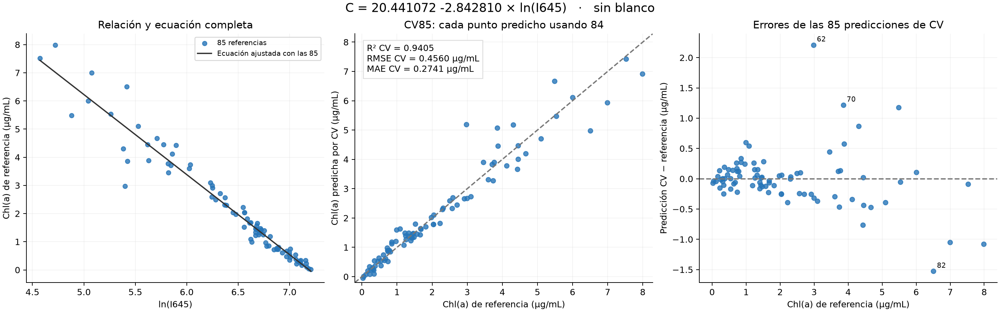
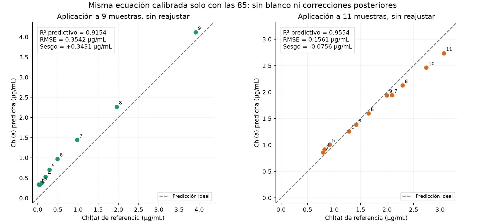
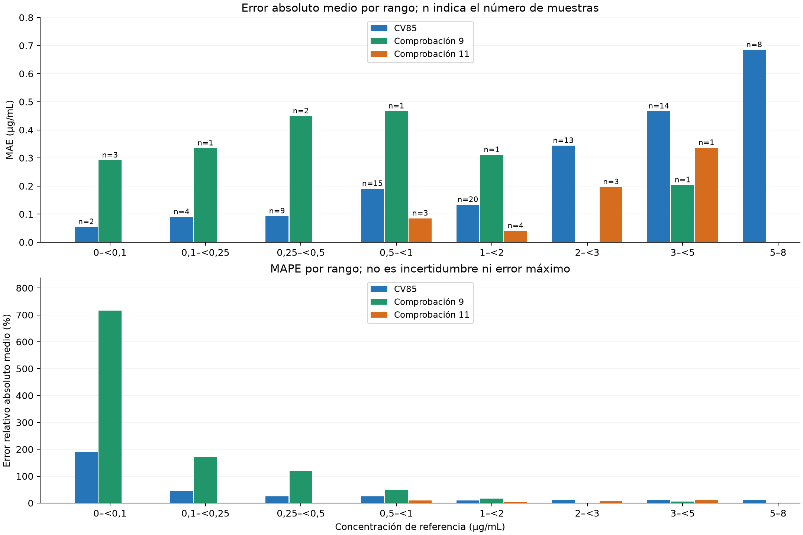

# ln(I645): CV con las 85 y aplicación a las nueve y las once

> Informe histórico de exploración. La decisión vigente es 85 → 9 con blanco; consultar [articulo.md](../articulo.md). Este informe conserva sus resultados originales y no es la guía actual del manuscrito.

Fecha: 18 de octubre de 2026. Nueva etapa solicitada por Alex: se adopta la forma lineal en ln(I645), sin blanco. No se utiliza ND ni se reajusta con las nueve o las once.

## Ecuación fijada con las 85
C (µg/mL) = 20.4410723055 -2.8428103277 × ln(I645).
ln es el logaritmo natural; I645 es la intensidad media suministrada en los Excel. Los coeficientes se ajustan con las 85 muestras completas. Se guarda el modelo antes de abrir los otros dos Excel. Esta ecuación completa no se utiliza para calcular la CV85.

## Validación y comprobaciones
CV85: entrenar con 84 y predecir la omitida, repitiendo 85 veces. Las métricas de las 85 usan únicamente esas predicciones fuera del entrenamiento. La CV se verificó independientemente mediante la identidad de residuos eliminados de regresión lineal.
Comprobaciones 9 y 11: aplicar sin modificación los coeficientes ajustados con las 85. No son CV9 ni CV11. Esos conjuntos ya fueron examinados en la investigación, por lo que se describe una comprobación retrospectiva de transferencia, no una validación prospectiva ciega.
No se corrige por blanco, no se pondera por desviaciones, no se eliminan atípicos y no se recortan predicciones negativas. Se excluyen del conjunto de 85 las filas con solo identificadores, no mediciones completas.

## Errores globales
| Evaluación | n | R² predictivo | RMSE | MAE | Sesgo | Error máximo | MAPE (%) |
|---|---|---|---|---|---|---|---|
| CV85, entrenamiento con 84 por turno | 85 | 0.94052 | 0.45598 | 0.27406 | -0.00003 | 2.20998 | 20.86 |
| Comprobación 9, ecuación fija de 85 | 9 | 0.91539 | 0.35419 | 0.34313 | 0.34313 | 0.48448 | 291.78 |
| Comprobación 11, ecuación fija de 85 | 11 | 0.95539 | 0.15608 | 0.12190 | -0.07564 | 0.33602 | 6.84 |

RMSE, MAE, sesgo y error máximo están en µg/mL. R² predictivo = 1 − Σ(predicción − referencia)² / Σ(referencia − media de referencia)². MAPE = promedio(|predicción − referencia|/referencia) × 100. Sesgo positivo significa sobreestimación.

## Resumen por debajo y por encima de 1 µg/mL
| Evaluación | Rango (µg/mL) | n | RMSE | MAE | Sesgo | Error máximo | MAPE (%) |
|---|---|---|---|---|---|---|---|
| CV85, entrenamiento con 84 por turno | <1 | 30 | 0.18581 | 0.13863 | 0.05580 | 0.60060 | 38.61 |
| CV85, entrenamiento con 84 por turno | >=1 | 55 | 0.55000 | 0.34793 | -0.03049 | 2.20998 | 11.19 |
| Comprobación 9, ecuación fija de 85 | <1 | 7 | 0.37628 | 0.36770 | 0.36770 | 0.48448 | 372.13 |
| Comprobación 9, ecuación fija de 85 | >=1 | 2 | 0.26265 | 0.25713 | 0.25713 | 0.31069 | 10.55 |
| Comprobación 11, ecuación fija de 85 | <1 | 3 | 0.08616 | 0.08480 | 0.08480 | 0.09939 | 10.04 |
| Comprobación 11, ecuación fija de 85 | >=1 | 8 | 0.17524 | 0.13581 | -0.13581 | 0.33602 | 5.65 |

## Errores por intervalos fijos
Los intervalos se definieron antes de evaluar resultados, según la referencia, no según la predicción. Incluyen el extremo inferior y excluyen el superior, excepto el último, que incluye 8. Los guiones significan que no hay muestras, no error cero. Un intervalo con una muestra describe solo esa observación. No se calcula R² por intervalo para evitar interpretar porcentajes de varianza con muy pocos puntos.
El promedio global no se obtiene promediando sin pesos los errores de los intervalos: cada muestra tiene el mismo peso dentro de su evaluación. Los recuentos y la agregación de MAE/RMSE se verifican contra las métricas globales.

### CV85, entrenamiento con 84 por turno
| Rango (µg/mL) | n | RMSE | MAE | Sesgo | Error máximo | MAPE (%) |
|---|---|---|---|---|---|---|
| 0–<0,1 | 2 | 0.05761 | 0.05457 | -0.05457 | 0.07303 | 191.12 |
| 0,1–<0,25 | 4 | 0.10403 | 0.08976 | -0.00484 | 0.14956 | 46.26 |
| 0,25–<0,5 | 9 | 0.12541 | 0.09272 | 0.00066 | 0.24928 | 25.32 |
| 0,5–<1 | 15 | 0.23725 | 0.19041 | 0.11978 | 0.60060 | 24.20 |
| 1–<2 | 20 | 0.17973 | 0.13343 | 0.02196 | 0.54112 | 9.92 |
| 2–<3 | 13 | 0.64910 | 0.34333 | 0.04057 | 2.20998 | 12.84 |
| 3–<5 | 14 | 0.55743 | 0.46637 | 0.01827 | 1.21665 | 11.77 |
| 5–8 | 8 | 0.87778 | 0.68440 | -0.36240 | 1.52669 | 10.63 |

### Comprobación 9, ecuación fija de 85
| Rango (µg/mL) | n | RMSE | MAE | Sesgo | Error máximo | MAPE (%) |
|---|---|---|---|---|---|---|
| 0–<0,1 | 3 | 0.29207 | 0.29163 | 0.29163 | 0.31418 | 715.31 |
| 0,1–<0,25 | 1 | 0.33471 | 0.33471 | 0.33471 | 0.33471 | 171.21 |
| 0,25–<0,5 | 2 | 0.45024 | 0.44882 | 0.44882 | 0.48448 | 120.03 |
| 0,5–<1 | 1 | 0.46664 | 0.46664 | 0.46664 | 0.46664 | 47.74 |
| 1–<2 | 1 | 0.31069 | 0.31069 | 0.31069 | 0.31069 | 15.89 |
| 2–<3 | 0 | — | — | — | — | — |
| 3–<5 | 1 | 0.20356 | 0.20356 | 0.20356 | 0.20356 | 5.21 |
| 5–8 | 0 | — | — | — | — | — |

### Comprobación 11, ecuación fija de 85
| Rango (µg/mL) | n | RMSE | MAE | Sesgo | Error máximo | MAPE (%) |
|---|---|---|---|---|---|---|
| 0–<0,1 | 0 | — | — | — | — | — |
| 0,1–<0,25 | 0 | — | — | — | — | — |
| 0,25–<0,5 | 0 | — | — | — | — | — |
| 0,5–<1 | 3 | 0.08616 | 0.08480 | 0.08480 | 0.09939 | 10.04 |
| 1–<2 | 4 | 0.04266 | 0.04016 | -0.04016 | 0.05611 | 2.46 |
| 2–<3 | 3 | 0.20453 | 0.19660 | -0.19660 | 0.27592 | 8.13 |
| 3–<5 | 1 | 0.33602 | 0.33602 | -0.33602 | 0.33602 | 10.94 |
| 5–8 | 0 | — | — | — | — | — |

## Figuras

## Alcance
La calibración cubre 0,02384–7,98964 µg/mL. Las nueve cubren 0,0244–3,9098 y las once 0,7944–3,07062. Que una señal quede dentro del intervalo de calibración no demuestra transferencia entre tandas ni elimina efectos del protocolo.
Las nueve son diluciones de un mismo extracto madre. La CV85 evalúa la tanda disponible y no constituye por sí sola validación entre sesiones. Se desconoce una agrupación más detallada por extracto madre o día para las 85; no se ha hecho CV agrupada por esos factores.
El MAPE puede crecer mucho cerca de cero. No representa una incertidumbre expandida ni un error máximo garantizado. No se establece un límite de cuantificación a partir del menor punto. No se han preparado extractos, medido lagos ni cambiado el firmware.

## Archivos
modelo_85_fijado.json conserva la ecuación completa previa a las comprobaciones. resultados.json conserva las métricas, los 85 ajustes por turno y la procedencia. predicciones.csv contiene 105 predicciones: 85 de CV y 20 de aplicación fija. errores_por_rango.csv conserva todos los intervalos, incluidos los vacíos. errores_menor_y_mayor_1.csv resume el rango bajo.
Los resultados de esta carpeta son una etapa nueva; no sobrescriben los análisis previos. El documento articulo.md describe la propuesta anterior con ND y necesitará revisión si se incorpora esta nueva elección al manuscrito.
