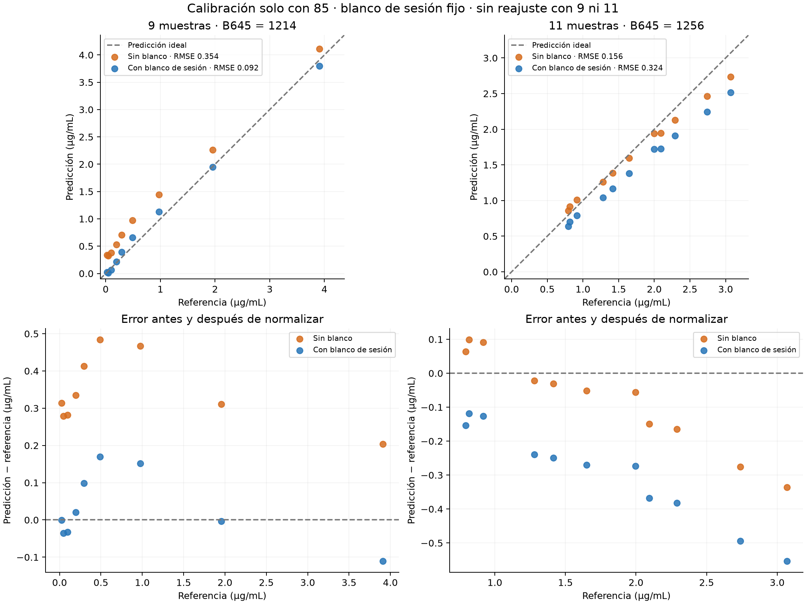
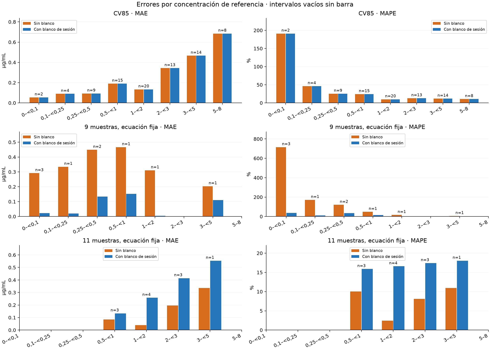

# Calibración ln645 con blanco de sesión: CV85 y transferencia a 9 y 11

> Informe histórico de exploración. La decisión vigente es 85 → 9 con blanco; consultar [articulo.md](../articulo.md). Este informe conserva sus resultados originales y no es la guía actual del manuscrito.

Fecha: 18 de octubre de 2026. Continuación autorizada por Alex para incorporar el blanco; los análisis anteriores se conservan.

## Resultado principal
El blanco mejora mucho las nueve, pero empeora las once. Por tanto, no puede presentarse como una corrección universal entre tandas. En las 85, normalizar con un único blanco constante no cambia ninguna predicción de CV: solo cambia cómo se escribe la ecuación.

## Ecuación y blancos
**C (µg/mL) = -0.0621128959 + 2.8428103277 × ln(B645 / I645).**
I645 es la intensidad media de la muestra y B645 el blanco de su sesión, en las mismas unidades instrumentales y configuración. ln es el logaritmo natural. Se usa cociente, no resta I−B. Ambos valores deben ser positivos y finitos.
Blancos de sesión proporcionados por Alex: 85 → 1356; 9 → 1214; 11 → 1256. No se estiman ni optimizan con las concentraciones de las nueve o las once.
Equivalencia: I equivalente = I645 × 1356/B645; se aplica a esta señal la ecuación sin blanco C = 20,4410723055 − 2,8428103277 × ln(I equivalente). La corrección resultante es un desplazamiento constante por sesión: nueve −0,3144674054 µg/mL; once −0,2177795161 µg/mL.
Cuando I645 = B645, esta ecuación devuelve −0,0621128959 µg/mL, no cero. No se ha forzado el paso por el blanco ni recortado valores negativos: eso sería otro modelo y requeriría evaluarlo por separado.

## Separación entre calibración y comprobaciones
Los dos coeficientes se ajustan solo con las 85 muestras completas. CV85 deja una fuera cada vez: 85 entrenamientos de 84 muestras. Se verifica la CV con la identidad de residuos eliminados de regresión lineal y contra las 85 predicciones sin blanco ya guardadas.
La ecuación completa de las 85 se guarda antes de abrir los Excel de nueve y once. Después se aplica fija a ambos, con sus blancos de sesión. No se añade offset ni pendiente aprendida de sus concentraciones. Esas 20 predicciones no son CV9/CV11.
Como las tandas ya se han explorado y la normalización se evalúa después de observar diferencias, esta comparación es retrospectiva, no validación prospectiva ciega. Las nueve son diluciones de un mismo extracto, no nueve extractos independientes.

## Errores globales
| Grupo | Modelo | n | RMSE | MAE | Sesgo | MAPE (%) |
|---|---|---|---|---|---|---|
| 85 | Sin blanco | 85 | 0.45598 | 0.27406 | -0.00003 | 20.86 |
| 85 | Con blanco de sesión | 85 | 0.45598 | 0.27406 | -0.00003 | 20.86 |
| 9 | Sin blanco | 9 | 0.35419 | 0.34313 | 0.34313 | 291.78 |
| 9 | Con blanco de sesión | 9 | 0.09241 | 0.06937 | 0.02866 | 22.80 |
| 11 | Sin blanco | 11 | 0.15608 | 0.12190 | -0.07564 | 6.84 |
| 11 | Con blanco de sesión | 11 | 0.32363 | 0.29342 | -0.29342 | 16.75 |

RMSE, MAE y sesgo están en µg/mL. Sesgo = promedio(predicción − referencia); MAPE = promedio(|predicción − referencia|/referencia) × 100. R² predictivo, error máximo y recuentos de negativos se incluyen en comparacion_global.csv. No se combinan los tres grupos en una única cifra.

## Por debajo y por encima de 1 µg/mL
| Grupo | Modelo | Rango (µg/mL) | n | RMSE | MAE | Sesgo | MAPE (%) |
|---|---|---|---|---|---|---|---|
| 85 | Sin blanco | <1 | 30 | 0.18581 | 0.13863 | 0.05580 | 38.61 |
| 85 | Sin blanco | >=1 | 55 | 0.55000 | 0.34793 | -0.03049 | 11.19 |
| 85 | Con blanco de sesión | <1 | 30 | 0.18581 | 0.13863 | 0.05580 | 38.61 |
| 85 | Con blanco de sesión | >=1 | 55 | 0.55000 | 0.34793 | -0.03049 | 11.19 |
| 9 | Sin blanco | <1 | 7 | 0.37628 | 0.36770 | 0.36770 | 372.13 |
| 9 | Sin blanco | >=1 | 2 | 0.26265 | 0.25713 | 0.25713 | 10.55 |
| 9 | Con blanco de sesión | <1 | 7 | 0.09603 | 0.07281 | 0.05323 | 28.88 |
| 9 | Con blanco de sesión | >=1 | 2 | 0.07847 | 0.05734 | -0.05734 | 1.51 |
| 11 | Sin blanco | <1 | 3 | 0.08616 | 0.08480 | 0.08480 | 10.04 |
| 11 | Sin blanco | >=1 | 8 | 0.17524 | 0.13581 | -0.13581 | 5.65 |
| 11 | Con blanco de sesión | <1 | 3 | 0.13386 | 0.13298 | -0.13298 | 15.88 |
| 11 | Con blanco de sesión | >=1 | 8 | 0.37053 | 0.35359 | -0.35359 | 17.08 |

## Errores por intervalos fijos
Se conservan los intervalos del análisis anterior, definidos según la referencia. Extremo inferior incluido y superior excluido, excepto el último que incluye 8. — significa que no hay muestras, no error cero. n=1 no permite caracterizar la variabilidad de ese rango. MAPE es muy sensible a referencias pequeñas y no es una incertidumbre ni un error máximo garantizado.

### Grupo 85
| Grupo | Modelo | Rango (µg/mL) | n | RMSE | MAE | Sesgo | MAPE (%) |
|---|---|---|---|---|---|---|---|
| 85 | Sin blanco | 0–<0,1 | 2 | 0.05761 | 0.05457 | -0.05457 | 191.12 |
| 85 | Sin blanco | 0,1–<0,25 | 4 | 0.10403 | 0.08976 | -0.00484 | 46.26 |
| 85 | Sin blanco | 0,25–<0,5 | 9 | 0.12541 | 0.09272 | 0.00066 | 25.32 |
| 85 | Sin blanco | 0,5–<1 | 15 | 0.23725 | 0.19041 | 0.11978 | 24.20 |
| 85 | Sin blanco | 1–<2 | 20 | 0.17973 | 0.13343 | 0.02196 | 9.92 |
| 85 | Sin blanco | 2–<3 | 13 | 0.64910 | 0.34333 | 0.04057 | 12.84 |
| 85 | Sin blanco | 3–<5 | 14 | 0.55743 | 0.46637 | 0.01827 | 11.77 |
| 85 | Sin blanco | 5–8 | 8 | 0.87778 | 0.68440 | -0.36240 | 10.63 |
| 85 | Con blanco de sesión | 0–<0,1 | 2 | 0.05761 | 0.05457 | -0.05457 | 191.12 |
| 85 | Con blanco de sesión | 0,1–<0,25 | 4 | 0.10403 | 0.08976 | -0.00484 | 46.26 |
| 85 | Con blanco de sesión | 0,25–<0,5 | 9 | 0.12541 | 0.09272 | 0.00066 | 25.32 |
| 85 | Con blanco de sesión | 0,5–<1 | 15 | 0.23725 | 0.19041 | 0.11978 | 24.20 |
| 85 | Con blanco de sesión | 1–<2 | 20 | 0.17973 | 0.13343 | 0.02196 | 9.92 |
| 85 | Con blanco de sesión | 2–<3 | 13 | 0.64910 | 0.34333 | 0.04057 | 12.84 |
| 85 | Con blanco de sesión | 3–<5 | 14 | 0.55743 | 0.46637 | 0.01827 | 11.77 |
| 85 | Con blanco de sesión | 5–8 | 8 | 0.87778 | 0.68440 | -0.36240 | 10.63 |

### Grupo 9
| Grupo | Modelo | Rango (µg/mL) | n | RMSE | MAE | Sesgo | MAPE (%) |
|---|---|---|---|---|---|---|---|
| 9 | Sin blanco | 0–<0,1 | 3 | 0.29207 | 0.29163 | 0.29163 | 715.31 |
| 9 | Sin blanco | 0,1–<0,25 | 1 | 0.33471 | 0.33471 | 0.33471 | 171.21 |
| 9 | Sin blanco | 0,25–<0,5 | 2 | 0.45024 | 0.44882 | 0.44882 | 120.03 |
| 9 | Sin blanco | 0,5–<1 | 1 | 0.46664 | 0.46664 | 0.46664 | 47.74 |
| 9 | Sin blanco | 1–<2 | 1 | 0.31069 | 0.31069 | 0.31069 | 15.89 |
| 9 | Sin blanco | 2–<3 | 0 | — | — | — | — |
| 9 | Sin blanco | 3–<5 | 1 | 0.20356 | 0.20356 | 0.20356 | 5.21 |
| 9 | Sin blanco | 5–8 | 0 | — | — | — | — |
| 9 | Con blanco de sesión | 0–<0,1 | 3 | 0.02790 | 0.02284 | -0.02284 | 35.94 |
| 9 | Con blanco de sesión | 0,1–<0,25 | 1 | 0.02024 | 0.02024 | 0.02024 | 10.35 |
| 9 | Con blanco de sesión | 0,25–<0,5 | 2 | 0.13900 | 0.13435 | 0.13435 | 34.23 |
| 9 | Con blanco de sesión | 0,5–<1 | 1 | 0.15218 | 0.15218 | 0.15218 | 15.57 |
| 9 | Con blanco de sesión | 1–<2 | 1 | 0.00377 | 0.00377 | -0.00377 | 0.19 |
| 9 | Con blanco de sesión | 2–<3 | 0 | — | — | — | — |
| 9 | Con blanco de sesión | 3–<5 | 1 | 0.11090 | 0.11090 | -0.11090 | 2.84 |
| 9 | Con blanco de sesión | 5–8 | 0 | — | — | — | — |

### Grupo 11
| Grupo | Modelo | Rango (µg/mL) | n | RMSE | MAE | Sesgo | MAPE (%) |
|---|---|---|---|---|---|---|---|
| 11 | Sin blanco | 0–<0,1 | 0 | — | — | — | — |
| 11 | Sin blanco | 0,1–<0,25 | 0 | — | — | — | — |
| 11 | Sin blanco | 0,25–<0,5 | 0 | — | — | — | — |
| 11 | Sin blanco | 0,5–<1 | 3 | 0.08616 | 0.08480 | 0.08480 | 10.04 |
| 11 | Sin blanco | 1–<2 | 4 | 0.04266 | 0.04016 | -0.04016 | 2.46 |
| 11 | Sin blanco | 2–<3 | 3 | 0.20453 | 0.19660 | -0.19660 | 8.13 |
| 11 | Sin blanco | 3–<5 | 1 | 0.33602 | 0.33602 | -0.33602 | 10.94 |
| 11 | Sin blanco | 5–8 | 0 | — | — | — | — |
| 11 | Con blanco de sesión | 0–<0,1 | 0 | — | — | — | — |
| 11 | Con blanco de sesión | 0,1–<0,25 | 0 | — | — | — | — |
| 11 | Con blanco de sesión | 0,25–<0,5 | 0 | — | — | — | — |
| 11 | Con blanco de sesión | 0,5–<1 | 3 | 0.13386 | 0.13298 | -0.13298 | 15.88 |
| 11 | Con blanco de sesión | 1–<2 | 4 | 0.25834 | 0.25794 | -0.25794 | 16.58 |
| 11 | Con blanco de sesión | 2–<3 | 3 | 0.41820 | 0.41438 | -0.41438 | 17.42 |
| 11 | Con blanco de sesión | 3–<5 | 1 | 0.55380 | 0.55380 | -0.55380 | 18.04 |
| 11 | Con blanco de sesión | 5–8 | 0 | — | — | — | — |

## Gráficas

## Interpretación y límites
En las nueve, la corrección elimina gran parte de la sobreestimación. En las once, donde la predicción sin blanco ya tenía sesgo negativo, desplazarla hacia abajo agrava el error. Los blancos no explican por sí solos todas las diferencias entre estas tandas; estos datos no identifican la causa restante.
El ajuste con ln(B/I) presupone que el blanco sirve para normalizar una variación multiplicativa de la intensidad. Esta comparación prueba su resultado empírico, no demuestra ese mecanismo. La CV85 no valida dicha hipótesis entre sesiones, porque usa el mismo blanco constante en todos sus turnos.
No se dispone de réplicas del blanco para propagar su incertidumbre. Tampoco se establece LOD/LOQ, capacidad en lagos, incertidumbre total o exactitud en sesiones nuevas. Se conserva todo punto completo sin eliminar atípicos ni ponderar por las desviaciones proporcionadas.
No se han cambiado el firmware, la fórmula del equipo ni los .bin. Este es un análisis comparativo, no una nueva calibración desplegada. articulo.md y el ZIP para Daniela son de etapas anteriores y no se han modificado.

## Procedencia y reproducibilidad
Fuentes: calibracion_85_puntos (1).xlsx, Sheet1 A1:D86; 9Samples.xlsx, Sheet1 A1:AL10; 11Samples.xlsx, Sheet1 A1:AL12. Se usan identificador, concentración de referencia e I645. Las filas adicionales con solo identificador en el primer libro no son mediciones. Los tres originales se verifican por SHA-256 y no se modifican.
modelo_85_fijado.json guarda la ecuación y blancos; resultados.json incluye métricas, procedencia y coeficientes de los 85 turnos; predicciones.csv contiene 105 filas con ambas predicciones; comparacion_global.csv tiene 6 evaluaciones; errores_por_rango.csv contiene 48 filas, incluidos intervalos vacíos; errores_menor_y_mayor_1.csv tiene 12 filas.
analisis_blanco.py reproduce el análisis con numpy, openpyxl y matplotlib, reutilizando las funciones de lectura y métricas de la etapa sin blanco. Las comprobaciones verifican entradas, equivalencia algebraica, CV sin fuga del punto omitido, cobertura de rangos, agregación de errores y conservación de originales.
