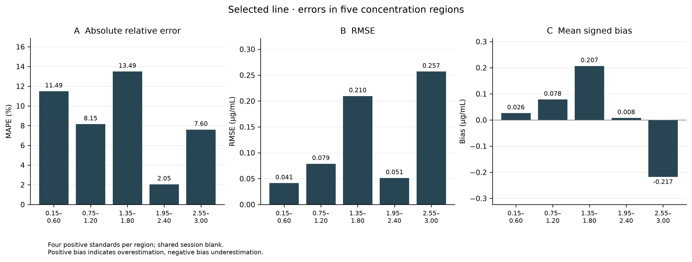
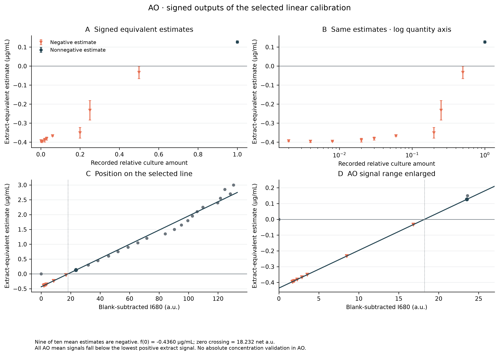

# Dudas resueltas · selección actual lineal 90°/680 nm

**Actualizado el 20 de noviembre de 2026, después de la elección explícita de Alex del modelo lineal global.** El cuadrático queda como comparación histórica. Se conserva el intercepto libre de la recta ya evaluada; no se impone cero ni se ajusta una recta local.

## 1. Error general, error relativo y límites de medición

La validación interna deja fuera cada muestra completa y conserva el blanco de sesión disponible. Las tres adquisiciones se promedian antes de cualquier división. El error relativo con signo es `100 × (predicción − referencia)/referencia`; MAPE promedia su valor absoluto. El blanco cero no tiene error relativo definido.

| Región de referencia (µg/mL) | n | RMSE (µg/mL) | MAPE (%) | Sesgo (µg/mL) |
|---|---:|---:|---:|---:|
| 0.15–3.00 | 20 | 0.1552 | 8.55 | +0.0203 |
| 0.15–0.60 | 4 | 0.0415 | 11.49 | +0.0262 |
| 0.75–1.20 | 4 | 0.0787 | 8.15 | +0.0783 |
| 1.35–1.80 | 4 | 0.2095 | 13.49 | +0.2065 |
| 1.95–2.40 | 4 | 0.0513 | 2.05 | +0.0077 |
| 2.55–3.00 | 4 | 0.2569 | 7.60 | -0.2175 |

**Global:** RMSE 0,1552 µg/mL, MAE 0,1170 µg/mL, MAPE 8,55%, RMSRE 9,88%. El mayor error absoluto LOO es 0,3631 µg/mL. A 0,15 µg/mL, el error relativo es −17,03%. El sesgo medio global de +0,0203 µg/mL no elimina los sesgos por región: entre 1,35–1,80 sobreestima y entre 2,55–3,00 subestima.

[Residuos del lineal](lineal_90_680/resultados/figuras/S02_residuos_lineal.png) · [tabla sin redondear](lineal_90_680/resultados/errores_regiones.csv).

No escribir «error del fluorómetro ±8,55%»: MAPE y RMSE no son intervalos de cobertura ni garantías para una muestra nueva. Describen esta calibración de extracto, con referencias asignadas y blanco compartido; no validan otras preparaciones, días o matrices. Las barras de lectura describen adquisiciones técnicas, no incertidumbre total.

**LOD/LOQ no establecidos.** El intervalo de patrones positivos ensayado es 0,15–3 µg/mL, más blanco. No es automáticamente un intervalo de cuantificación validado. Hay tres archivos de blanco con diez lecturas internas por archivo; no treinta preparaciones independientes. Los dark nulos no acreditan ruido nulo. La raíz de la recta tampoco es una LOD.

Para cerrar los límites, falta medir blancos y niveles bajos con preparaciones independientes, definir criterios de error/precisión y confirmarlos cerca de la LOQ estimada. Es coherente con la [definición de IUPAC](https://goldbook.iupac.org/terms/view/08022) y la [guía Eurachem de 2025](https://www.eurachem.org/images/stories/Guides/pdf/MV_guide_3rd_ed_V1_EN.pdf). La serie baja más densa propuesta en el análisis anterior sigue siendo una propuesta, no un ensayo ejecutado.

## 2. Ecuación más clara sin modificar las predicciones

`C_eq [µg/mL] = -0.436013275475 + 0.023914842025 × (I680 − B680)`.

Con `u = (I680 − B680)/100`, se puede mostrar como **`C_eq ≈ 2.391484u -0.436013` µg/mL**. Escalar la intensidad obliga a transformar también la pendiente; no divide la concentración entre 100. Para calcular, usar los [coeficientes completos](lineal_90_680/resultados/modelo_seleccionado.json).

El redondeo mostrado cambia el resultado menos de 0,00000028 µg/mL entre el blanco y la mayor señal de calibración. Para una recta, el máximo de la diferencia de redondeo se comprueba en los extremos. Convertir a µg/L equivale a multiplicar la concentración en µg/mL por 1000; no altera el signo ni el error relativo.

El blanco de calibración fue 0,8821683333 u.a.; el medio de AO, 0,4940142667 u.a. En AO se conserva la pendiente/intercepto del extracto y se resta el medio de su sesión. Esa aplicación sigue siendo exploratoria.

## 3. Negativos de AO con la recta elegida

**Con el modelo actual hay nueve medias negativas, AO01–AO09.** AO10 da **0,126852 µg/mL equivalentes**. Todas las medias de intensidad neta son positivas. El paso de cuatro negativos del cuadrático a nueve del lineal resulta del cambio de ecuación, no de alterar las mediciones.

El intercepto es `-0.436013` µg/mL y la recta cruza cero a `ΔI = 18.231911` u.a. Por eso una señal positiva menor que ese cruce produce un equivalente negativo. Esa raíz no mide detección o ausencia de clorofila.

[Tabla actual de AO](lineal_90_680/resultados/AO_muestras.csv). Se conservan todos los signos; no se truncan negativos a cero ni se cambia el blanco para conseguir concentraciones positivas. Tampoco se etiqueta «no detectado» o «<LOQ», porque no están demostrados esos resultados.

Las diez señales medias AO quedan entre el blanco y el menor patrón positivo de extracto; no hay patrones positivos que comprueben esa zona baja. El cultivo no tiene referencia absoluta de clorofila. No puede calcularse su error relativo de concentración con estas mediciones.

**Figura principal recomendada:** [respuesta medida de AO](lineal_90_680/resultados/figuras/F3_AO_respuesta_medida.png). La aplicación lineal con signo queda como suplemento. La recomendación de conservar resultados originales con signo para análisis estadístico es coherente con el [Analytical Methods Committee (2001)](https://doi.org/10.1039/B009590G); aquí se identifica además la contribución del intercepto.

## Comparación con el cuadrático y próximos pasos

La recta tiene MAPE global 8,55% frente a 8,68% del cuadrático; su RMSE es mayor, 0,1552 frente a 0,0938 µg/mL. Elegirla no acredita superioridad en todas las regiones ni resuelve la conversión de señales AO bajas.

[Comparación actual con el cuadrático histórico](lineal_90_680/resultados/figuras/S04_lineal_y_cuadratico.png) · [análisis anterior completo, conservado como histórico](dudas_2026-11-20_comparacion_HISTORICO.md). La prueba de cuadrático anclado a cero anterior no es la recta seleccionada.

Queda por medir una serie baja densa con preparaciones independientes, comparar una recta local u otras funciones sencillas con datos nuevos y determinar LOD/LOQ. Si se desea validar concentración absoluta en AO, hará falta una referencia independiente del cultivo. No se han hecho esas mediciones.

## Entrega y reproducción

[Guía para Daniela](00_LEEME_DANIELA.md) · [19 figuras y pies en inglés](lineal_90_680/FIGURAS_Y_PIES.md) · [informe actual](lineal_90_680/INFORME.md).

Para regenerar la entrega actual: `python lineal_90_680/generar_entrega.py`. Los generadores antiguos reproducen sus análisis históricos; sus valores cuadráticos no son la selección actual. No se cambian datos originales ni firmware.
