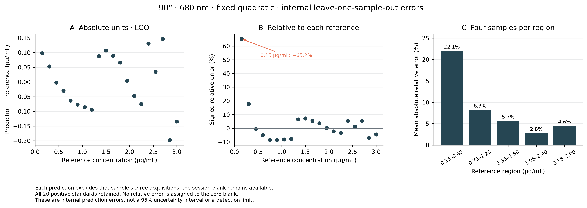
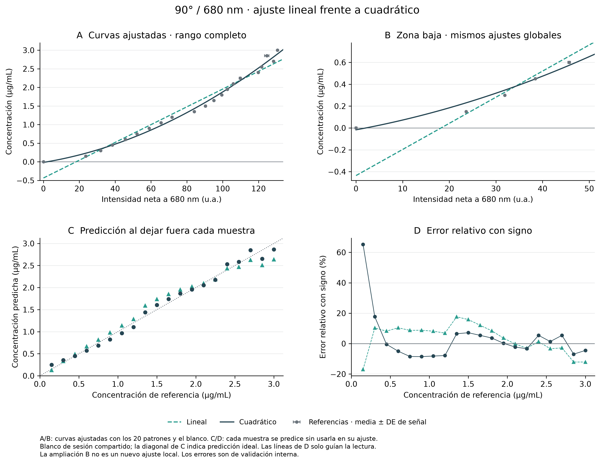
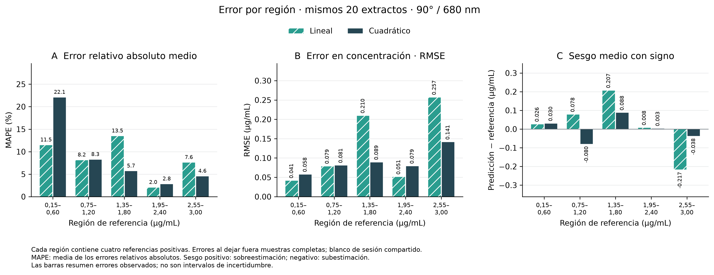
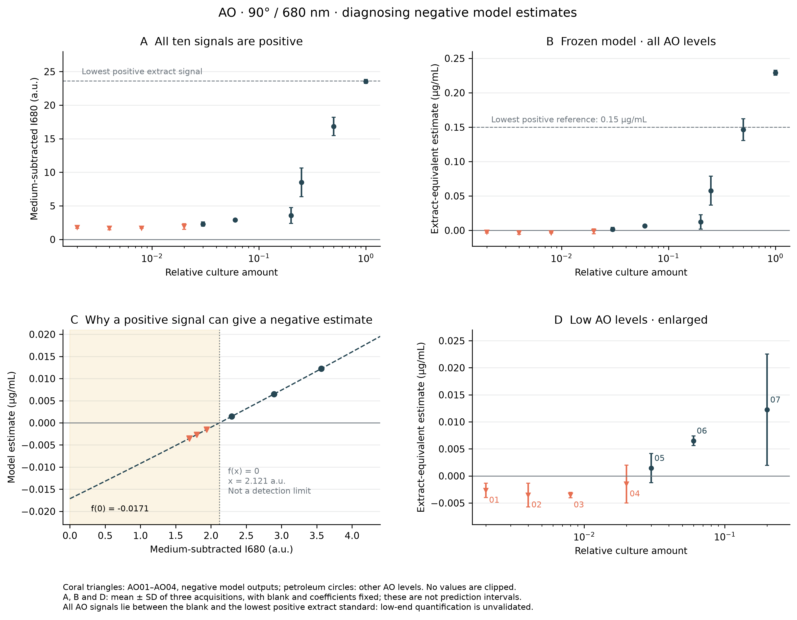
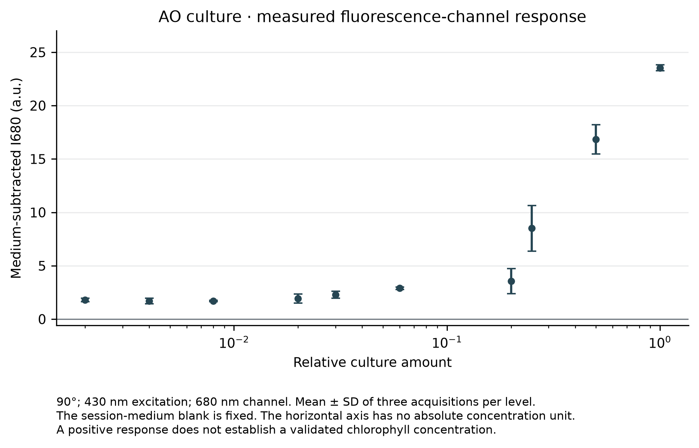

> **Selección vigente desde el 20/11/2026: 90°/680 nm y modelo lineal.** Análisis previo a la selección final explícita del lineal. [Abrir la versión actual](dudas.md).

# Respuestas a las dudas para el paper

**Análisis del 19 de noviembre de 2026.** Configuración seleccionada: **90° / 680 nm**, excitación a 430 nm; en cultivos, solamente **AO**. Se conservan los datos, los coeficientes elegidos y los resultados anteriores. Los cálculos y las figuras de esta revisión están en [resultados/dudas/](resultados/dudas/).

**Ampliación del 20 de noviembre:** comparación gráfica del lineal y el cuadrático y errores de ambos por región, dentro de la sección 1.

| Duda | Respuesta con los datos actuales |
|---|---|
| ¿Qué error tiene? | En extractos, RMSE interno **0,0938 µg/mL** y error relativo absoluto medio **8,68%**. Depende mucho de la región: el punto de 0,15 µg/mL tiene **+65,2%** de error. |
| ¿Se puede presentar mejor la ecuación? | Sí: normalizando la intensidad se obtiene **Ĉ = 1,10942u² + 0,78497u − 0,01715**, con `u = (I680 − B680)/100` para intensidades numéricas en u.a. La concentración sigue en µg/mL. |
| ¿Por qué aparecen concentraciones negativas en AO? | El modelo tiene intercepto negativo y no está obligado a pasar por cero. AO01–AO04 tienen señal neta positiva, pero la ecuación les asigna una estimación negativa. No son concentraciones físicas negativas. |
| ¿Ya hay LOD y LOQ? | **No están establecidos experimentalmente.** El rango de patrones positivos ensayado fue 0,15–3 µg/mL; sus extremos no equivalen a límites de detección o cuantificación validados. |

## 1. Error general, error relativo por región y límites de medición

### Cómo se calculó

Se reutilizó el **cuadrático fijado de 680 nm**, con la resta del blanco de sesión. Se dejó fuera cada una de las 20 muestras de extracto y se reajustó con las demás y el blanco. Las tres adquisiciones de una muestra se promedian antes de dividir los datos: ninguna adquisición de la muestra evaluada entra en su ajuste. Los cálculos reproducen los [errores LOO anteriores](resultados/residuos_correccion_fondo.csv).

Para cada muestra, con concentración asignada de referencia `Cref > 0`:

\[
e_i=\widehat C_{i,\mathrm{LOO}}-C_{i,\mathrm{ref}},\qquad
e_{r,i}(\%)=100\frac{e_i}{C_{i,\mathrm{ref}}}.
\]

El error absoluto es `|eᵢ|`. El **MAPE** promedia `|eᵣ,ᵢ|`; el **RMSRE** es la raíz de la media de los errores relativos al cuadrado y penaliza más los grandes. Ambos son relativos a la referencia de **cada punto**, no al valor máximo del rango. El blanco `Cref = 0` no tiene error relativo definido y no entra en estas métricas.

### Resultados del modelo elegido

| Referencias agrupadas (µg/mL) | n | RMSE (µg/mL) | MAPE (%) | Máximo error relativo absoluto (%) | Sesgo medio (µg/mL) |
|---|---:|---:|---:|---:|---:|
| **Todo: 0,15–3,00** | **20** | **0,0938** | **8,68** | **65,23** | **+0,0006** |
| 0,15–0,60 | 4 | 0,0576 | 22,08 | 65,23 | +0,0298 |
| 0,75–1,20 | 4 | 0,0809 | 8,25 | 8,55 | −0,0801 |
| 1,35–1,80 | 4 | 0,0890 | 5,69 | 7,16 | +0,0878 |
| 1,95–2,40 | 4 | 0,0790 | 2,82 | 5,44 | +0,0031 |
| 2,55–3,00 | 4 | 0,1413 | 4,55 | 6,93 | −0,0377 |

El MAE global es **0,0813 µg/mL** y el RMSRE global **16,04%**. Las regiones reutilizan la agrupación de cuatro patrones consecutivos de la revisión de residuos; no son cinco curvas independientes ni acreditan lo que ocurre en concentraciones no medidas. [Tabla por muestra](resultados/dudas/errores_por_muestra.csv) · [Tabla por región, sin redondear](resultados/dudas/errores_por_region.csv).



[Figura editable SVG](resultados/dudas/01_errores_y_regiones.svg).

**La lectura de los residuos cambia cómo debe comunicarse el error:**

- El sesgo global casi nulo combina regiones con subestimación y otras con sobreestimación. Entre 0,75 y 1,20 µg/mL todos los errores son negativos; entre 1,35 y 1,80 todos son positivos. El error no es una dispersión aleatoria uniforme alrededor de cero.
- A **0,15 µg/mL**, la predicción LOO es **0,24784 µg/mL**: error **+0,09784 µg/mL**, o **+65,23%**. El siguiente patrón, de 0,30 µg/mL, tiene **+17,69%**. La pequeña desviación de las lecturas repetidas no elimina este error de calibración.
- La muestra 19, de 2,85 µg/mL, conserva el mayor error en unidades de concentración: **−0,19741 µg/mL**. Se mantiene en el análisis; no se eliminó para mejorar el resultado.

**Cómo expresarlo en el paper:** «La validación interna dejando fuera muestras completas del modelo cuadrático de 680 nm a 90° produjo un RMSE de 0,0938 µg/mL y un error relativo absoluto medio de 8,68% sobre las 20 referencias positivas. El desempeño dependió de la concentración y mostró sesgos locales, con un error relativo de +65,2% en 0,15 µg/mL».

**No escribir “el fluorómetro tiene un error de ±8,68%” ni “±0,0938 µg/mL”.** MAPE y RMSE no son intervalos de cobertura ni garantizan el error de una muestra nueva. Estas cifras corresponden a la calibración con extracto y sus referencias asignadas, bajo un blanco compartido. No incluyen una caracterización completa de la incertidumbre de la referencia, de preparaciones o días independientes, ni de la transferencia a cultivos. La búsqueda original de todos los candidatos tuvo un RMSE anidado de **0,0990 µg/mL** a 90°; es una evaluación distinta de la selección completa, no el error del cuadrático fijado presentado aquí.

### Comparación gráfica del lineal y el cuadrático — 20 de noviembre

**Sí se probó un ajuste lineal.** La siguiente comparación usa las mismas 20 referencias positivas, el mismo blanco y la misma señal neta de 680 nm. Ambos modelos se ajustan sobre todo el rango; la ampliación de la zona baja no es una recta ajustada solo a esa zona.



[SVG editable de curvas y residuos](resultados/dudas/04_lineal_vs_cuadratico_curvas.svg) · [Predicciones y errores por muestra](resultados/dudas/lineal_vs_cuadratico_muestras.csv).

- **A y B:** ajustes completos y referencias; las barras horizontales son la DE entre tres adquisiciones de intensidad. El lineal es la línea discontinua teal; el cuadrático, la línea continua azul petróleo. B muestra la misma comparación ampliada.
- **C:** predicciones de muestras que no entraron en su propio ajuste, frente a su referencia. La diagonal corresponde a una predicción ideal.
- **D:** errores relativos de esas predicciones. Un valor positivo significa sobreestimación y uno negativo, subestimación. Ninguno de los dos presenta residuos uniformemente dispersos alrededor de cero.



[SVG editable de errores por región](resultados/dudas/05_lineal_vs_cuadratico_regiones.svg) · [Tabla completa sin redondear](resultados/dudas/lineal_vs_cuadratico_regiones.csv).

| Región de referencia (µg/mL) | MAPE lineal (%) | MAPE cuadrático (%) | RMSE lineal (µg/mL) | RMSE cuadrático (µg/mL) |
|---|---:|---:|---:|---:|
| 0,15–0,60 | **11,49** | 22,08 | **0,0415** | 0,0576 |
| 0,75–1,20 | **8,15** | 8,25 | **0,0787** | 0,0809 |
| 1,35–1,80 | 13,49 | **5,69** | 0,2095 | **0,0890** |
| 1,95–2,40 | **2,05** | 2,82 | **0,0513** | 0,0790 |
| 2,55–3,00 | 7,60 | **4,55** | 0,2569 | **0,1413** |
| **Global: 0,15–3,00** | **8,55** | 8,68 | 0,1552 | **0,0938** |

Cada región contiene cuatro muestras; la fila global, veinte. El MAPE representa el error relativo **absoluto** medio y no permite ver su signo; por eso la figura también muestra el sesgo. El blanco no entra en los errores relativos.

**Interpretación:**

1. **El cuadrático no gana en todas las regiones.** En el grupo bajo, el MAPE pasa de 22,08% con el cuadrático a 11,49% con el lineal. En el primer patrón, de 0,15 µg/mL, los errores son +65,23% y −17,03%, respectivamente.
2. **El lineal también tiene un patrón de sesgo claro.** Entre 1,35 y 1,80 µg/mL sobreestima en promedio +0,2065 µg/mL; entre 2,55 y 3,00 subestima −0,2175 µg/mL. Estas desviaciones aumentan su RMSE global.
3. **La elección depende de la métrica y del uso.** Los MAPE globales son muy parecidos: 8,55% frente a 8,68%. La preferencia original por el cuadrático se apoya en el RMSE global menor, 0,0938 frente a 0,1552 µg/mL. Eso no acredita una mejor exactitud en todas las concentraciones.
4. **La zona baja merece una calibración específica.** Este resultado justifica comparar una recta local y otras opciones sencillas con una serie baja más densa. Aquí no se ha ajustado ni validado una recta local, ni se han combinado tramos escogiendo retrospectivamente el mejor modelo de cada región.

Se comprobaron de nuevo ambos ajustes y sus predicciones contra los resultados originales y mediante reajustes explícitos dejando fuera cada muestra. La elección de coeficientes se mantiene; no se volvió a buscar entre todos los modelos ni se alteraron datos o referencias.

### Qué límite de medición se puede declarar

Se puede declarar **“intervalo de concentraciones de referencia ensayado: 0,15–3 µg/mL, más blanco”**. No se ha demostrado todavía un intervalo de cuantificación con un criterio de exactitud e incertidumbre definido. Tampoco se ha comprobado el comportamiento por encima de 3 µg/mL.

**No hay una cifra defendible de LOD o LOQ del método con esta serie.** Hay tres archivos de blanco con diez lecturas internas por archivo, no treinta preparaciones independientes. Los dark nulos tampoco demuestran ruido o límite de detección nulos. Además, no hay patrones positivos por debajo de 0,15 µg/mL que comprueben allí la relación señal–concentración. Aplicar el polinomio actual al blanco incluso produce un valor negativo, como se explica abajo.

La [definición de LOQ de IUPAC](https://goldbook.iupac.org/terms/view/08022) exige cumplir un criterio de aptitud para el uso; por ello, ni el punto más bajo ni la raíz de la ecuación bastan para establecerlo.

**Medición que falta para cerrarlo:** una serie específica de blancos y muestras de baja concentración, con preparaciones independientes, matriz y protocolo definidos. La [guía Eurachem de 2025, sección 5.3 y cuadro de referencia 4](https://www.eurachem.org/images/stories/Guides/pdf/MV_guide_3rd_ed_V1_EN.pdf) propone diez determinaciones para estimar la variación próxima a cero, considerar la resta de blanco y el promedio de réplicas, y confirmar el desempeño cerca de la LOQ calculada. Su cuadro incluye una confirmación con cinco determinaciones. No sustituir esas determinaciones por cinco lecturas consecutivas de la misma preparación.

Como diseño para nuestro próximo ensayo, propongo blanco y **0,01; 0,025; 0,05; 0,075; 0,10; 0,125; 0,15; 0,20; 0,25 y 0,30 µg/mL**, manteniendo puntos medios y altos para comprobar continuidad. Son niveles propuestos, no un resultado ya medido. Fijar antes el error relativo y la precisión admisibles; comprobarlos en muestras nuevas. Una curva por tramos puede evaluarse, pero solo se justifica si mejora las predicciones nuevas y no únicamente la apariencia del ajuste.

## 2. Ecuación de calibración más clara, sin cambiar el modelo

Definimos `ΔI = I680 − B680`, con intensidades en u.a. Los [coeficientes originales completos](resultados/coeficientes.json) del cuadrático seleccionado son:

\[
\widehat C = -0.01714639608308932
+0.007849688918047307\,\Delta I
+0.00011094242466074308\,(\Delta I)^2,
\]

con `Ĉ` en µg/mL. Los números pequeños se deben en parte a la escala de la intensidad. Definiendo una variable sin unidad,

\[
u=\frac{I_{680}-B_{680}}{100\,\mathrm{u.a.}},
\]

la **misma ecuación**, antes de redondear, queda:

\[
\widehat C = 1.1094242466074308\,u^2
+0.7849688918047307\,u
-0.01714639608308932
\quad[\mathrm{\mu g/mL}].
\]

**Versión recomendada para mostrar en el paper:**

\[
\boxed{\widehat C\simeq1.10942\,u^2+0.78497\,u-0.01715
\quad[\mathrm{\mu g/mL}].}
\]

La transformación sin redondeo conserva las predicciones hasta precisión numérica. El redondeo mostrado cambia la concentración como máximo **0,00000939 µg/mL** entre el blanco y la mayor intensidad neta de calibración, 130,4903 u.a. Se comprobó también el extremo del polinomio de diferencia para no depender solo de una malla de prueba. Es un efecto despreciable frente al RMSE interno de 0,0938 µg/mL. Para calcular, conservar los coeficientes completos.

**Dividir la intensidad entre 100 no divide las concentraciones entre 100:** los coeficientes se transforman simultáneamente. Por ejemplo, AO10 tiene `ΔI = 23,5362444`, por tanto `u = 0,235362444`; la ecuación completa da **0,22906289 µg/mL equivalentes**, y la redondeada **0,22905931**.

El blanco de calibración fue **0,88216833 u.a.** En AO se usó el blanco de medio de su sesión, **0,49401427 u.a.**, manteniendo los mismos coeficientes. Ese cambio de matriz y referencia debe acompañar la ecuación cuando se aplique a cultivos. Si se desean µg/L, multiplicar el resultado en µg/mL por **1000**: es una conversión de unidad que conserva el signo y el error relativo.

Esta presentación arregla la legibilidad. **No corrige el sesgo del extremo bajo ni constituye un modelo nuevo.**

## 3. Valores negativos en AO: causa, figura y tratamiento

### Qué ocurre en los datos

Estas son las cuatro medias con estimaciones negativas:

| Muestra | Intensidad neta ΔI680 (u.a.) | Ĉ equivalente (µg/mL) | DE de Ĉ entre tres adquisiciones (µg/mL) |
|---|---:|---:|---:|
| AO01 | +1,799623 | −0,002661 | 0,001333 |
| AO02 | +1,693763 | −0,003533 | 0,002190 |
| AO03 | +1,693763 | −0,003533 | 0,000502 |
| AO04 | +1,940770 | −0,001494 | 0,003506 |

Las cuatro señales están **por encima del medio sin algas**. El origen inmediato del signo negativo es matemático: el ajuste tiene **f(0) = −0,0171464 µg/mL** y su raíz positiva está en **ΔI = 2,120774 u.a.** Para señales entre cero y esa raíz predice concentraciones negativas. Incluir el blanco como punto de ajuste no obligó al intercepto a valer cero.

**La raíz de 2,120774 u.a. no es un límite de detección.** Es donde este polinomio cruza cero. Cambiar al blanco original tampoco elimina el problema: con ese blanco, las cinco primeras medias AO darían resultados negativos. No hay base para elegir un blanco distinto solo para conseguir valores positivos.



[Figura editable SVG](resultados/dudas/02_AO_negativos.svg) · [Tabla completa de AO y comprobación con anclaje a cero](resultados/dudas/AO_diagnostico.csv).

La figura separa cuatro hechos: **A**, todas las señales netas son positivas; **B**, la ecuación produce cuatro medias negativas; **C**, el intercepto y la raíz explican el signo; **D**, la ampliación permite ver las medias bajas y sus desviaciones. Las barras describen adquisiciones con blanco y coeficientes fijos; **no son intervalos de incertidumbre total**. Las cantidades relativas se muestran en eje horizontal logarítmico para distinguir los niveles bajos; la concentración y la intensidad permanecen en ejes verticales lineales.

### Hasta dónde es válida la conversión

**Las diez medias AO tienen una intensidad neta inferior a la del menor patrón positivo de extracto**, 23,606818 u.a. AO10 queda apenas un 0,30% por debajo y su DE de lectura alcanza esa señal de referencia. Nueve resultados calculados son inferiores a 0,15 µg/mL; AO10 da 0,229 µg/mL. Clasificar AO10 como cuantificado válidamente solo porque su resultado supera 0,15 sería incorrecto.

Hay una distinción matemática: como el blanco también entró en el ajuste, las medias AO caen entre el blanco y el primer patrón positivo. No están fuera del intervalo total de intensidades incluyendo el blanco; están en una **zona sin patrones positivos que respalden la cuantificación del extremo bajo**. No debe confundirse esa situación con una extrapolación más allá de todas las intensidades medidas.

El propio primer extracto, cuya referencia es 0,15 µg/mL, da **0,22999** al aplicar el ajuste completo. Esto explica que una señal parecida, AO10, se transforme en **0,22906**: la cercanía entre esas dos salidas es numérica, y no demuestra cuál es la concentración real de AO10. Su referencia absoluta no se ha medido.

### ¿Un ajuste obligado a pasar por cero lo arregla?

**Arregla el signo en estas muestras, pero no valida sus concentraciones.** Como comprobación adicional reajusté únicamente un cuadrático sin intercepto, usando las mismas referencias y validación dejando fuera muestras completas:

\[
\widehat C_0=1.1360066\,u^2+0.7392332\,u
\quad[\mathrm{\mu g/mL}].
\]

| Comparación interna | Cuadrático actual | Cuadrático obligado a C(0) = 0 |
|---|---:|---:|
| RMSE LOO (µg/mL) | 0,09379 | 0,09239 |
| MAPE (%) | 8,68 | 8,46 |
| Predicción LOO del patrón 0,15 µg/mL | 0,24784 | 0,24204 |
| Error relativo en ese patrón (%) | +65,23 | +61,36 |

El modelo anclado es creciente y no negativo para `ΔI ≥ 0`, y sus diez salidas AO son positivas. Sin embargo, mantiene un error superior al 60% en el primer patrón. La pequeña mejora global **no demuestra buen desempeño por debajo de 0,15 ni justifica reemplazar automáticamente el modelo**. Esta es una sensibilidad de un candidato revisado con estos datos, no una nueva selección validada externamente. [Predicciones LOO de ambos modelos](resultados/dudas/comparacion_anclaje_cero.csv).

No se modificaron los coeficientes elegidos ni las tablas AO anteriores. Tampoco se sumó una constante a todas las salidas ni se sustituyeron negativos por cero: ambas operaciones alterarían los resultados sin resolver la calibración.

### Qué figura y qué texto usar

**Para la figura principal de AO recomiendo mostrar la respuesta neta a 680 nm contra la cantidad relativa registrada.** Responde directamente a lo que se midió y conserva la información de los niveles bajos. La figura nueva está lista en [PNG](resultados/dudas/03_AO_respuesta_recomendada.png) y [SVG editable](resultados/dudas/03_AO_respuesta_recomendada.svg).



**Pie propuesto en inglés:** “Medium-subtracted response at 680 nm for ten AO culture levels measured at 90° with 430 nm excitation. Points and error bars represent the mean and standard deviation of three acquisitions per level, with a fixed session-medium blank. Relative culture amounts are those recorded in the source table and are shown on a logarithmic horizontal axis. These measurements describe the fluorescence-channel response; absolute culture chlorophyll concentrations were not independently determined.”

Para documentar la aplicación del modelo, conservar los valores con signo en la tabla y usar la figura diagnóstica como suplemento. Identificarlos como **estimaciones equivalentes sin cuantificación validada en el extremo bajo**. No poner “ausencia de clorofila”, “no detectado” o “<LOQ” como sustitutos: los datos actuales no establecen esos resultados. La recomendación de conservar los resultados originales con signo para su evaluación estadística es coherente con el [Analytical Methods Committee, *Analyst* (2001)](https://doi.org/10.1039/B009590G); aquí, además, se ha identificado el efecto específico del intercepto del modelo.

**Texto propuesto para el análisis:** «AO presentó una respuesta positiva respecto al medio a 680 nm. La aplicación exploratoria de la calibración de extracto produjo cuatro estimaciones equivalentes negativas debido al intercepto del ajuste. Todas las medias de señal AO quedaron entre el blanco y el menor patrón positivo; por tanto, estas estimaciones no se interpretaron como concentraciones físicas negativas ni como cuantificación validada de clorofila en el cultivo».

## Qué queda cerrado y qué requiere nuevas mediciones

- **Resuelto con los datos existentes:** error interno global y por regiones; definición del error relativo; expresión normalizada y efecto del redondeo; identificación y explicación de los cuatro negativos; prueba de anclaje a cero y recomendación de figuras.
- **Requiere experimento:** LOD/LOQ del método; mejora y validación del extremo bajo; incertidumbre entre preparaciones/días; error de concentración en AO mediante una referencia independiente si se desea validar la cuantificación absoluta. Los resultados de extracto no proporcionan ese error de AO.

## Trazabilidad y reproducción

Los resultados numéricos completos, coeficientes normalizados, blancos y huellas de las fuentes están en [resumen.json](resultados/dudas/resumen.json). El análisis usa los lectores originales de ZIP y referencia, comprueba las predicciones contra los resultados entregados y contrasta la validación rápida con reajustes explícitos por muestra.

Para regenerar solamente los archivos de esta revisión, ejecutar desde esta carpeta, con las [dependencias del análisis](requirements.txt):

```bash
python resolver_dudas.py
```

El ZIP del 16 de noviembre y su manifiesto siguen como entrega fechada anterior a esta revisión; no contienen estos archivos nuevos. No se modificaron datos fuente, resultados anteriores ni firmware.
