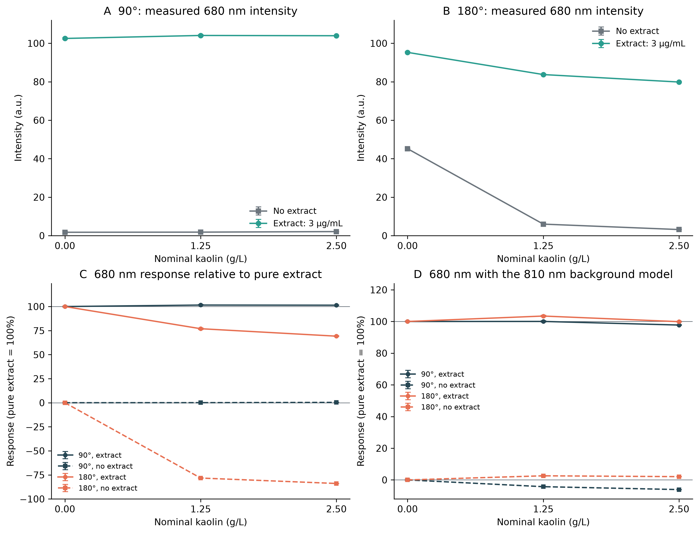

> **Selección vigente desde el 20/11/2026: 90°/680 nm y modelo lineal.** Las observaciones de señal con caolín se conservan; la selección actual de concentración es lineal. [Abrir la versión actual](../../lineal_90_680/INFORME.md).

# Extracto con partículas de caolín: elección de geometría

Análisis: 15 de noviembre de 2026. Los nombres de los dark indican adquisiciones del 10 de noviembre.

## Conclusión para estas muestras

**Elegiría 90° y 680 nm como señal principal de fluorescencia del extracto en presencia de caolín.** Es la combinación que conserva la respuesta con menos tratamiento: las mezclas cambian aproximadamente +1,4–1,5% y el caolín sin extracto produce solo +0,07–0,35% de la respuesta del extracto puro. **180° aporta información complementaria sobre el fondo y la atenuación**, pero la resta convencional del blanco no conserva la respuesta a caolín constante: la señal neta de 680 cae aproximadamente 23–31%. Una resta de fondo escalada mediante un canal auxiliar mejora mucho esa estabilidad en este ensayo. Es una opción para desarrollar, sin sustituir todavía la elección más sencilla de 90°.

## Diseño y fuentes

Se lee `../kaolin+extracto.zip`, que contiene 36 espectros (seis preparaciones × tres adquisiciones × dos geometrías) y dos dark. Los 38 CSV coinciden exactamente con la carpeta extraída, que se conserva intacta. Cada espectro guarda media, DE y n=10 por canal; las diez lecturas originales no están presentes. Las tres adquisiciones se tratan como repeticiones de lectura de una preparación; no hay tres preparaciones independientes documentadas.

Alex confirma el mismo LED azul de 430 nm y los mismos ajustes de ganancia e integración entre 90° y 180°. Confirma agitación antes de cada lectura; el tiempo entre agitación y medición no fue especificado. Los valores numéricos de los ajustes, corriente y volumen realmente medido en la cámara no están incluidos en estos CSV.

| Preparación | Clorofila nominal (µg/mL) | Caolín nominal (g/L) | Composición indicada |
|---|---:|---:|---|
| Etanol | 0 | 0 | Etanol sin extracto ni caolín |
| Extracto puro | 3 | 0 | Extracto sin caolín |
| Caolín b | 0 | 1,25 | 0,1 g en 80 mL de etanol |
| Caolín a | 0 | 2,50 | 0,1 g en 40 mL de etanol |
| Extracto + caolín b | 3 | 1,25 | 0,1 g en 80 mL del extracto |
| Extracto + caolín a | 3 | 2,50 | 0,1 g en 40 mL del extracto |

Las dos mezclas conservan nominalmente 3 µg/mL de clorofila: cambiar 40 por 80 mL de un mismo extracto no cambia esa concentración. Las cargas de caolín son masa/volumen de preparación, no una medida de NTU/FNU ni de material efectivamente suspendido. Esto es un contraste factorial de dos matrices (con/sin extracto) y tres cargas, **no una nueva calibración de concentración**. No se entrenan clasificadores ni regresiones de clorofila con solo los niveles 0 y 3.

## Qué se compara

Sea B el etanol, E el extracto puro, K el caolín en etanol y EK la mezcla con la misma carga. Se calculan por canal: F₀=E−B; P=K−B; D=EK−B; Fₖ=EK−K; e interacción H=EK−K−E+B. D/F₀ mide conservación de la respuesta con blanco habitual; Fₖ/F₀ compara la contribución asociada a añadir extracto frente a un control de partículas. **Fₖ es un contraste entre preparaciones, no fluorescencia pura corregida:** la absorción, dispersión u otras interacciones pueden cambiar al añadir extracto.

Se muestran medias y DE entre tres adquisiciones. Para diferencias de medias se calcula EE por suma de varianzas s²/3, tratando los grupos como no emparejados; el índice de réplica no acredita un emparejamiento. En carga cero se cancela la covarianza del control compartido: la interacción es exactamente cero, sin error artificial. Estas dispersiones describen repetibilidad de lectura, no incertidumbre de preparación ni confianza sobre muestras ambientales.

## 680 nm: respuesta a extracto y efecto de partículas

| Geometría | Preparación | Media (u.a.) | DE de tres adquisiciones |
|---|---|---:|---:|
| 90° | blanco_etanol | 1.764 | 0.428 |
| 90° | extracto_puro | 102.508 | 0.401 |
| 90° | kaolin_b | 1.835 | 0.122 |
| 90° | kaolin_a | 2.117 | 0.000 |
| 90° | extracto+kaolin_b | 104.061 | 0.461 |
| 90° | extracto+kaolin_a | 103.919 | 0.162 |
| 180° | blanco_etanol | 45.202 | 0.280 |
| 180° | extracto_puro | 95.274 | 0.280 |
| 180° | kaolin_b | 5.999 | 0.266 |
| 180° | kaolin_a | 3.176 | 0.000 |
| 180° | extracto+kaolin_b | 83.735 | 0.382 |
| 180° | extracto+kaolin_a | 79.854 | 0.220 |

La tabla siguiente expresa respuestas normalizadas: etanol=0 y extracto puro=100. Los porcentajes **no son concentraciones recuperadas ni exactitud de concentración**. Un valor negativo en un control significa supresión del fondo, no una falsa fluorescencia positiva.

| Geometría e indicador | Caolín b (%) | Caolín a (%) | Mezcla b (%) | Mezcla a (%) |
|---|---:|---:|---:|---:|
| 90°, I680 con blanco habitual | 0.07 | 0.35 | 101.54 | 101.40 |
| 180°, I680 con blanco habitual | -78.29 | -83.93 | 76.96 | 69.20 |

A 90°, la señal neta del extracto sin caolín es 100,744 u.a. y permanece casi igual con partículas. A 180° es 50,072 u.a.; pasa a 38,533 y 34,652 u.a. usando el mismo blanco de etanol. La intensidad absoluta de los controles de caolín a 680 nm baja de 45,202 (etanol) a 5,999 y 3,176 u.a. Por tanto, la configuración de 180° no está midiendo solo una emisión sobre fondo constante.

Restar el control de caolín de igual carga da a 180° contrastes de 77,737 y 76,678 u.a., frente a 50,072 sin partículas: alrededor de 155 y 153%. Esa aparente mejora tras restar K **no demuestra que la fluorescencia aumente un 55%**. El fondo que llega al detector ya cambia por efecto del extracto y de las partículas. A 90°, el mismo contraste se conserva en aproximadamente 101,5 y 101,1%.

## El canal 730 revela por qué 180° es informativo, pero ambiguo

A 90°, 730 nm aumenta de 2,432 u.a. en etanol a 110,509 en extracto puro; el caolín sin extracto queda en 4,054–5,405 y las mezclas en 114,266–117,374. Es una segunda banda roja compatible con el extracto, algo más sensible al caolín que 680 nm.

A 180°, el etanol da 226,937 u.a. y el extracto puro 170,561: la respuesta neta es negativa (−56,376). Sin embargo, las mezclas dan 103,401 y 96,672, muy por encima de los controles de caolín de 22,459 y 9,729. El contraste asociado a extracto cambia de signo y llega a +80,943 y +86,943 u.a. Esto es compatible con una señal roja del extracto superpuesta a un fondo grande que se atenúa. La caída de 730 nm en extracto puro no bastaba para concluir ausencia de una contribución fluorescente. Tampoco este ensayo identifica por sí solo cuánto corresponde a emisión, transmisión u otras interacciones.

En los canales azules, 90° sí aporta información de las partículas: 435 nm aumenta de 781,988 u.a. en etanol a 1836,030 y 2368,112 con caolín sin extracto, mientras 680 nm queda casi al nivel del blanco. A 180°, 460 nm cae desde 7687,402 hasta 509,902 y 201,963. Estas respuestas complementan el rojo como diagnóstico de interacción con partículas; no representan por sí solas turbidez calibrada. No es necesario dividir la señal roja estable de 90° por un canal azul que cambia con las partículas para aprovechar esa información.

## Corrección multicanal sencilla: prueba exploratoria

Se prueba `Sⱼ = I680 − βⱼ·Iⱼ`, con `βⱼ = B680/Bⱼ`. Cada coeficiente se obtiene **solo del etanol**, sin ajustar los valores de las mezclas. La hipótesis es que una parte del fondo de 680 nm cambia proporcionalmente al canal auxiliar. Se revisan 460, 645, 705, 730, 760, 810, 860, 900 y 940 nm, y se conservan todos los resultados, sin presentar el mínimo encontrado como validación independiente. Esta hipótesis no equivale a una corrección física de filtro interno ni demuestra que el canal auxiliar esté libre de emisión.

Como ejemplo explícito a 180°: `S810 = I680 − 0.239205582·I810`. S810 es aproximadamente 77,076 u.a. para extracto puro, 79,721 para la mezcla b y 76,987 para la a. Se normaliza con el mismo extracto puro para comparar estabilidad de respuesta.

| Geometría, fondo escalado con 810 nm | Caolín b (%) | Caolín a (%) | Mezcla b (%) | Mezcla a (%) |
|---|---:|---:|---:|---:|
| 90° | -4.27 | -6.10 | 100.03 | 97.75 |
| 180° | 2.60 | 2.07 | 103.43 | 99.88 |

A 180°, esta corrección conserva la respuesta del extracto en aproximadamente 103,4 y 99,9%, y deja residuos de caolín de 2,6 y 2,1% de la señal de referencia. Es una mejora clara frente al blanco fijo y apoya estudiar la información conjunta emisión/fondo. A 90° no hace falta: el canal 680 solo ya tiene menor interferencia, y la corrección con 810 añade sesgo en los controles. 860 nm da residuos incluso menores a 180° en esta serie, pero está fuertemente cuantizado; no se declara óptimo por tener DE cero. 810 nm se muestra como ejemplo interpretable; la banda auxiliar definitiva necesita otra serie independiente.

La normalización anterior usa el extracto de 3 µg/mL de esta misma sesión. No valida una ecuación C(S), la transferencia de los coeficientes a otras concentraciones, ni que no exista compensación fortuita entre una disminución de emisión y un aumento de luz parásita. Faltan varios niveles no nulos de clorofila cruzados con varias cargas de partículas para resolverlo.

## Qué ocurre con cocientes y predictores del ensayo anterior

Se revisan I680/I730, I680/I705, I680/I810, I730/I705, ln(I810) y ln(I645), además de los canales rojos directos. Los resultados están en `diagnosticos.csv`. Los cocientes se calculan en cada adquisición antes de promediar, sin coeficientes aprendidos de las mezclas. No se presupone que dividir por un canal compense la dispersión: el denominador también puede responder al caolín.

Especialmente, **ln(I810), buen predictor de las diluciones puras a 180°, no es específico de clorofila en esta matriz**: con caolín sin clorofila su respuesta normalizada equivale a aproximadamente 267 y 369% de la del extracto puro. Las mezclas quedan en 266 y 303%. No deben presentarse como concentraciones calculadas, pero sí muestran que un ajuste excelente en diluciones puras puede confundir atenuación por partículas con pigmento.

## Comparación entre sesiones

El extracto nominal de 3 µg/mL de esta sesión tiene una respuesta neta a 680 nm menor que el extremo de 3 µg/mL de la calibración anterior. No se identifica aquí si cambió la muestra, su conservación, el blanco, la alineación u otro factor. La confirmación de ajustes iguales se refiere a 90° frente a 180° en este ensayo. Por eso las ecuaciones anteriores no se aplican como calibraciones de concentración ya validadas a estas mezclas.

| Geometría | ΔI680 serie anterior | ΔI680 extracto actual | Cambio (%) |
|---|---:|---:|---:|
| 90° | 130.490 | 100.744 | -22.8 |
| 180° | 69.903 | 50.072 | -28.4 |

## Elección de figura para el paper

**Usaría `figuras/01_figura_principal.svg`**, con cuatro paneles. A–B enseñan las lecturas reales de 680 nm con y sin extracto en cada geometría. C cuantifica el efecto del caolín con el blanco habitual. D muestra qué mejora la resta de fondo escalada con 810 nm, aplicando la misma fórmula en ambas geometrías. Así la figura no oculta la interferencia original ni presenta una corrección exploratoria como fluorescencia aislada. Barras: DE entre tres adquisiciones; en C–D la DE se escala por la diferencia entre las medias del extracto puro y del etanol, tratando esa referencia como fija para el gráfico. No incluye su incertidumbre compartida.

**Segunda figura, si hay espacio:** `02_canales_rojos_y_contrastes.svg`, por la inversión de signo de 730 nm y el efecto de restar controles con igual caolín. Sus paneles superiores muestran media±DE; los inferiores, contrastes de medias±EE propagado. Las dos láminas `03_18_canales_90.svg` y `03_18_canales_180.svg` quedarían como material suplementario. No usaría una nueva recta concentración–intensidad: solo hay una concentración no nula de clorofila.

### Suggested English caption

Effect of nominal kaolin loading on the optical response of chlorophyll extracts under 430 nm excitation. Extract-containing preparations had a nominal chlorophyll a concentration of 3 µg/mL; matched no-extract controls contained ethanol. Kaolin loadings were 0, 1.25 and 2.50 g/L. (A, B) Measured 680 nm intensities in the 90° and 180° configurations. (C) Ethanol-referenced 680 nm response, normalized to the pure-extract response in each configuration. (D) Exploratory background-scaled proxy S810 = I680 − (B680/B810)I810, normalized in the same way; B denotes the ethanol reference. Coefficients were derived from ethanol measurements, not fitted to mixture values. Symbols and error bars show means and standard deviations of three acquisitions. Reference means are treated as fixed when scaling error bars. Normalized responses are not concentration recoveries. The background-scaling assumption and transfer to other pigment concentrations require independent testing.

## Límites y siguiente prueba decisiva

Los datos apoyan una elección operativa para este extracto etanólico, estas cargas y estas sesiones. Ambas geometrías distinguen las mezclas de sus controles a 3 µg/mL; no se estima sensibilidad/especificidad de clasificación con ellas. Las geometrías se adquirieron sucesivamente y las condiciones por bloques; la agitación reduce pero no cuantifica la sedimentación. Faltan tiempo de espera, blancos intercalados y preparaciones independientes. No se mide clorofila disuelta después del contacto con caolín; no se separan óptica, adsorción o cambios químicos. No hay turbidez en NTU/FNU, validación en agua natural ni serie de varias concentraciones con caolín. Se retienen anomalías: 410/435 nm a 180° se excluyen por el blanco próximo a 2³²; 485 se excluye en ambas geometrías por inestabilidad. Ambos dark son cero; no acreditan ausencia de ruido.

La prueba siguiente más informativa sería cruzar varias concentraciones de extracto, incluida una baja, con las mismas cargas de caolín y preparaciones independientes. Registrar un tiempo fijo tras agitar. Comparar 90°/680 con 180°/S810 usando coeficientes bloqueados antes de ver las nuevas mezclas y referencias analíticas de clorofila. Hasta entonces: 90° para la señal principal; 180° como vía complementaria de diagnóstico y desarrollo multicanal.

## Archivos y reproducción

Ejecutar `python3 analizar_kaolin.py` desde `kaolin/`, con NumPy y Matplotlib. Se regeneran exclusivamente los resultados de esta carpeta. Para comparar sesiones se lee también `../../resultados/medias.csv` desde el informe, correspondiente al análisis previo de extractos puros.

- `preparaciones.csv`: composiciones nominales.
- `adquisiciones.csv` (648 filas) y `medias.csv` (216): datos y banderas.
- `contrastes.csv` (108): efectos, interacciones y errores estándar.
- `diagnosticos.csv` (34): canales, cocientes y nueve restas de fondo por geometría.
- `coeficientes_fondo.csv`: todos los coeficientes obtenidos del etanol.
- `comparacion_entre_sesiones.csv`: extracto puro nominal de 3 µg/mL.
- `resumen.json`, `inventario_fuentes.csv` y `trazabilidad.json`: resultados sin redondeo, fuentes y confirmaciones de Alex.
- `figuras/`: PNG a 300 dpi y SVG editables.

## Contexto bibliográfico

Las partículas pueden modificar tanto la excitación como la luz que recibe el detector, y las correcciones dependen del instrumento y de la matriz: [guía USGS de fluorescencia de pigmentos](https://pubs.usgs.gov/publication/tm1D10/full). Un ejemplo experimental con clorofila constante y arcilla es [Puiu et al., 2015](https://doi.org/10.3390/s150614415). Estos trabajos justifican evaluar la interferencia; no validan la fórmula S810 de este instrumento. La interpretación y elección anteriores se basan en los controles medidos aquí.