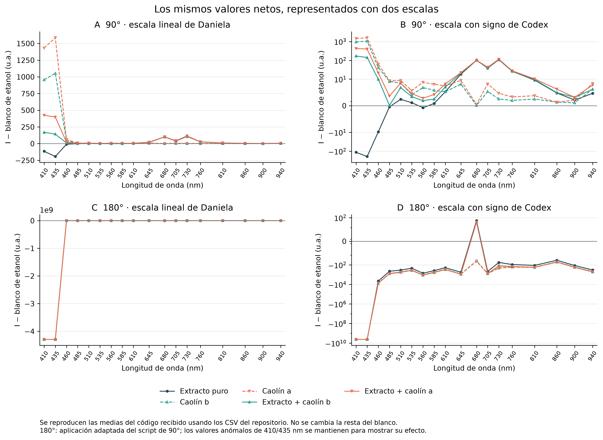

# Revisión del código de Daniela

15 de noviembre de 2026. Archivo recibido: `codifgo de daniela/plot90°.py`.

## Resultado principal

**Con los CSV del repositorio, las medias y la resta del blanco coinciden con nuestro análisis.** La diferencia máxima encontrada es 2,27 × 10⁻¹³ u.a., correspondiente al redondeo numérico. Se compararon las seis preparaciones y las 18 longitudes de cada geometría: 216 medias y sus 216 señales netas.

La diferencia visible más clara es la escala: Daniela usa logaritmo para los espectros originales (línea 150), pero deja **escala lineal para los corregidos** (líneas 158–185). Nuestra última figura utiliza una escala logarítmica con signo después de restar el blanco. Con los mismos números, esto cambia mucho la forma y la altura aparentes de las curvas.

## Qué hace el código y qué se comprobó

El script lee los CSV de una carpeta de Windows a 90°, reconoce seis grupos por nombre de archivo, elimina ciertos valores, calcula media y DE entre adquisiciones y genera cinco figuras. La resta corregida es `media_muestra − media_etanol`: la misma que usamos en la vista de cuatro paneles.

Se ejecutaron las secciones originales de lectura, agrupación, medias y porcentajes, redirigiendo únicamente `RUTA` hacia los archivos locales. Se omitió la importación de gráficos en esa ejecución. Se conservaron las fórmulas originales y se obtuvieron tres adquisiciones por grupo. Las medias, DE y señales netas se contrastaron con `kaolin/resultados/medias.csv`.

Solo se ha recibido **un archivo, `plot90°.py`**. La comprobación a 180° aplica su misma lógica a los CSV de 180° del repositorio: no acredita que Daniela utilizara ese procedimiento ni esos mismos archivos en su ordenador. No se recibieron sus imágenes o tablas finales.

| Geometría | Preparación | Intensidad a 680 nm | Intensidad − etanol | Resultado de ambos procedimientos |
|---|---|---:|---:|---|
| 90° | Extracto puro | 102,508 | 100,744 | Coincide |
| 90° | Extracto + caolín b | 104,061 | 102,296 | Coincide |
| 90° | Extracto + caolín a | 103,919 | 102,155 | Coincide |
| 180° | Extracto puro | 95,274 | 50,072 | Coincide en la reproducción adaptada |
| 180° | Extracto + caolín b | 83,735 | 38,533 | Coincide en la reproducción adaptada |
| 180° | Extracto + caolín a | 79,854 | 34,652 | Coincide en la reproducción adaptada |

## Diferencias de representación

La figura siguiente usa exactamente las mismas señales netas en ambas columnas. Se muestra el mismo conjunto de cinco grupos de la figura corregida de Daniela; el etanol, cuya resta consigo mismo es cero, se representa mediante la línea de referencia.

- Izquierda: escala lineal utilizada por Daniela en su figura 2.
- Derecha: escala con signo utilizada en nuestra vista espectral.
- Arriba: 90°. Abajo: aplicación del procedimiento a 180°.

Las curvas no tienen las mismas alturas aparentes porque los ejes son diferentes. La escala logarítmica comprime las señales grandes y hace visibles las pequeñas. En la escala con signo se conservan los valores negativos.

Daniela añade bandas de dispersión; nuestra última vista muestra solamente las medias. Además, omite el etanol en la figura corregida, mientras que nuestra vista lo incluye como curva cero. Su mapa de calor y su figura de porcentajes terminan en 800 nm: no muestran 810, 860, 900 y 940 nm. Sus espectros completos sí incluyen las 18 longitudes.

## Hallazgos que conviene corregir antes de interpretar porcentajes

### 1. El filtro por igualdad exacta no detecta el blanco anómalo de 180°

**Dónde:** líneas 13 y 65–68.

El código sustituye únicamente el valor exacto `4294967296.0`. Los seis valores anómalos de los blancos de 180° son `4294967296.000001`. La lectura con pandas conserva esa diferencia de aproximadamente 9,54 × 10⁻⁷; por tanto, **ninguno de los seis se elimina**.

En la aplicación a 180°, la resta del blanco produce aproximadamente −4,29 × 10⁹ en 410 y 435 nm. Con escala lineal, esos valores comprimen visualmente el resto del espectro casi hasta cero. Esta es una consecuencia comprobada con los archivos locales. No ocurre a 90°, cuyos espectros no contienen esos valores.

**Corrección mínima propuesta:** detectar valores próximos a 2³² mediante una tolerancia absoluta explícita, por ejemplo `np.isclose(valor, 2**32, rtol=0, atol=1e-3)`, conservar su marca de calidad y excluirlos de cálculos interpretativos. El valor anómalo no demuestra por sí solo saturación óptica. Un canal sin blanco válido no debe presentarse como corregido de forma válida.

### 2. Los porcentajes de la consola y de las figuras usan bases diferentes

**Dónde:** líneas 119–125 frente a 201–216 y 275–282.

La consola calcula `100·(1 − mezcla_raw/extracto_raw)`. Las figuras 3 y 5 calculan `100·[1 − (mezcla−blanco)/(extracto−blanco)]`. Son magnitudes distintas cuando el blanco no es despreciable.

| Geometría, 680 nm | Mezcla | «Atenuación» de consola, raw (%) | «Atenuación» de figuras, neta (%) |
|---|---|---:|---:|
| 90° | a | −1,38 | −1,40 |
| 90° | b | −1,51 | −1,54 |
| 180°, reproducción adaptada | a | 16,19 | 30,80 |
| 180°, reproducción adaptada | b | 12,11 | 23,04 |

En nuestro informe se expresa conservación de respuesta neta, que equivale a `100 − atenuación_neta`: por ejemplo, −1,40% de reducción equivale a 101,40% de conservación. Esos resultados concuerdan.

**Corrección mínima propuesta:** usar una misma definición en consola y figuras, indicando si se trabaja con intensidad original o neta. No interpretar un porcentaje calculado sobre un extracto de señal neta negativa como una reducción de fluorescencia. A 90°/435 nm, por ejemplo, el extracto neto es negativo y las mezclas son positivas: el porcentaje no mide una pérdida de emisión fluorescente.

### 3. Las etiquetas añaden un segundo signo menos

**Dónde:** líneas 215–218.

La etiqueta se construye con `f'-{pct:.0f}%'`. Si el porcentaje ya es negativo, aparece un doble signo. Con los datos actuales de 90°, la mezcla a en 680 nm genera `--1%` y la mezcla a en 730 nm genera `--6%`. No son etiquetas claras de atenuación ni de aumento.

**Corrección mínima propuesta:** definir si la etiqueta expresa reducción o cambio de señal y formatear el signo una sola vez. Por ejemplo, para un cambio de señal se puede calcular `100·(mezcla_neta/extracto_neto − 1)` y mostrarlo con `f'{cambio:+.1f}%'`, siempre que la referencia neta sea adecuada para esa interpretación.

## Otros tratamientos que no explican la diferencia actual

- Línea 68: sustituye las intensidades cero por valores ausentes antes de promediar. **Ninguna de las 648 medias de adquisición de muestra/blanco de este ensayo es cero**, así que ese paso no cambia los resultados actuales. Si aparecen ceros reales en otra serie, eliminarlos podría elevar las medias.
- Línea 246: el mapa de calor convierte valores ausentes en cero. En esta reproducción no cambió ninguna celda, pero ocultaría la ausencia de datos si el filtro de valores anómalos funcionara y produjera valores ausentes. Cero y dato no válido deberían distinguirse.
- La DE se calcula entre las tres adquisiciones, igual que en nuestro análisis. Las bandas combinadas de la figura corregida usan `sqrt(DE_muestra² + DE_blanco²)`; describen una dispersión combinada, no el error estándar de una diferencia de medias. Para este último, con tres adquisiciones por grupo, se dividiría por √3 bajo la hipótesis de grupos independientes.

## Veredicto

**La lectura y la resta del blanco son coherentes a 90° con los archivos locales.** No encuentro un desacuerdo numérico en ese paso. La forma distinta del espectro se explica por las escalas y otros detalles de representación.

Antes de usar los porcentajes para concluir atenuación, conviene corregir 2 y 3. Antes de reutilizar el script a 180°, también 1. El análisis mantiene la observación previa: a 90°/680 nm, las mezclas dan una respuesta neta aproximadamente 1,4–1,5% mayor que el extracto puro; esto es estabilidad de respuesta a este nivel nominal, no una validación de concentración.

No se modificó el código original de Daniela ni los análisis previos. No se comprobó su ejecución histórica en Windows, sus versiones de librerías, sus imágenes ni que sus CSV sean idénticos a las copias del repositorio.

## Evidencia guardada

- `comparacion_valores.csv`: 216 medias, DE y señales netas de ambos procedimientos, con sus diferencias.
- `porcentajes_y_etiquetas.csv`: fórmulas raw/neta y etiquetas originales reproducidas.
- `reproduccion_lectura.txt`: salida de las secciones de lectura y cálculo del código recibido.
- `verificacion.json`: huella del archivo original, versiones utilizadas y alcance de la reproducción.
- `comparacion_escalas.png` y `.svg`: comparación visual con la paleta de Alex.
