# Figuras y pies para Daniela · selección lineal 90°/680 nm

20 de noviembre de 2026. F1–F3: propuestas principales; S01–S16: material complementario.
Las figuras F1, S01–S05 y S06–S10 son nuevas. Las siete figuras restantes describen mediciones y se conservan sin cambiar sus datos.
Paleta: azul petróleo, teal, amarillo, coral y gris. En las comparaciones de modelos nuevas, petróleo identifica la recta elegida y teal el cuadrático histórico.

## F1_calibracion_lineal · Extract calibration · 90° / 680 nm · selected linear model

[PNG](resultados/figuras/F1_calibracion_lineal.png) · [SVG editable](resultados/figuras/F1_calibracion_lineal.svg)

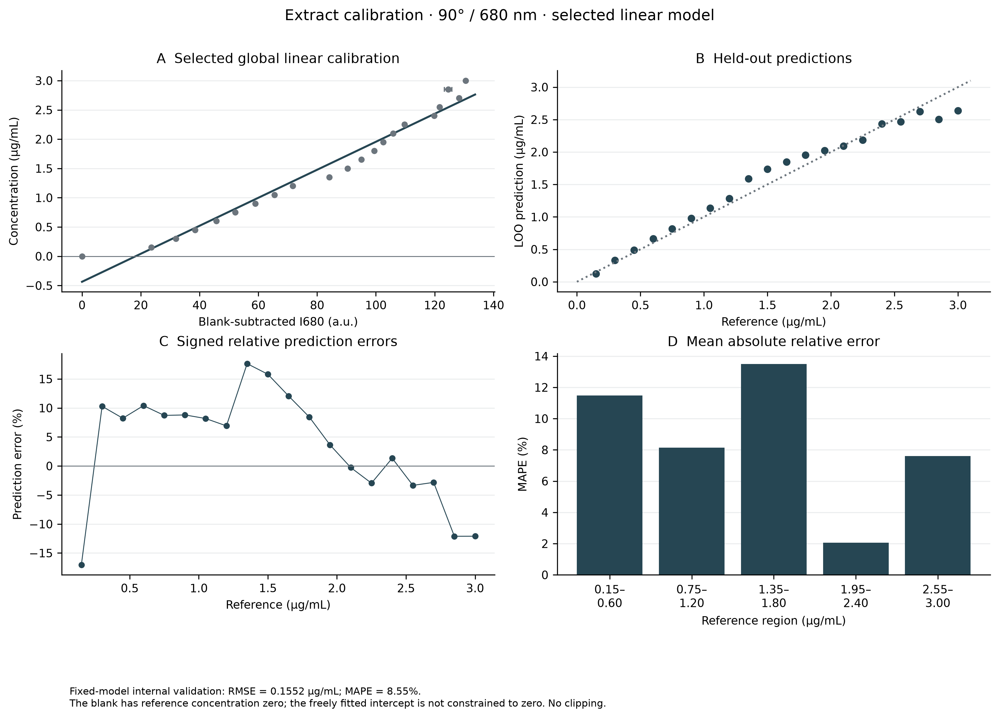

**Caption:** Linear extract calibration selected by Alex on 20 November 2026. (A) Mean net intensities and their acquisition SD, with the global concentration-on-signal fit including the measured zero-reference blank. (B) Leave-one-sample-out concentration predictions. (C) Signed relative errors. (D) MAPE in five groups of four reference levels. Each held-out unit is a complete sample; the session blank remains available. Residual structure persists.

## F2_caolin_geometrias · Kaolin response · 90° and 180°

[PNG](resultados/figuras/F2_caolin_geometrias.png) · [SVG editable](resultados/figuras/F2_caolin_geometrias.svg)

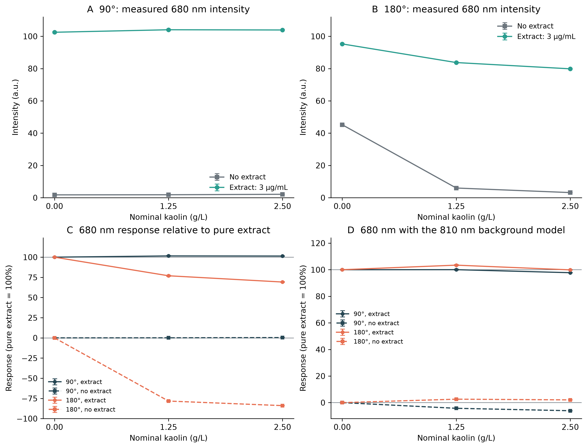

**Caption:** Measured 680 nm intensities and normalized responses with and without kaolin. The 810 nm correction is exploratory. Response percentages are not concentration recoveries.

## F3_AO_respuesta_medida · AO culture · 90° / 680 nm · measured response

[PNG](resultados/figuras/F3_AO_respuesta_medida.png) · [SVG editable](resultados/figuras/F3_AO_respuesta_medida.svg)

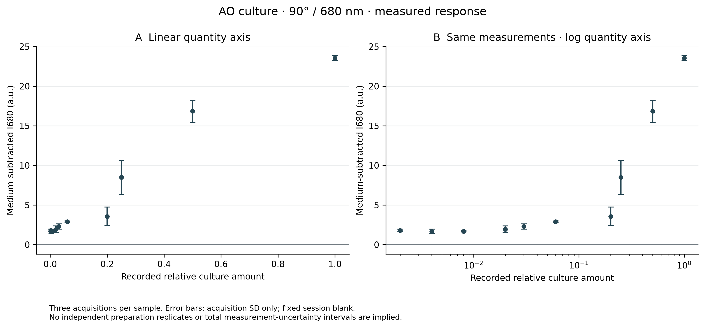

**Caption:** Medium-subtracted 680 nm response from ten recorded relative AO culture levels at 90° under 430 nm excitation. Linear and logarithmic horizontal axes show the same means and acquisition SD. The medium blank is fixed. Chlorophyll concentrations of the cultures were not determined independently; the horizontal axis has no absolute concentration unit.

## S01_curva_y_zona_baja · Selected linear calibration · full range and low-end enlargement

[PNG](resultados/figuras/S01_curva_y_zona_baja.png) · [SVG editable](resultados/figuras/S01_curva_y_zona_baja.svg)

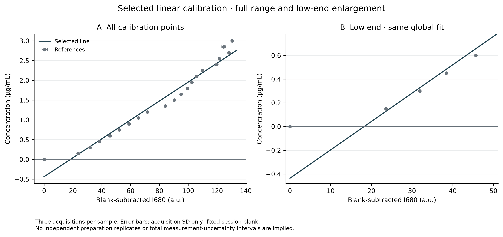

**Caption:** The same global linear calibration is shown over the full measured range and enlarged at the low end. Gray points include the measured zero-reference blank. Horizontal error bars show acquisition SD. The enlargement is not a locally refitted line. The freely fitted intercept is negative.

## S02_residuos_lineal · Selected line · residual diagnostics

[PNG](resultados/figuras/S02_residuos_lineal.png) · [SVG editable](resultados/figuras/S02_residuos_lineal.svg)

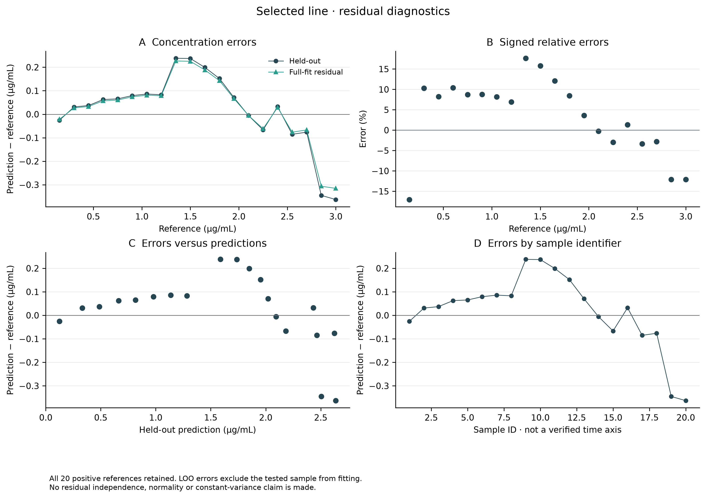

**Caption:** Full-fit and held-out concentration errors are distinguished. The lower-right panel follows sample identifiers and does not establish measurement chronology. Local bias persists; a near-zero global average must not be interpreted as absence of bias. Shared references and the session blank limit independence assumptions.

## S03_errores_por_region · Selected line · errors in five concentration regions

[PNG](resultados/figuras/S03_errores_por_region.png) · [SVG editable](resultados/figuras/S03_errores_por_region.svg)

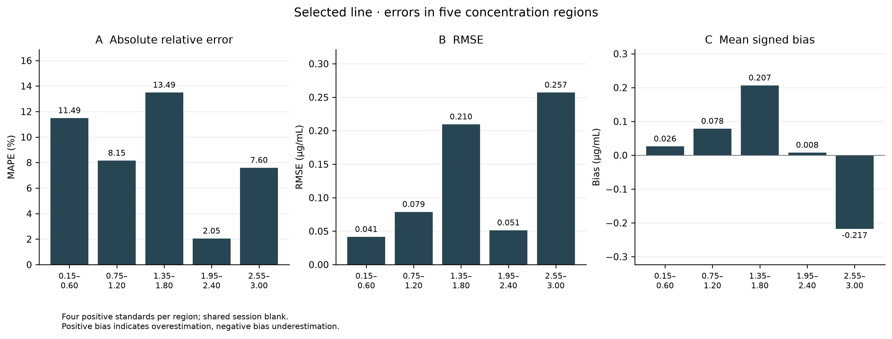

**Caption:** Internal held-out errors of the selected line in five groups of four consecutive references: MAPE, RMSE and mean signed bias. The blank is excluded from relative errors. Bars summarize observed errors and are not uncertainty intervals.

## S04_lineal_y_cuadratico · Selected line and historical quadratic · transparent model comparison

[PNG](resultados/figuras/S04_lineal_y_cuadratico.png) · [SVG editable](resultados/figuras/S04_lineal_y_cuadratico.svg)

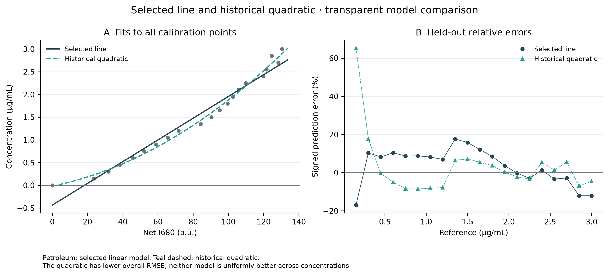

**Caption:** The selected line is compared with the previously studied quadratic on the same references and held-out splits. Selection of the line is an explicit operational choice, not a claim that it minimizes RMSE. Both retain structured errors.

## S05_repetibilidad_y_error · Reading repeatability does not represent total calibration error

[PNG](resultados/figuras/S05_repetibilidad_y_error.png) · [SVG editable](resultados/figuras/S05_repetibilidad_y_error.svg)

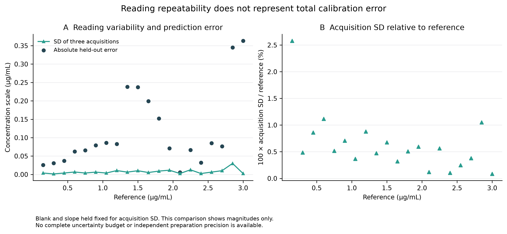

**Caption:** Variation among three acquisitions is mapped to the concentration scale using the fixed slope and contrasted with held-out prediction errors. These are distinct quantities: acquisition SD is not uncertainty of the sample mean or a prediction interval. Relative SD is divided by the assigned reference.

## S06_AO_conversion_lineal · AO · signed outputs of the selected linear calibration

[PNG](resultados/figuras/S06_AO_conversion_lineal.png) · [SVG editable](resultados/figuras/S06_AO_conversion_lineal.svg)

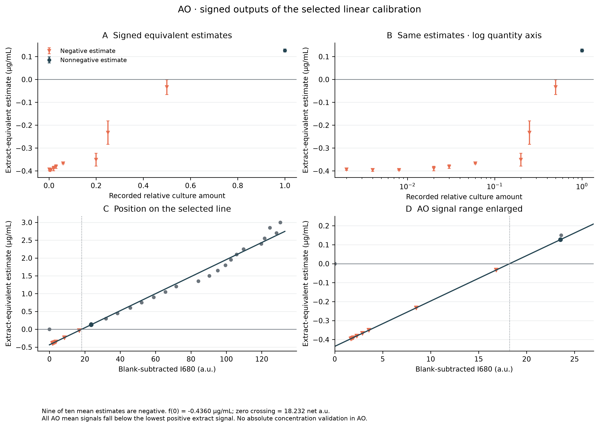

**Caption:** Exploratory application of the selected extract line to AO using its session-medium blank. Nine mean outputs are negative and all ten lie below 0.15 µg/mL. Negative values are retained; they are model estimates, not physical negative concentrations. The zero crossing is a property of the line and is not a detection limit. Error bars describe acquisition SD with fixed blank and coefficients.

## S07_AO_espectros_18_canales · AO · all 18 channels · all ten culture levels

[PNG](resultados/figuras/S07_AO_espectros_18_canales.png) · [SVG editable](resultados/figuras/S07_AO_espectros_18_canales.svg)

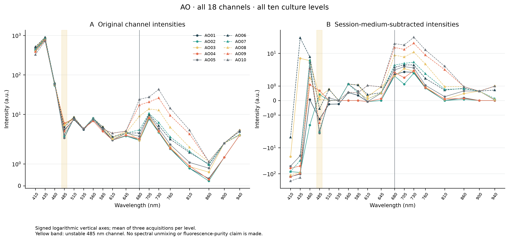

**Caption:** Original and medium-subtracted channel spectra for all ten AO levels at 90°. Colors and markers distinguish levels in both panels. Signed logarithmic axes preserve negative differences. The 485 nm band is flagged as unstable and is retained for traceability; 680 nm is the selected analysis channel.

## S08_blancos_680 · 680 nm reference readings · calibration and AO sessions

[PNG](resultados/figuras/S08_blancos_680.png) · [SVG editable](resultados/figuras/S08_blancos_680.svg)

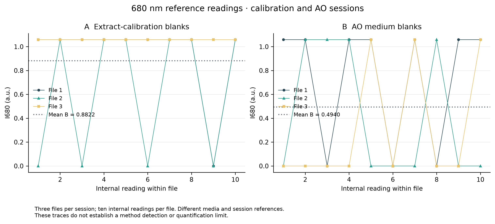

**Caption:** Ten internal readings from each of three blank files in the extract-calibration and AO-medium datasets. Dotted lines indicate the session means used in subtraction. These files do not represent thirty independent blank preparations and do not establish a method LOD or LOQ.

## S09_transferencia_entre_series · Between-series response comparison at nominal 3 µg/mL

[PNG](resultados/figuras/S09_transferencia_entre_series.png) · [SVG editable](resultados/figuras/S09_transferencia_entre_series.svg)

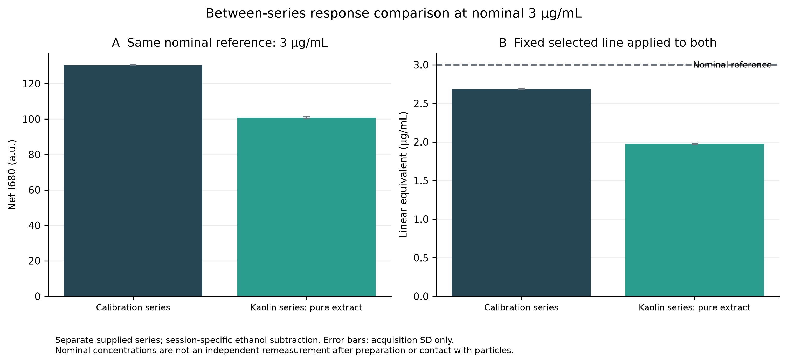

**Caption:** The highest extract reference of the calibration series and pure extract of the kaolin series have the same nominal concentration but different net responses. Fixed-line outputs are shown as a transfer sensitivity check. The differences do not identify a cause or establish independently measured concentration recovery.

## S10_caolin_equivalentes_lineales · Kaolin series · selected 90° / 680 nm line applied without refitting

[PNG](resultados/figuras/S10_caolin_equivalentes_lineales.png) · [SVG editable](resultados/figuras/S10_caolin_equivalentes_lineales.svg)

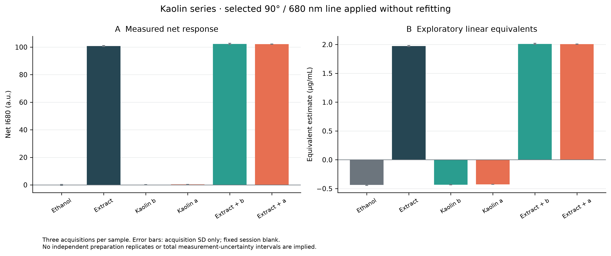

**Caption:** Measured net responses and corresponding fixed-line equivalent estimates for all six kaolin-series preparations at 90°. Negative outputs for controls are retained. These are transfer calculations, not validated concentration recoveries; the nominal chlorophyll-containing preparations were supplied at 3 µg/mL. Acquisition SD holds the ethanol reference and slope fixed.

## S11_caolin_rojos · Kaolin · red-channel contrasts

[PNG](resultados/figuras/S11_caolin_rojos.png) · [SVG editable](resultados/figuras/S11_caolin_rojos.svg)

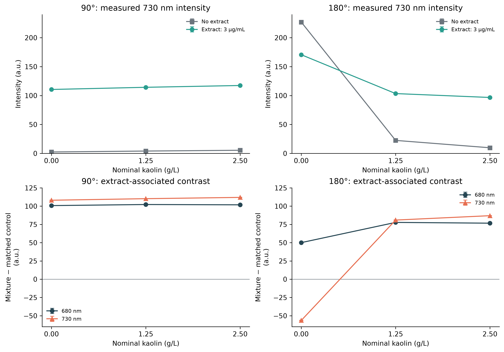

**Caption:** Red-channel signals and matched contrasts across kaolin loadings. Contrasts show measured response differences and do not isolate pure chlorophyll fluorescence.

## S12_caolin_espectros · Kaolin · all wavelengths, original and blank-subtracted

[PNG](resultados/figuras/S12_caolin_espectros.png) · [SVG editable](resultados/figuras/S12_caolin_espectros.svg)

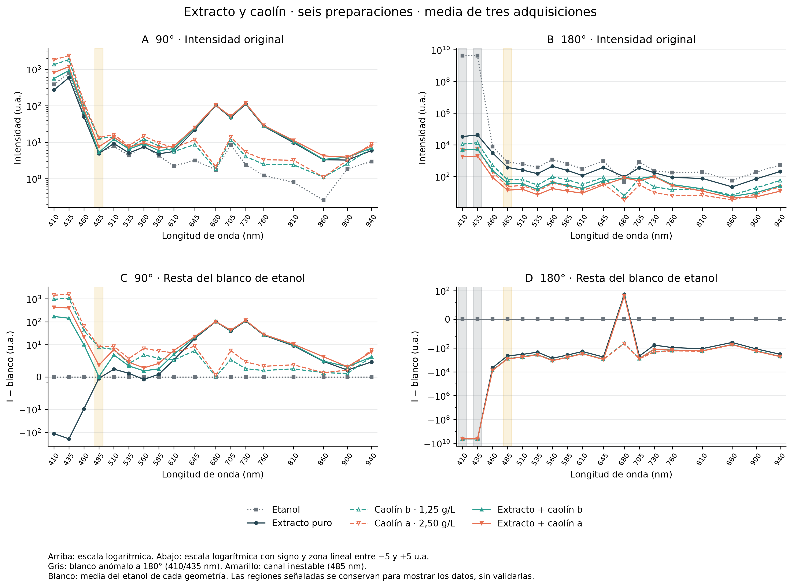

**Caption:** All six preparations and 18 channels, with 90° on the left and 180° on the right. Original spectra are above and ethanol-subtracted spectra below. Flagged bands remain visible. Signed logarithmic scaling is identified on the figure.

## S13_caolin_18_canales_90 · Kaolin · 18-channel review at 90°

[PNG](resultados/figuras/S13_caolin_18_canales_90.png) · [SVG editable](resultados/figuras/S13_caolin_18_canales_90.svg)

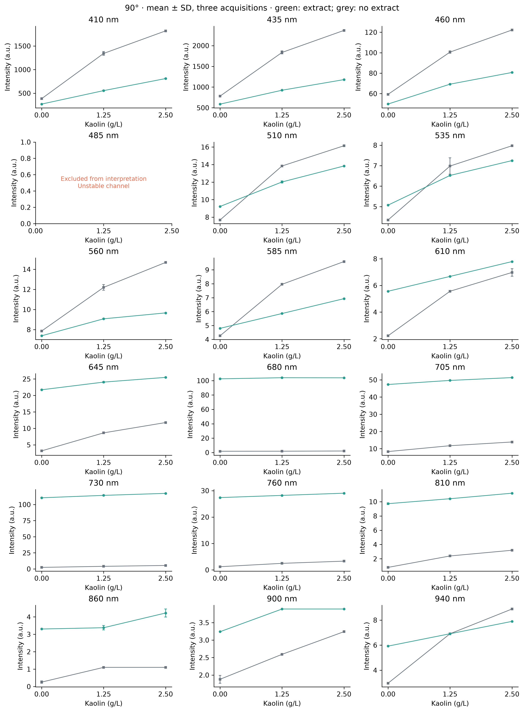

**Caption:** Individual channel responses at 90° for preparations with and without extract. The unstable 485 nm band is flagged; acquisitions are technical replicates.

## S14_caolin_18_canales_180 · Kaolin · 18-channel review at 180°

[PNG](resultados/figuras/S14_caolin_18_canales_180.png) · [SVG editable](resultados/figuras/S14_caolin_18_canales_180.svg)

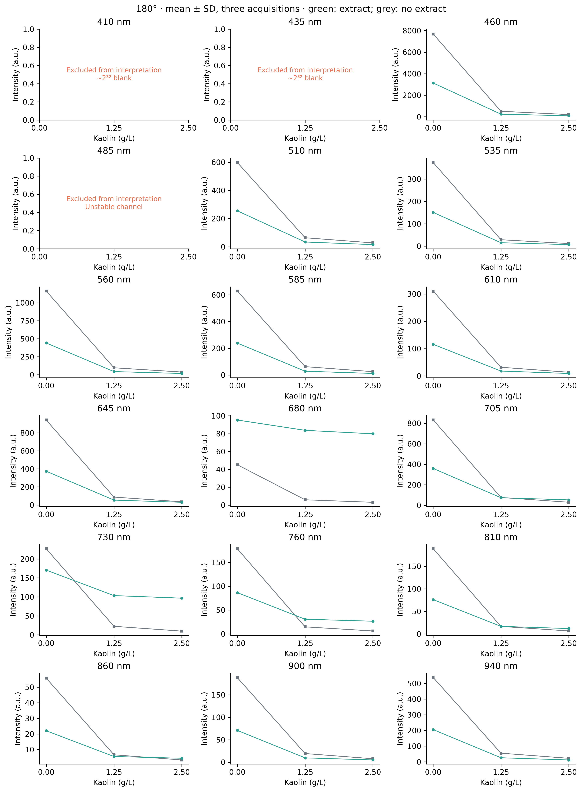

**Caption:** Individual channel responses at 180°. Near-2^32 readings at 410/435 nm and the unstable 485 nm band are flagged and excluded from interpretation.

## S15_extractos_18_canales_90 · Extract standards · 18-channel review at 90°

[PNG](resultados/figuras/S15_extractos_18_canales_90.png) · [SVG editable](resultados/figuras/S15_extractos_18_canales_90.svg)

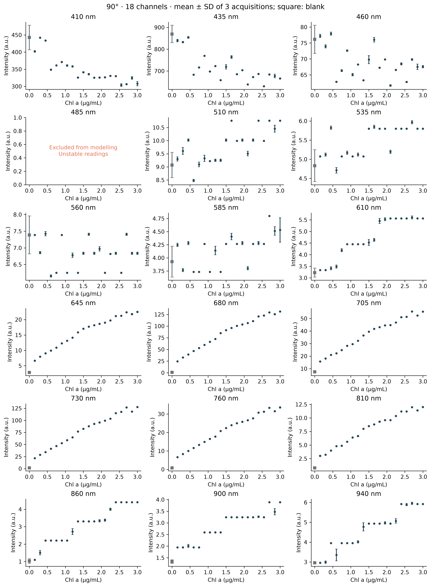

**Caption:** Observed 18-channel responses across the extract references at 90°. This measurement overview does not make other channel fits the selected calibration.

## S16_extractos_18_canales_180 · Extract standards · 18-channel review at 180°

[PNG](resultados/figuras/S16_extractos_18_canales_180.png) · [SVG editable](resultados/figuras/S16_extractos_18_canales_180.svg)

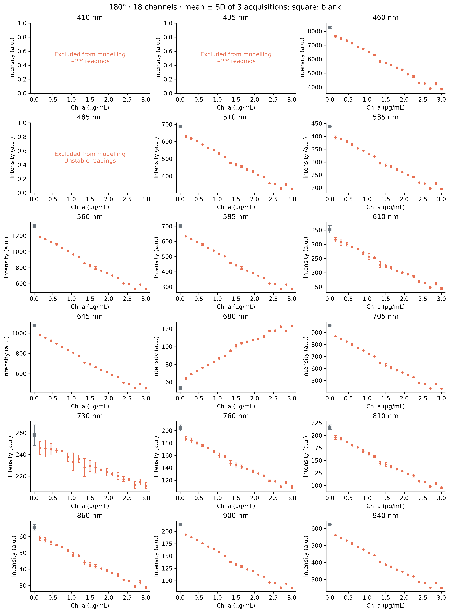

**Caption:** Observed 18-channel responses across the extract references at 180°. Flagged channels remain documented. The current selected geometry is 90°.
