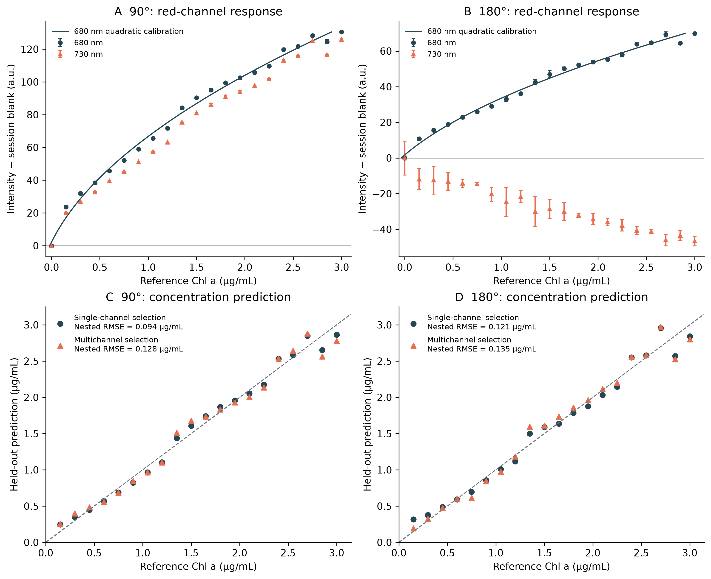

> **Selección vigente desde el 20/11/2026: 90°/680 nm y modelo lineal.** Búsqueda histórica de modelos del 15 de noviembre. [Abrir la versión actual](../lineal_90_680/INFORME.md).

# Calibración de extractos para el paper

Fecha del análisis: 15 de noviembre de 2026. Excitación: LED azul de 430 nm, según Alex.

## Resultado y elección

**Para este conjunto, elegiría 90° y 680 nm con una calibración cuadrática de concentración.** A 90°, añadir canales reduce muy poco el error de un modelo fijado y empeora el error de la selección multicanal anidada. A 180°, la mejor alternativa sencilla para predecir concentración usa ln(I810/B810): su señal disminuye y no se interpreta como fluorescencia. Si se requiere una señal compatible con fluorescencia a 180°, conservar 680 nm y su calibración cuadrática. La preferencia por 90° se refiere a estos extractos y estas sesiones, sin demostrar una superioridad general del ángulo.

## Fuentes, blanco y unidad experimental

Se leen exclusivamente `../dataCruda.zip` y el Excel externo `../reCalibration_20samples.xlsx`, Sheet1!A3:D22. Se usa D como concentración de referencia suministrada: 20 niveles de 0,15 a 3,00 µg/mL. No se recalculan las referencias a partir de A664/A648 ni se cambia el Excel. El blanco medido se incorpora como una fila de concentración **0 µg/mL** en cada geometría. Cero es su concentración nominal; su intensidad medida se conserva y no se sustituye por cero. Se define Bλ como la media de los tres blancos de sesión y ΔIλ = Iλ − Bλ.

Hay 120 archivos de muestra (20 × 3 × 2), seis blancos de diez lecturas y dos dark de diez lecturas. Cada archivo de muestra contiene media, DE y n=10, no las diez lecturas individuales. Se promedian las tres adquisiciones antes del ajuste: 21 puntos por geometría, incluido un solo punto de blanco. Las 60 adquisiciones de extracto por geometría no son 60 concentraciones independientes. Las barras representan DE entre tres adquisiciones; no incluyen incertidumbre de concentración ni del blanco compartido. El ZIP y la carpeta extraída coincidían en sus 128 CSV al iniciar el análisis. El ZIP coincide con el de la revisión de noviembre anterior; este análisis amplía la búsqueda y la validación, sin añadir muestras.

## Control de calidad

Se conservan todos los valores originales. Se excluyen de los predictores 410 y 435 nm a 180° por registros próximos a 2³², incluidos blancos. No se intentan reconstruir esos datos ni se presupone que sean saturación óptica. 485 nm se excluye en ambas geometrías por variabilidad excesiva. Los dos dark contienen únicamente ceros: no permiten cuantificar el ruido físico; no se aplica una corrección oscura inventada. Hay DE nulas por cuantización, por lo que no se pondera por 1/DE² ni se interpreta DE=0 como precisión perfecta. Los datos y sus banderas están en `adquisiciones.csv`, `medias.csv` y `canales.csv`.

## Qué canales muestran una respuesta compatible con fluorescencia

La selección espectral parte de extractos, no de células intactas. Como referencia externa, Greipel et al. observaron, con excitación de 430 nm en extractos metanólicos, un máximo de emisión en 673 nm y un hombro alrededor de 730 nm [1]. Esto orienta a revisar 680, 705 y 730 nm, sin fijar el máximo exacto de este extracto cuyo solvente no está documentado aquí. El AS7265x tiene bandas nominales de 20 nm FWHM [2]; las intensidades de canales diferentes no equivalen a un espectro de potencia óptica corregido.

| Geometría | Canal (nm) | Blanco (u.a.) | ΔI a 3 µg/mL (u.a.) | Spearman, 20 extractos |
|---|---:|---:|---:|---:|
| 90° | 435 | 869.722 | -203.993 | -0.7113 |
| 90° | 460 | 76.168 | -8.581 | -0.3128 |
| 90° | 645 | 2.831 | +19.676 | 0.9985 |
| 90° | 680 | 0.882 | +130.490 | 0.9985 |
| 90° | 705 | 7.430 | +48.057 | 0.9955 |
| 90° | 730 | 1.622 | +125.914 | 0.9985 |
| 90° | 760 | 0.830 | +32.755 | 0.9985 |
| 90° | 810 | 0.799 | +11.215 | 0.9977 |
| 180° | 460 | 8263.772 | -4418.918 | -0.9985 |
| 180° | 645 | 1075.103 | -618.591 | -0.9985 |
| 180° | 680 | 53.354 | +69.903 | 0.9955 |
| 180° | 705 | 958.144 | -524.735 | -0.9985 |
| 180° | 730 | 257.936 | -46.674 | -0.9955 |
| 180° | 760 | 204.468 | -95.470 | -0.9985 |
| 180° | 810 | 216.272 | -120.136 | -0.9985 |

**90°:** 680 y 730 nm son los candidatos principales: aumento grande, casi monotónico y repetible sobre un blanco bajo. 705 nm puede aportar información de la zona roja. 645 y 760 nm también predicen concentración, pero su correlación no identifica un pigmento ni prueba fluorescencia pura. El aumento en canales más alejados, como 810–940 nm, no se atribuye automáticamente a emisión de clorofila.

**180°:** 680 nm es el único canal con incremento neto positivo claro a lo largo de la serie. 705 y 730 nm disminuyen respecto al blanco, igual que numerosos canales visibles/NIR. Son respuestas ópticas útiles como predictores, compatibles con un fondo modificado o atenuación, sin identificar su mecanismo. Una disminución neta tampoco demuestra ausencia de una contribución fluorescente superpuesta. No se reconstruye una fluorescencia pura a partir de esa disminución sin una medición independiente del fondo.

## Funciones comparadas y validación

Se comparan 464 candidatos a 90° y 379 a 180°. Se incluyen lineal y cuadrático por canal; lineal en ln(I/B); todos los pares de canales válidos en intensidad o logaritmo; 680/730 con un canal logarítmico auxiliar; cocientes normalizados entre cada canal rojo (680/705/730) y canales válidos con función lineal o cuadrática; polinomios de segundo grado de dos canales rojos, con interacción; ridge con todos los canales válidos (α=0,1; 1; 10; 100), en intensidad o logaritmo; y respuesta directa de saturación ΔI=A[1−exp(−kC)] invertida, en 680 nm y además 730 nm a 90°. La saturación usa k entre 10⁻⁵ y 3 mL/µg, A positivo en estos ajustes, y devuelve inválido si la inversión no existe. No se recortan concentraciones para mejorar errores. Los modelos lineales en parámetros llevan intercepto libre; el blanco es un punto real y no una restricción de paso exacto por el origen.

**LOO del modelo fijado:** se deja fuera una de las 20 muestras, se ajusta con las otras 19 y el blanco, y se predice su concentración. Se repite para cada candidato. Sirve para ordenar candidatos; el mínimo entre cientos de resultados puede ser optimista [3].

**CV anidada:** en cada una de las 20 particiones externas, se repite la búsqueda mediante LOO interno solo entre las 19 muestras disponibles, conservando el blanco. Se elige por separado entre un canal, multicanal y todos. La regla de un error estándar (1-SE) admite candidatos cuyo MSE está a una SE del mínimo; dentro de ese margen prioriza menos canales, después menos términos, y después menor MSE. SE = DE de los errores cuadrados del mejor candidato / √n. Es una regla de parsimonia, no una prueba de equivalencia estadística. La normalización para ridge se calcula dentro de cada entrenamiento. Todos los errores se puntúan en concentración (µg/mL), usando únicamente las 20 muestras de extracto. El blanco permanece como referencia compartida y punto de ajuste; no se presenta como predicción independiente.

| Configuración y búsqueda | Modelo final con 21 puntos | RMSE LOO, modelo fijado | RMSE CV anidada, selección | MAE CV anidada | Q² CV anidada |
|---|---|---:|---:|---:|---:|
| 90°, un canal | `cuadratico_680` | 0.0938 | 0.0938 | 0.0813 | 0.9882 |
| 90°, varios canales | `dos_cuadratico_680_730` | 0.0921 | 0.1279 | 0.1093 | 0.9781 |
| 90°, búsqueda completa | `cuadratico_680` | 0.0938 | 0.0990 | 0.0848 | 0.9869 |
| 90°, zona de emisión (680 a 180°) | `cuadratico_680` | 0.0938 | 0.0990 | 0.0848 | 0.9869 |
| 180°, un canal | `log_810` | 0.1032 | 0.1209 | 0.0947 | 0.9805 |
| 180°, varios canales | `cociente_705_730` | 0.1099 | 0.1346 | 0.0972 | 0.9758 |
| 180°, búsqueda completa | `log_810` | 0.1032 | 0.1209 | 0.0947 | 0.9805 |
| 180°, zona de emisión (680 a 180°) | `cuadratico_680` | 0.1197 | 0.1361 | 0.1038 | 0.9752 |

El RMSE anidado evalúa el procedimiento de selección: puede usar un modelo diferente en cada partición. No es un error externo garantizado para la ecuación final. Q² = 1 − Σ(Cpred−Cref)²/Σ(Cref−media de Cref)²; no es el R² de un ajuste sobre los propios datos.

### Mínimos numéricos y decisión práctica

A 90°, el mínimo LOO fijado es el cuadrático de dos canales, 680+730 nm (0,0921 µg/mL), frente a 0,0938 con el cuadrático de 680 nm. La ganancia es de solo 0,0017 µg/mL, con cinco términos espectrales frente a dos. La búsqueda multicanal anidada da 0,1279 µg/mL; la de un canal da 0,0938. La búsqueda completa da 0,0990 y elige 680 cuadrático en 19 de 20 particiones. **No hay una ventaja predictiva convincente de añadir canales aquí.**

A 180°, el mínimo LOO fijado es el cuadrático de 810 nm (0,1017 µg/mL); ln(I810/B810) queda casi igual (0,1032) con un término menos. La regla 1-SE selecciona el logarítmico. El mejor par por mínimo numérico es ln(I535/B535)+ln(I810/B810), con 0,1022. Entre los modelos multicanal, la regla de parsimonia elige el cociente 705/730 normalizado; su procedimiento de selección da 0,1346 de RMSE anidado, frente a 0,1209 para un canal. La búsqueda de un canal cambia entre ln810 (11 particiones) y lineal460 (nueve): 810 nm es una elección empírica razonable, sin estabilidad suficiente para llamarla universalmente óptima. Si se exige trabajar con el canal de incremento fluorescente 680 nm, su cuadrático da 0,1197 de LOO fijado y la selección de función en 680 da 0,1361 de RMSE anidado.

## Ecuaciones finales y uso

C se expresa en µg/mL, las intensidades son las medias de tres adquisiciones en las unidades originales, y ln es logaritmo natural. Deben utilizarse el blanco y los ajustes instrumentales de la calibración. Los coeficientes sin redondeo y los rangos de intensidad están en `coeficientes.json`; `modelos.csv` conserva también términos y parámetros de todos los candidatos.

**90°, recomendación para fluorescencia de extracto:** con x = I680 − 0,8821683333,

`C = −0,0171463961 + 0,00784968892·x + 0,000110942425·x²`.

**180°, predicción empírica por señal decreciente:**

`C = −0,0714331021 − 3,7628353365·ln(I810 / 216,272109)`.

**180°, alternativa centrada en fluorescencia:** con x = I680 − 53,3535285667,

`C = −0,0356338276 + 0,0205431738·x + 0,000307191661·x²`.

El blanco figura como Cref=0, aunque las regresiones con intercepto libre predicen −0,0171, −0,0714 y −0,0356 µg/mL, respectivamente, para su intensidad media. No se convierten esos valores en ceros ni se usan como límite de detección. Si se necesita una fórmula operacional que dé exactamente cero para cualquier blanco, habría que imponer esa condición y volver a comparar las calibraciones. Estas ecuaciones se limitan a la serie 0,15–3,00 µg/mL más el blanco; no validan el intervalo entre cero y 0,15. El rango ensayado tampoco garantiza la misma exactitud relativa en todos los niveles: un error absoluto cercano a 0,1 µg/mL es grande frente al nivel inferior de 0,15. No se declara 0,15 µg/mL como límite de cuantificación demostrado.

## Figura elegida para el paper

**Elegir `figuras/01_figura_principal.svg`**, con cuatro paneles y una versión PNG a 300 dpi. A–B muestran 680 y 730 nm frente a concentración en cada geometría, con el blanco en cero y DE entre adquisiciones. La curva azul representa la calibración cuadrática inversa de 680 nm; no demuestra un mecanismo de saturación. C–D muestran concentración predicha frente a referencia, con predicciones externas de CV anidada para la búsqueda de un canal y la multicanal. La diagonal representa concordancia perfecta. Las escalas de intensidad de A y B son distintas y están rotuladas; C y D comparten límites. Esta figura combina evidencia espectral y utilidad de calibración sin escoger por R² visual.

**Segundo gráfico, si hay espacio:** `figuras/03_residuos.svg`. Ayuda a ver desviaciones sistemáticas y el comportamiento de las muestras 18–20, que una diagonal de buen aspecto puede ocultar. **Material suplementario:** `02_canales_90.svg` y `02_canales_180.svg`, con los 18 canales y las exclusiones explícitas. No usaría una figura con todas las curvas ajustadas ni cientos de modelos como figura principal; su comparación completa queda en las tablas CSV.

### Suggested English caption

Optical response and internal concentration prediction of chlorophyll a extracts under 430 nm LED excitation. (A, B) Blank-referenced intensities at 680 and 730 nm for the 90° and 180° configurations, respectively. Symbols represent means of three acquisitions and error bars show their standard deviations. The measured session blank is assigned a reference concentration of 0 µg/mL. Blue curves show inverse representations of the quadratic 680 nm concentration calibrations fitted to all calibration points. Intensity scales differ between A and B. (C, D) Held-out concentration predictions from nested leave-one-sample-out selection of single-channel and multichannel models. Each outer test set contains one complete extract sample; the shared session blank remains available for calibration. Dashed lines indicate identity. Reported errors describe internal validation within the supplied dilution series and sessions.

## Alcance y límites que afectan a la conclusión

Solo se analizan extractos. No se evalúan caolín, selectividad en agua natural, células intactas ni otros ensayos. Las dos geometrías se adquirieron en sesiones sucesivas, con tres blancos compartidos por sesión. No hay validación entre días, stocks o extractos independientes, y geometría y sesión están confundidas. No se conoce aquí la incertidumbre de la concentración de referencia, el solvente y la igualdad efectiva de ganancia, integración y potencia de excitación entre sesiones. La dilución de un mismo extracto hace variar conjuntamente otros pigmentos y componentes: un buen predictor no acredita selectividad química para clorofila a. Las desviaciones compartidas a alta concentración, incluida sample19, se conservan sin eliminar muestras. No se atribuye la curvatura a un mecanismo concreto ni se estima un límite de detección a partir de tres blancos. La validación anidada reduce el sesgo de selección entre funciones, pero no elimina estas dependencias experimentales.

## Reproducción y archivos

Desde la carpeta `datos para el paper`, ejecutar `python3 analizar_extractos.py` en un entorno con NumPy, SciPy y Matplotlib. Se regeneran los CSV, JSON, figuras e informe dentro de `resultados/`; no se modifican las fuentes ni el firmware. El script incluye comprobaciones de estructura, identificadores, concentraciones, equivalencia de PRESS con LOO explícito e inversión de una saturación conocida.

- `concentraciones.csv`: referencias y blanco 0.
- `adquisiciones.csv`: 2.268 filas, incluidas las tres adquisiciones de blanco por geometría.
- `medias.csv`: 756 filas, 21 puntos × 18 canales × dos geometrías.
- `canales.csv`: 36 resúmenes de tendencia, repetibilidad y calidad.
- `modelos.csv`: todos los candidatos, parámetros y LOO de modelo fijado.
- `predicciones.csv`: predicción, error y modelo escogido en cada partición externa.
- `coeficientes.json`: ecuaciones seleccionadas, blancos y dominio de intensidades.
- `resumen.json`: métricas y frecuencias de selección.
- `trazabilidad.json`: huellas SHA-256 de las fuentes y versiones del entorno.
- `figuras/`: figura principal, residuos y dos láminas de 18 canales, en SVG y PNG.

## Referencias para la interpretación y el método

1. Greipel et al. (2024). [Extraction of chlorophyll a from Tetradesmus obliquus—a method upgrade](https://link.springer.com/article/10.1007/s42977-024-00209-3). Fundamento del máximo rojo y hombro lejano en extractos; no identifica el solvente ni la composición de esta serie.
2. ams OSRAM. [AS7265x Smart Spectral Sensor](https://ams-osram.com/de/products/sensor-solutions/ambient-light-color-spectral-proximity-sensors/ams-as7265x-smart-spectral-sensor). 18 canales y anchura nominal de banda.
3. scikit-learn. [Nested versus non-nested cross-validation](https://scikit-learn.org/stable/auto_examples/model_selection/plot_nested_cross_validation_iris.html). Justificación de separar selección y evaluación; el cálculo de este proyecto se implementa con NumPy/SciPy.