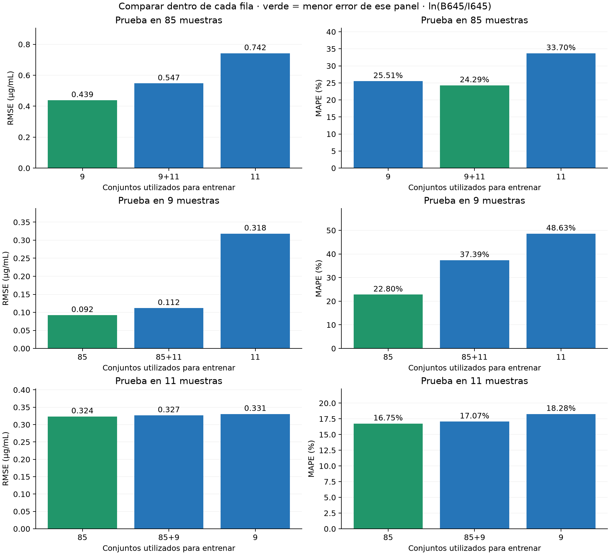
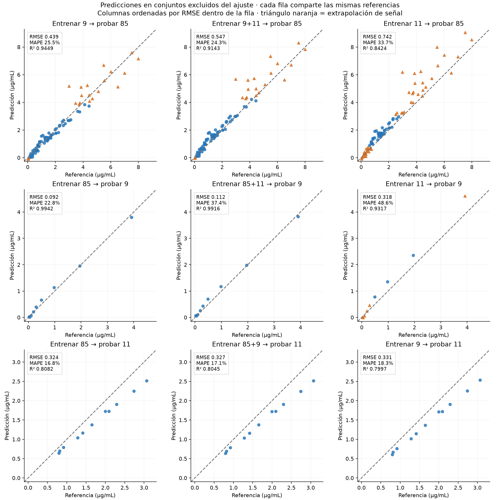

# Todas las combinaciones de entrenamiento y prueba: ln645 con blanco

> Informe histórico de exploración. La decisión vigente es 85 → 9 con blanco; consultar [articulo.md](../articulo.md). Este informe conserva sus resultados originales y no es la guía actual del manuscrito.

Fecha: 18 de octubre de 2026.

## Diseño y criterio
Se ajustan seis ecuaciones: entrenar con 85, 9, 11, 85+9, 85+11 o 9+11. Cada ecuación se prueba en todos los conjuntos individuales que no participaron en su ajuste: seis pruebas con entrenamiento simple y tres con entrenamiento doble, nueve en total. No se mezclan muestras de prueba dentro de una evaluación.
Se mantiene C = a + b × ln(B645/I645), con intercepto libre y mínimos cuadrados ordinarios. Igual peso por muestra, no por tanda. Los blancos fijos proporcionados por Alex son 1356, 1214 y 1256 para 85, 9 y 11, respectivamente. Se emplean al entrenar y al predecir, sin optimizarlos ni añadir blancos como puntos de concentración cero.
Cada entrenamiento usa solo las concentraciones de sus grupos. Se guardan las seis ecuaciones antes de calcular los errores de transferencia en este análisis. No se eliminan atípicos, no se recortan negativos ni se pondera por las desviaciones del sensor.
Criterio principal: menor RMSE entre las tres alternativas evaluadas sobre exactamente el mismo conjunto de prueba. Se muestran también MAE, sesgo, MAPE y error bajo 1 µg/mL. No se elige ganador por el mayor R² entre pruebas con rangos distintos.

## Las nueve combinaciones
| Entrenar | Probar | n prueba | R² predictivo | RMSE | MAE | Sesgo | MAPE (%) | MAPE <1 (%) |
|---|---|---|---|---|---|---|---|---|
| 9 | 85 | 85 | 0.94493 | 0.43874 | 0.26870 | 0.00484 | 25.51 | 52.11 |
| 9+11 | 85 | 85 | 0.91431 | 0.54729 | 0.32368 | 0.25726 | 24.29 | 43.17 |
| 11 | 85 | 85 | 0.84239 | 0.74225 | 0.48035 | 0.44994 | 33.70 | 55.73 |
| 85 | 9 | 9 | 0.99424 | 0.09241 | 0.06937 | 0.02866 | 22.80 | 28.88 |
| 85+11 | 9 | 9 | 0.99156 | 0.11189 | 0.08561 | 0.06690 | 37.39 | 47.54 |
| 11 | 9 | 9 | 0.93169 | 0.31824 | 0.23229 | 0.20752 | 48.63 | 57.04 |
| 85 | 11 | 11 | 0.80818 | 0.32363 | 0.29342 | -0.29342 | 16.75 | 15.88 |
| 85+9 | 11 | 11 | 0.80449 | 0.32673 | 0.29739 | -0.29739 | 17.07 | 16.54 |
| 9 | 11 | 11 | 0.79968 | 0.33073 | 0.30792 | -0.30792 | 18.28 | 19.97 |

RMSE, MAE y sesgo en µg/mL. MAPE = promedio del error relativo absoluto. Las filas se ordenan por RMSE dentro de cada conjunto de prueba. n de la evaluación <1: 30 para prueba 85, 7 para prueba 9 y 3 para prueba 11.

## Mejores resultados observados para cada prueba
- Prueba 85: entrenar con **9**, RMSE 0.43874 µg/mL; MAE 0.26870; MAPE 25.51%; MAPE <1 52.11%.
- Prueba 9: entrenar con **85**, RMSE 0.09241 µg/mL; MAE 0.06937; MAPE 22.80%; MAPE <1 28.88%.
- Prueba 11: entrenar con **85**, RMSE 0.32363 µg/mL; MAE 0.29342; MAPE 16.75%; MAPE <1 15.88%.

No hay un ganador universal demostrado: los conjuntos de prueba tienen distinto rango, protocolo y número de muestras. El menor RMSE de las nueve filas se observa con 85 → 9 (0,09241 µg/mL), pero no permite afirmar ese rendimiento en las once, donde la misma calibración da 0,32363 µg/mL.
Para prueba 85, entrenar con nueve minimiza RMSE y MAE; entrenar con 9+11 minimiza MAPE, incluido el rango <1. Por tanto, el criterio elegido cambia la selección. Las otras dos pruebas favorecen entrenar solo con 85 para ambas métricas.
Añadir las nueve a las 85 no mejora la prueba sobre las once; añadir las once a las 85 no mejora la prueba sobre las nueve. La diferencia de RMSE entre 85 → 11 y 85+9 → 11 es pequeña: este orden numérico no demuestra una diferencia estadísticamente significativa.

## Ecuaciones completas de entrenamiento
ln es el logaritmo natural. B645 es el blanco de la sesión de la muestra que se evalúa e I645 su intensidad media. Ambos deben ser positivos y finitos, en las mismas unidades y configuración.
- Entrenar 85, n=85: C (µg/mL) = -0.0621128959 + 2.8428103277 × ln(B645/I645).
- Entrenar 9, n=9: C (µg/mL) = -0.1172443651 + 2.9197150992 × ln(B645/I645).
- Entrenar 11, n=11: C (µg/mL) = -0.0975018338 + 3.4651949529 × ln(B645/I645).
- Entrenar 85+9, n=94: C (µg/mL) = -0.0691723511 + 2.8486574141 × ln(B645/I645).
- Entrenar 85+11, n=96: C (µg/mL) = -0.0199535282 + 2.8314409481 × ln(B645/I645).
- Entrenar 9+11, n=20: C (µg/mL) = -0.0585662909 + 3.1681675640 × ln(B645/I645).

## Gráficas

## Alcance de la selección
Al buscar la mejor combinación mirando todos los resultados, los tres conjuntos pasan a formar parte de la exploración. Los errores del ganador observado no son una estimación independiente de su selección. No se debe descartar la tanda de once solo porque dé peor resultado ni ocultar las pruebas desfavorables al publicar.
La tanda de nueve son diluciones de un solo extracto, no nueve extractos independientes. Las 85 cubren 0,02384–7,98964 µg/mL; las nueve 0,0244–3,9098; las once 0,7944–3,07062. La extrapolación se identifica además según el intervalo de ln(B/I) entrenado y se conserva en los CSV.
El MAPE puede crecer mucho cerca de cero y no es incertidumbre ni error máximo garantizado. Este análisis no calcula LOD/LOQ, rendimiento en lagos ni incertidumbre de los blancos. No se han modificado el firmware ni los .bin.

## Fuentes y resultados detallados
Fuentes originales: calibracion_85_puntos (1).xlsx, Sheet1 A1:D86; 9Samples.xlsx, Sheet1 A1:AL10; 11Samples.xlsx, Sheet1 A1:AL12. Se usan identificador, concentración e I645. Las filas con solo identificadores del primer libro no son mediciones. Los tres originales se verifican por SHA-256 y permanecen intactos.
modelos_fijados.json contiene las seis ecuaciones y las métricas de ajuste sobre su propio entrenamiento, claramente separadas de las pruebas y sin denominarlas CV. comparacion_nueve_combinaciones.csv contiene las nueve evaluaciones; predicciones_prueba.csv contiene 315 predicciones fuera del ajuste correspondiente, tres por muestra. No son 315 muestras independientes.
errores_por_rango.csv conserva 72 intervalos, incluidos los vacíos; errores_menor_y_mayor_1.csv resume 18 evaluaciones. resultados.json contiene todo lo anterior y la selección por RMSE, MAPE y métricas bajas, dentro de cada prueba.
Los análisis previos se conservan. Se reutilizan funciones verificadas de lectura, normalización y métricas. Se comprueban exclusión entre entrenamiento y prueba, cobertura de las nueve combinaciones, ajustes por covarianza y ecuaciones normales, recuentos, rangos y conservación de ecuaciones y fuentes.
