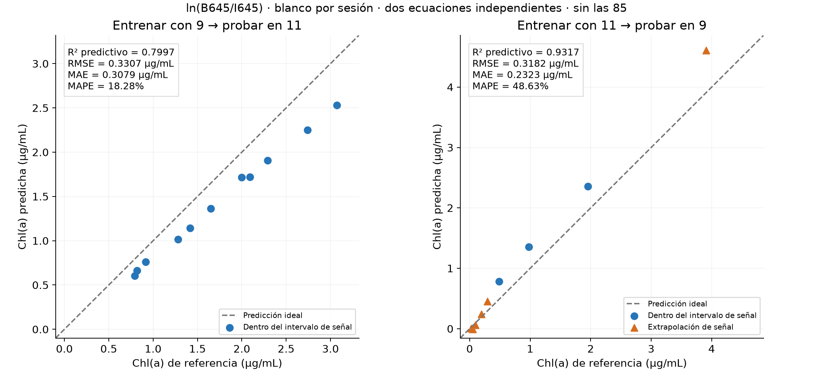
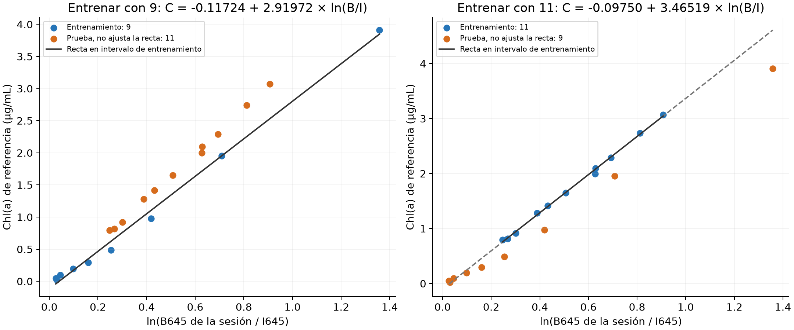

# Entrenar con nueve y probar en once, y viceversa; ln645 con blanco

> Informe histórico de exploración. La decisión vigente es 85 → 9 con blanco; consultar [articulo.md](../articulo.md). Este informe conserva sus resultados originales y no es la guía actual del manuscrito.

Fecha: 18 de octubre de 2026.

## Diseño
Se excluyen completamente las 85: este análisis solo abre los Excel de nueve y once. Se hacen dos ajustes independientes, con mínimos cuadrados ordinarios, intercepto libre e igual peso por muestra. Se mantiene la forma C = a + b × ln(B645/I645).
Blancos de sesión proporcionados por Alex: B645 = 1214 para las nueve y 1256 para las once. Se usan tanto al entrenar como al predecir. No se añaden como puntos de concentración cero ni se optimizan sus valores.
En la dirección 9 → 11 solo las concentraciones de las nueve calculan los coeficientes. En 11 → 9 ocurre lo contrario. Las ecuaciones se fijan antes de evaluar los errores de transferencia; no se seleccionan formas, pesos ni ajustes adicionales mirando el conjunto de prueba.

## Ecuaciones
Entrenar con 9, probar en 11: **C (µg/mL) = -0.1172443651 + 2.9197150992 × ln(B645/I645).**
Entrenar con 11, probar en 9: **C (µg/mL) = -0.0975018338 + 3.4651949529 × ln(B645/I645).**
ln es el logaritmo natural. I645 es la intensidad media de la muestra; B645 es el blanco de su sesión, en las mismas unidades y configuración. Ambos deben ser positivos y finitos.

## Resultados de prueba, no de entrenamiento
| Entrenar → probar | n | RMSE | MAE | Sesgo | MAPE (%) |
|---|---|---|---|---|---|
| 9 → 11 | 11 | 0.33073 | 0.30792 | -0.30792 | 18.28 |
| 11 → 9 | 9 | 0.31824 | 0.23229 | 0.20752 | 48.63 |

9 → 11: R² predictivo = 0.79968; señales fuera del intervalo de entrenamiento = 0/11; predicciones negativas = 0.
11 → 9: R² predictivo = 0.93169; señales fuera del intervalo de entrenamiento = 6/9; predicciones negativas = 1.
RMSE, MAE y sesgo en µg/mL. Sesgo = promedio(predicción − referencia); MAPE = promedio(|predicción − referencia|/referencia) × 100. No se recortan negativos ni se eliminan atípicos. Las métricas del ajuste sobre el propio entrenamiento están separadas en metricas.csv; no son CV.

## Prueba por debajo y por encima de 1 µg/mL
| Entrenar → probar | Rango (µg/mL) | n | RMSE | MAE | Sesgo | MAPE (%) |
|---|---|---|---|---|---|---|
| 9 → 11 | <1 | 3 | 0.16802 | 0.16722 | -0.16722 | 19.97 |
| 9 → 11 | >=1 | 8 | 0.37391 | 0.36069 | -0.36069 | 17.64 |
| 11 → 9 | <1 | 7 | 0.19332 | 0.14143 | 0.10958 | 57.04 |
| 11 → 9 | >=1 | 2 | 0.57004 | 0.55031 | 0.55031 | 19.21 |

## Prueba por intervalos fijos
| Entrenar → probar | Rango (µg/mL) | n | RMSE | MAE | Sesgo | MAPE (%) |
|---|---|---|---|---|---|---|
| 9 → 11 | 0–<0,1 | 0 | — | — | — | — |
| 9 → 11 | 0,1–<0,25 | 0 | — | — | — | — |
| 9 → 11 | 0,25–<0,5 | 0 | — | — | — | — |
| 9 → 11 | 0,5–<1 | 3 | 0.16802 | 0.16722 | -0.16722 | 19.97 |
| 9 → 11 | 1–<2 | 4 | 0.27561 | 0.27548 | -0.27548 | 17.80 |
| 9 → 11 | 2–<3 | 3 | 0.41791 | 0.41481 | -0.41481 | 17.46 |
| 9 → 11 | 3–<5 | 1 | 0.53916 | 0.53916 | -0.53916 | 17.56 |
| 9 → 11 | 5–8 | 0 | — | — | — | — |
| 11 → 9 | 0–<0,1 | 3 | 0.04034 | 0.03715 | -0.03715 | 73.97 |
| 11 → 9 | 0,1–<0,25 | 1 | 0.04568 | 0.04568 | 0.04568 | 23.37 |
| 11 → 9 | 0,25–<0,5 | 2 | 0.23663 | 0.22757 | 0.22757 | 57.67 |
| 11 → 9 | 0,5–<1 | 1 | 0.37771 | 0.37771 | 0.37771 | 38.64 |
| 11 → 9 | 1–<2 | 1 | 0.40160 | 0.40160 | 0.40160 | 20.54 |
| 11 → 9 | 2–<3 | 0 | — | — | — | — |
| 11 → 9 | 3–<5 | 1 | 0.69901 | 0.69901 | 0.69901 | 17.88 |
| 11 → 9 | 5–8 | 0 | — | — | — | — |

Intervalos según concentración de referencia: extremo inferior incluido y superior excluido, salvo el último que incluye 8. — significa ausencia de muestras, no error cero. Un rango con una observación no estima su variabilidad.

## Gráficas

## Cómo interpretar la comparación
Con nueve para entrenar, las once se subestiman: sesgo -0.30792 µg/mL. Con once para entrenar, el sesgo medio sobre las nueve es +0.20752 µg/mL. Las pendientes son distintas: 2.91972 frente a 3.46519. Normalizar por el blanco no elimina la discrepancia entre estas dos tandas.
Las métricas de ambas direcciones se calculan sobre conjuntos distintos y rangos distintos. No constituyen una comparación de dos modelos sobre las mismas muestras de prueba. El entrenamiento de once cubre 0,7944–3,07062 µg/mL; el de nueve cubre 0,0244–3,9098. Al predecir las nueve con la calibración de once hay concentraciones inferiores y superiores al rango entrenado. La figura marca además la extrapolación según la señal normalizada, que no coincide necesariamente con esos límites de concentración.
Las nueve proceden de diluciones de un solo extracto madre. Los dos conjuntos ya se han examinado en etapas previas, por lo que se trata de comprobaciones retrospectivas de transferencia, no de validación prospectiva ciega. Cada conjunto tiene un papel distinto en cada prueba; no hay una única reserva de datos intacta tras ambas direcciones.
El MAPE es muy sensible a concentraciones cercanas a cero. No representa incertidumbre ni garantiza un error máximo. No se determina LOD/LOQ ni rendimiento en lagos. No se cambia el firmware ni los .bin.

## Fuentes y archivos
9Samples.xlsx: Sheet1 A1:AL10. 11Samples.xlsx: Sheet1 A1:AL12. Se usan identificador, concentración de referencia e I645. Ambos originales se verifican por SHA-256 y permanecen intactos. Los blancos proceden de los valores de sesión aportados por Alex.
Los dos modelo_entrenado_*.json conservan los coeficientes. resultados.json conserva métricas y procedencia. predicciones.csv contiene 40 filas: 20 de ajuste sobre su propio entrenamiento y 20 de transferencia. metricas.csv identifica ambos papeles. errores_por_rango.csv contiene 16 intervalos y errores_menor_y_mayor_1.csv resume cuatro evaluaciones.
Los análisis previos se conservan. Se reutilizan únicamente funciones de lectura, normalización y métricas, no coeficientes de otros conjuntos. Se verifican los ajustes por covarianza y ecuaciones normales, los recuentos de puntos y rangos, la agregación de errores y la conservación de las ecuaciones.
